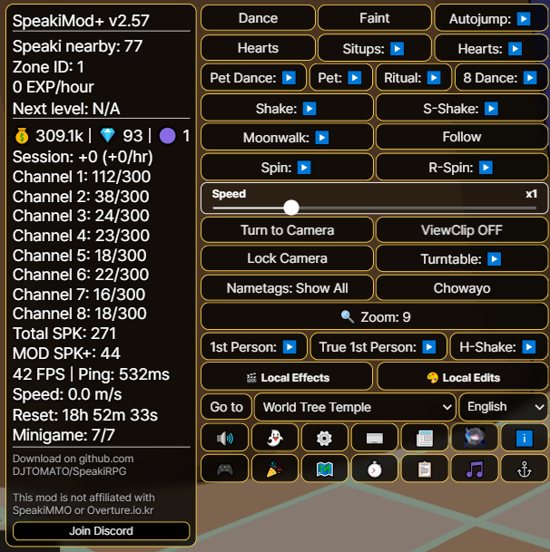
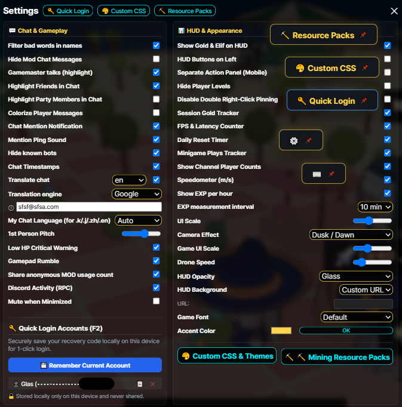
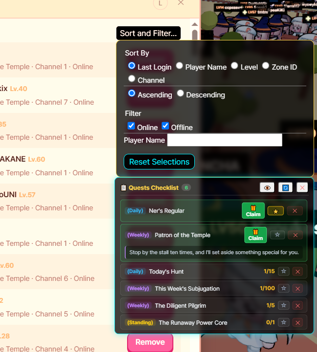
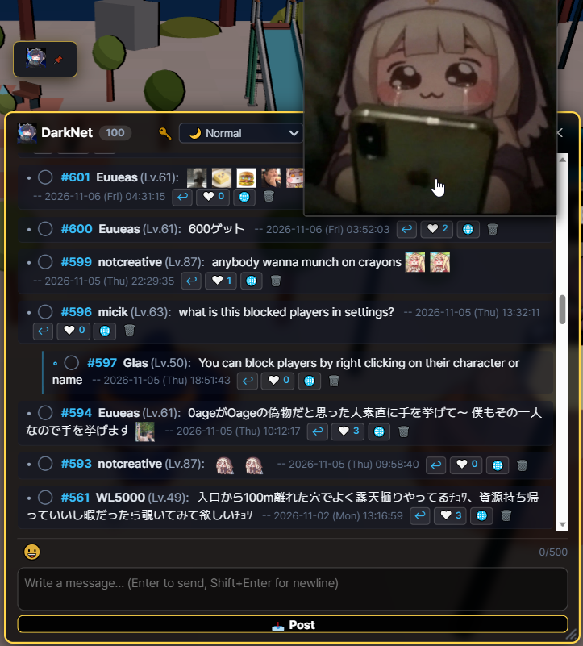
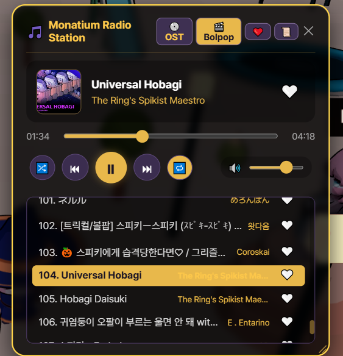
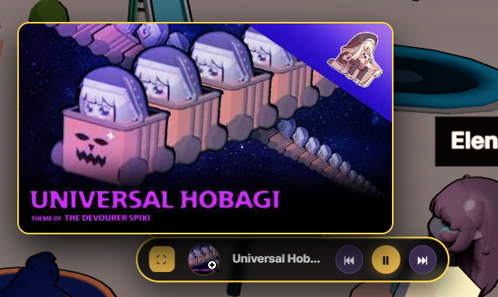
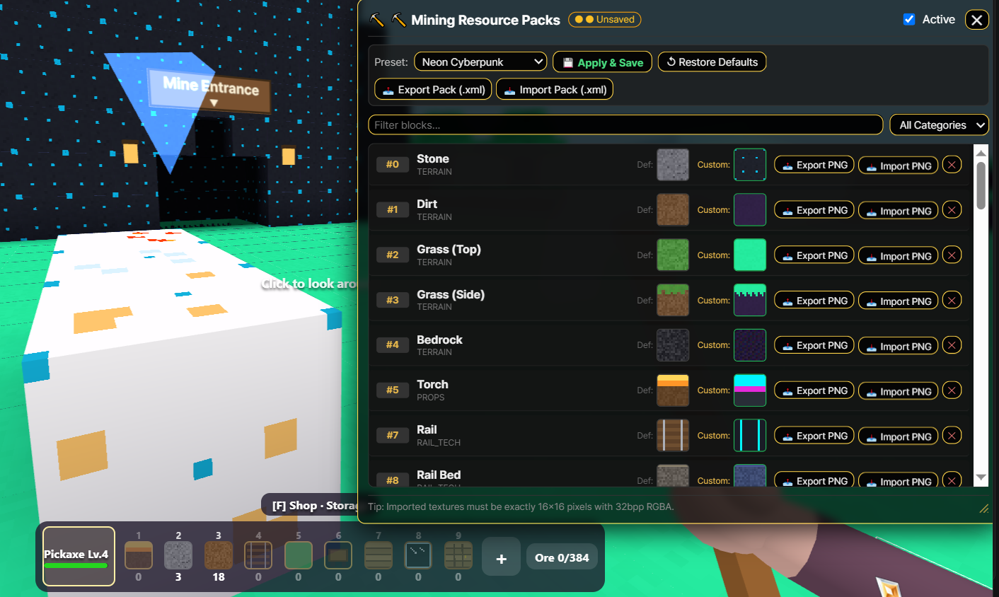
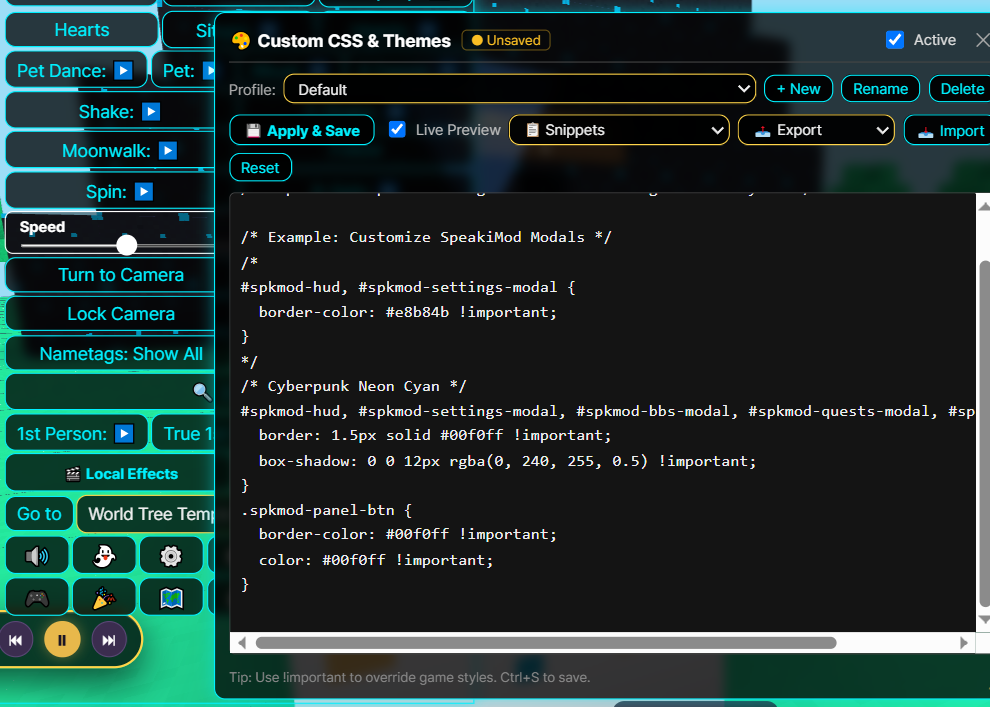
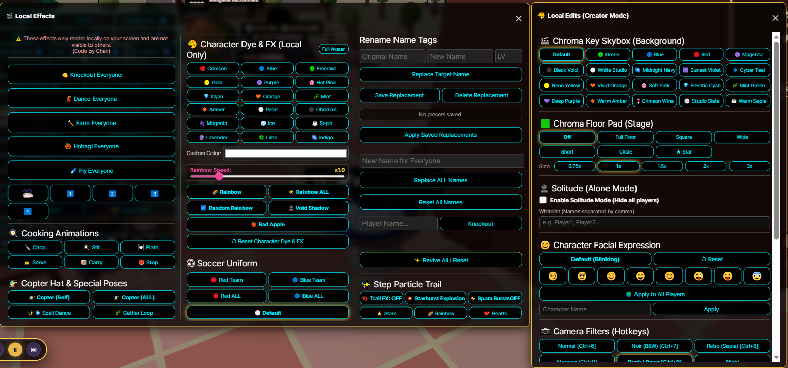
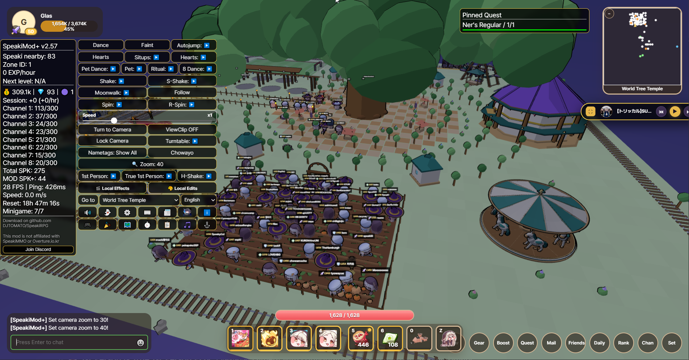

# Speaki RPG デスクトップクライアント

# -> [English](README.md) | [イマココ!](README.ja.md) | [한국어](README.ko.md) | [繁體中文](README.zh-tw.md) | [简体中文](README.zh-cn.md) <-


# -> [Download | ダウンロード | 다운로드 | 下載](https://github.com/DJTOMATO/SpeakiRPG/releases) | [Discord](https://discord.gg/bruZhcwqRx) <-

<div align="center">

### 🎥 注目動画：欲しい機能がきっとある！MOD紹介
[](https://www.youtube.com/watch?v=ekxvWkYELm8)

**[▶️ YouTubeで見る: 欲しい機能がきっとある！MOD紹介 Introducing Speakimod+! Speakimod+ 소개! [CC:Eng]](https://www.youtube.com/watch?v=ekxvWkYELm8)**  
*コミュニティクリエイター **おあげ** 様による SpeakiMod+ の機能紹介・解説動画です！（英語字幕対応）*

> ⚠️ **注意：** SpeakiMod+ はゲームGMに使用を公式に許可されているMODであり、不正・悪用につながる機能は排除されています。もし意図しない不具合や悪用可能な挙動を発見した場合は、悪用せず[公式Discordサポートサーバー](https://discord.gg/bruZhcwqRx)にてご報告ください。

</div>

---

**Speaki RPG デスクトップクライアント**は、ブラウザMMORPG **Speaki RPG** 専用のカスタムデスクトップクライアント、モバイルラッパー、および総合QOL拡張スイート（**SpeakiMod+**）です。ゲームをブラウザタブから解放し、GPUハードウェアアクセラレーション、Discord Rich Presence連携、リアルタイム双方向チャット翻訳、ゲーム内ジュークボックス、採掘リソースパック、本格的な動画撮影・クリエイタースタジオ、そして数多くのソーシャル＆快適機能をまとめて提供します！

> **🔒 詐欺防止に関する免責事項：** 本クライアントならびにMODは、収益化および寄付を**一切受け付けておりません**。ゲーム自体も寄付や収益化を行っていません。金品を要求してくる人物はすべて偽物（なりすまし）ですのでご注意ください！

<h2 id="table-of-contents">目次</h2>

- [1. 主な機能とハイライト](#1-features--highlights)
  - [🖥️ デスクトップ基本機能・HUD・クエスト](#core-desktop-hud--quests)
  - [💬 ソーシャル・チャット・翻訳・カスタム絵文字](#social-chat-translation--emojis)
  - [📻 モナティアムラジオ局（ジュークボックス）](#monatium-radio-station-jukebox)
  - [⛏️ 採掘リソースパック ＆ 🎨 カスタムCSSテーマ](#mining-resource-packs--custom-css-themes)
  - [🎬 クリエイタースタジオ：ローカルエディット＆ローカルエフェクト](#creator-studio-local-edits--local-effects)
  - [💃 ムーブメント・エモート・カメラトリック](#movement-emotes--camera-tricks)
  - [⌨️ ショートカットキー＆チャットコマンド一覧](#hotkeys--chat-commands-reference)
- [2. ダウンロード＆インストール（PC / Android）](#2-download--installation)
- [3. セルフコンパイル・クイックスタートガイド](#3-self-compile-quick-start-guide)
- [4. 使い方](#4-how-to-use-it)
- [5. SpeakiMod+ の実装について](#5-implementation-of-speakimod)
- [6. 公式開発者の見解および使用ポリシー](#6-official-developer-reaction--usage-policy)
- [7. 留意事項＆開発への協力](#7-good-to-know--collaboration)
- [8. よくある質問 (FAQ)](#8-faq)
- [9. クレジット](#9-credits)
- [10. Speaki MMO コミュニティムービー！](#10-speaki-mmo-community-movie)

---

<h2 id="1-features--highlights">1. 主な機能とハイライト</h2>

[⬆ トップへ戻る](#table-of-contents)

<h3 id="core-desktop-hud--quests">🖥️ デスクトップ基本機能・HUD・クエスト</h3>

<p align="center">
  
  
</p>

* **Discord Rich Presence（ステータス連携）：** Discordプロフィールに「現在のキャラクター名・レベル・EXP進行度」を自動表示します（設定画面でのON/OFF切り替えおよび `Ctrl+Shift+D` での強制更新に対応）。


* **GPUハードウェアアクセラレーション＆高DPI対応：** GPU設定を自動最適化して滑らかな3D描画を実現。さらに**解像度オーバーライド**や**モバイル高DPI描画補正**も搭載しています。
* **📌 フローティング・ショートカットボタン：** MODパネル内の任意のボタンを**右ダブルクリック**（モバイルでは長押し）すると、画面上の好きな場所に配置できるドラッグ可能なフローティングボタンとしてピン留めできます！もう一度右クリックすると解除されます。
* **🔑 クイックログイン＆アカウント管理 (<kbd>F2</kbd>)：** 複数のアカウント復旧コードを端末ローカルに安全に保存し、ワンクリックで切り替え・ログイン・コピーが可能です（データはPC内にのみ保存され、設定エクスポート時にも除外されるため外部へ共有されることはありません）。
* **🔊 スマートオーディオ＆バックグラウンド自動ミュート：** HUDからワンクリックでミュートできるほか、**最小化時にミュート**を有効にすると別ウィンドウ作業中（Alt+Tab時）にゲーム音を自動で消音します（バックグラウンドでも `@メンション` の通知音だけは鳴らすことが可能）。
* **⏱️ ライブトラッカー＆セッション統計：**
  * **経験値トラッカー：** 計測間隔を自由に設定できる移動平均での分給/時給EXP計算と、次のレベルまでの推定時間を表示します。
  * **セッション通貨＆パフォーマンス統計ウィンドウ (`⏱️`)：** プレイ時間、時給換算のゴールド / エリーフ / スピキコイン獲得量、FPS、現在のゲートウェイPing (`ms`)、リアルタイム移動速度計（`m/s` **スピードメーター**）、**チャンネル別接続人数**、**日替わりリセットタイマー**（`00:00 KST` までのカウントダウン）を一括表示します。
  * **📰 公式パッチノート＆アップデート掲示板：** 翻訳された公式ゲームのパッチノートやMODの更新履歴をゲーム内で直接閲覧できます。
* **📋 クエストチェックリスト＆ワンクリック報酬受取：**
  * **デイリー・ウィークリー・常設クエスト**の進行状況をリアルタイムで追跡し、詳細説明の展開や**ワンクリック報酬受取（Claim）**が可能な専用モーダルを搭載。
  * クエストをチェックリストにピン留めしたり、`⭐` マークで画面上のHUDへ直接固定表示したりできます。
* **🗺️ インタラクティブ・ワールドマップ＆自動歩行経路探索：**
  * 全エリアのつながり、ポータル位置、推奨レベルを視覚的に確認できるワールドマップ。
  * 複数マップをまたぐ動的BFS**自動歩行（Autowalk）経路探索**により、指定したポータルまで半自動で移動します（※移動中の回復や障害物回避は行わないため画面から目を離さないでください。戦闘不能時には自動停止します）。

<p align="center">
  
  
</p>

---

<h3 id="social-chat-translation--emojis">💬 ソーシャル・チャット・翻訳・カスタム絵文字</h3>

[⬆ トップへ戻る](#table-of-contents)

<p align="center">
  
</p>

* **💬 ゲーム内コミュニティ掲示板「SpeakiBBS (`DarkNet`)」：**
  * スレッド形式の返信、返信ツリーの折りたたみ、投稿・返信への「❤️ いいね！」、ワンクリック翻訳（`🌐`）、カスタム絵文字の挿入、ウィンドウサイズ変更に対応したゲーム内掲示板です。
* **🌐 双方向リアルタイムチャット翻訳：**
<p align="center">
  
</p>

  * **選べる翻訳エンジン：** **Google 翻訳** と **MyMemory API** を自由に切り替え可能（自動フォールバック機能およびデイリー利用枠表示付き）。
  * **受信チャット自動翻訳＆クリック翻訳：** 外国語のチャットメッセージを設定言語へ自動翻訳するほか、チャット欄の任意の行をクリックしてオンデマンド翻訳することも可能です。
  * **送信チャット自動翻訳コマンド：** `.en`、`.j`/`.ja`/`.jp`、`.k`/`.ko`、`.zh`/`.cn`、`.tw`、`.es` の後に続けてメッセージを入力すると、指定した言語へ自動翻訳して発言できます！
<p align="center">
    
</p>
* **😀 5パック構成のカスタム絵文字・お気に入り・ローカルアバター：**
  * 5つのカタログタブ＋**💚 お気に入り**タブに整理された **200種類以上のアニメーションGIF＆静止画トリッカル/スピキ絵文字**を収録。
  * **右クリックでお気に入り登録＆コピー：** 絵文字ピッカーやチャット欄の絵文字を右クリックするだけでお気に入り登録/解除が可能。左クリックすると入力欄にそのまま挿入できます。
  * **スマートホバープレビュー＆サイズ調整：** 画面端で見切れない拡大ホバープレビューと、チャット内絵文字サイズを調整できる `+`/`−` ボタンを搭載。
  * **カスタムローカルアバター：** プレイヤーカードのアイコンを任意のMOD絵文字や好きな画像/GIF（自動で円形にトリミング）に変更できます。
* **👥 フレンドリストの並び替え・フィルター＆ネームタグ同期：**
  * フレンドリストを **最終ログイン・名前・レベル・エリアID・チャンネル**（昇順/降順）でソートしたり、**オンライン/オフライン**や名前検索で絞り込んだりできます。
  * **スマートネームタグ表示モード：** 他プレイヤーの名前表示を *全員表示 / パーティのみ / フレンドのみ / 非表示* で切り替え可能。フレンドやパーティメンバーの参加・離脱時にも自動で同期されます。
* **✨ チャット快適機能＆モデレーション：**
  * **チャット強調＆カラー分け：** **GM/開発者**の発言を金色でハイライトしたり、**フレンド**や**パーティメンバー**の発言を強調したり、プレイヤーごとに固有の色を付ける**プレイヤー別チャットカラー**を有効化できます。
  * **メンション通知＆タイムスタンプ：** `[HH:MM:SS]` タイムスタンプ表示、視覚＆サウンドによる `@メンション` 通知、**不適切な単語フィルター**、および**スパムBot非表示機能**（エモート連投Botのミュート＆モデル非表示）を搭載。
  * **ステルスブロックリスト＆レーダー：** ゲーム本体のブロックリストに登録した相手のキャラクターモデル・吹き出し・エモートを完全に隠すほか、特定のプレイヤーの方角を矢印で示すレーダー追跡も可能です。

---

<h3 id="monatium-radio-station-jukebox">📻 モナティアムラジオ局（ジュークボックス）</h3>

[⬆ トップへ戻る](#table-of-contents)

<p align="center">
  
  
</p>

* **ゲーム内ミュージックプレイヤー (<kbd>Alt</kbd> + <kbd>M</kbd>)：** 厳選された **トリッカル OST** やコミュニティの **Bolpop / MAD楽曲** プレイリストを、ブラウザを開かずにゲーム内で直接楽しめます。
* **❤️ お気に入りプレイリスト：** 曲横のハートアイコンをクリックして、自分だけのお気に入りプレイリストを作成・保存できます。
* **ミニプレイヤー＆アートワーク表示：** ジュークボックスのヘッダーを右ダブルクリックすると、アルバムジャケット展開機能付きのコンパクトな**ミニプレイヤー**に折りたためます。
* **スマートBGM自動連動（ダッキング）：** ジュークボックス再生中はゲーム本体のBGMを自動的にミュート/減衰させ、一時停止すると元のBGM音量に自動で戻します。
* **充実の再生コントロール：** シャッフル、リピート、シークバー、音量スライダー、ウィンドウ角のドラッグによるサイズ変更に対応。

---

<h3 id="mining-resource-packs--custom-css-themes">⛏️ 採掘リソースパック ＆ 🎨 カスタムCSSテーマ</h3>

[⬆ トップへ戻る](#table-of-contents)

<p align="center">
  
  
</p>

* **⛏️ 採掘ボクセル・リソースパック：**
  * 採掘ミニゲーム内のあらゆるブロックテクスチャ（*地形・鉱石・建築・レール＆設備・小物*）をカスタマイズ可能。
  * 内蔵プリセット（**デフォルトバニラ**、**クラシックレトロ8ビット**、**ネオンサイバーパンク**、**パステルファンタジー**、**OBAGIパック**）をワンクリックで即座に切り替えられます。
  * **インポート＆エクスポート：** 個別の `16x16` (32bpp RGBA) `.png` ブロック画像の読み込み・書き出しや、パック名・作者クレジット付きの `.xml` リソースパック全体の共有に対応。
* **🎨 カスタムCSS＆テーマエディター：**
  * **リアルタイムプレビュー**付きでカスタムCSSを記述・貼り付けでき、複数のテーマプロファイルを保存・管理できます。
  * ワンクリックで適用できる内蔵テーマスニペット（*ダークガラスパネル、ゴールデンファンタジー、サイバーパンク・ネオンシアン、コンパクトHUD、カスタムゲームフォント*）を収録。
  * `.css` スタイルシートや `.json` プロファイルバンドルのインポート・エクスポートに対応。
* **🖌️ HUDデザイン・背景＆フォント変更：**
  * **UIスケール**（`80%`〜`130%` ＋ ゲーム本体UI用の `/uiscale`）、**HUD透明度/ガラス効果**（*不透明、透明、超透明、ライト/ミディアム/ヘビーガラス*）、**アクセントカラー**を自在に調整可能。
  * レベル10から50まで段階的にアンロックされる**HUD背景画像**に加え、任意の**カスタム画像URL**も設定可能。
  * **ゲームフォント切り替え：** *デフォルト、ポップ体（CJK自動対応）、明朝体（Serif）、丸ゴシック（Maru）、ピクセル/レトロ、等幅（Monospace）*、またはPCにインストールされている任意の**カスタムOSフォント**を指定できます。
  * **6言語のUIローカライズ：** *日本語、English、한국어、繁體中文、简体中文、Español* に完全対応。
<p align="center">

</p>

---

<h3 id="creator-studio-local-edits--local-effects">🎬 クリエイタースタジオ：ローカルエディット＆ローカルエフェクト</h3>

[⬆ トップへ戻る](#table-of-contents)

<p align="center">
  
</p>

スクリーンショット撮影者、ミーム職人、コミュニティ動画制作者のために設計されたスタジオ機能です！*(※ローカルエディットおよびローカルエフェクトはクライアント側＝自分の画面上にのみ反映されます)*

* **🟢 クロマキースカイボックス＆床パッドステージ：**
  * 空の背景（スカイボックス）をスタジオ用背景（*クロマキーグリーン/ブルー/レッド/マゼンタ、ブラックボイド、ホワイトスタジオ、ミッドナイトネイビー、サンセットバイオレット、サイバーティール* など15種類以上）に切り替え可能。
  * キャラクターの足元に**クロマキー床パッド**（*四角、ワイド、ショート、円形、★星形*、または地面の映り込みを完全に防ぐ**全面床（Full Floor）**モード）を生成し、サイズ（`0.75x`〜`3x`）も調整できます。
* **👻 ソリチュードモード（単独撮影モード）＋ホワイトリスト：**
  * ワンクリックで周囲の他プレイヤーとドローンをすべて非表示にし、すっきりとしたソロ撮影環境を作れます。
  * **ホワイトリスト**にカンマ区切りでプレイヤー名を登録すれば、共演するフレンドや特定の役者だけを表示・アニメーション同期させたまま撮影できます！
* **📷 30種類以上のカメラ・ポストプロセスフィルター：**
  * ショートカットキー（<kbd>Ctrl</kbd>+<kbd>6</kbd>〜<kbd>0</kbd>）またはパネルから、*通常、ノワール（白黒）、レトロ（セピア）、朝焼け、夕暮れ、夜間、ヴェイパーウェイヴ、色収差、90年代VHS、サイバーパンク、パステルアニメ、マトリックス、モナティアムボーイ、ブラッドムーン、シンセウェイヴ、ゴールデンアワー、コミック調、サーマル、X線、バーチャルボーイ、グリッチアート、レインボープリズム、スーパーノヴァ* など30種類以上の視覚効果を適用可能。
* **🎨 キャラクター染色・シルエット＆ユニフォーム：**
  * 18種類以上のカラープリセット、HEXカラーピッカー、**レインボー / ランダムレインボー**（速度調整付き）、**ヴォイドシャドウ（漆黒の影）**、**Bad Appleモード**（白黒シルエット反転）を使って、自分やマップ内の全プレイヤーの衣装・全身を染色可能！
  * 自分またはゾーン内の全員にサッカーの**赤チーム / 青チームユニフォーム**を着せることもできます。
* **😊 表情コントローラー（Facial Expression）：**
  * 自分自身、名前指定した特定プレイヤー、または**マップ内の全プレイヤー**の表情（*通常のまばたき、ドヤ顔 😏、きょとん 🥺、まつ毛スマイル ☺️、満面の笑み 😄、おだやか 😊、ウインク＆べー 😜、からかい 😛、心配顔 😨*）を固定できます。
* **🎭 群衆コレオグラファー＆ローカル名前変更 (`🎬 ローカルエフェクト`)：**
  * 画面内の全員に一斉アニメーションを実行：**全員ダンス**、**全員農作業**、**全員ホバギカー**、**全員飛行**、**全員気絶（ノックアウト）**（解除時はサーバー本来のアニメーションへスムーズに復帰します）。
  * **料理アニメーション**（*切る・混ぜる・盛り付け・配膳・運ぶ*）、**タケコプター帽**（自分/全員）、**スペルダンス**、**採集ループ**、**自分の透明化**もワンクリックで発動可能。
  * **ローカルネームタグ＆プレイヤー名変更：** 寸劇や動画撮影向けに、特定のプレイヤーや画面内の全員の名前を一括変更（プリセット保存対応）できます。

---

<h3 id="movement-emotes--camera-tricks">💃 ムーブメント・エモート・カメラトリック</h3>

[⬆ トップへ戻る](#table-of-contents)
<p align="center">
  
</p>

* **多彩なカメラモード：**
  * **🛸 ドローン / フリーカメラモード (<kbd>F4</kbd>)：** カメラをキャラクターから切り離し、`WASD` + `Space`/`Ctrl`（またはゲームパッドのスティック）で飛行速度を調整しながら自由に空中撮影できます。
  * **👁️ 1人称視点＆真・1人称視点 (True POV)：** 上下ピッチ角を調整可能（`!fppitch`）な目線カメラ。頭部やアバターの自動非表示同期にも対応しています。
  * **🔍 クイックズーム＆壁抜けカメラ (ViewClip)：** HUDボタンまたは `!zoom` でカメラ距離プリセット（`5`〜`90`）を瞬時に切り替え。**カメラロック**（初代PS風の固定視点）、**ターンテーブル**（360°回転/半周パン撮影）、**ViewClip**（壁をすり抜けるカメラ）、および**低HP危険警告エフェクト**も搭載。
* **同期ムーブメント＆エモートマクロ：**
  * **くるりん (`左回転` / `右回転`)：** スライダーまたは `/speed <0.1 - 2.0>` で回転速度を調整できる高速スピン。
  * **真・方向固定ムーンウォーク：** キャラクターの向いている方角をロックしたまま、あらゆる方向へ移動できます。
  * **ふるふる (Shake)・ふりふり (S-Shake)・激震 (H-Shake)：** カメラ追従の小刻みな震え、元気いっぱいのスーパーシェイク、そしてサーバー同期される超高速バイブレーション（H-Shake）。
  * **ダンスの儀式＆コンボマクロ：** 円を描く**舞う（Ritual）**（通常＆逆回転）、8の字を描く**8の字ダンス**（通常＆逆回転）、**ペットダンス**コンボ、気絶とﾁｮﾜﾖ!を超高速で交互に繰り出す**腹筋マクロ（Situps）**、単発の**気絶（Faint）**、**自動ジャンプ**、**自動ﾁｮﾜﾖ!**、**継続ハート散布**。
  * **👣 足跡パーティクル軌跡：** 歩くたびに *星 ⭐、虹 🌈、ハート 💖、スターバースト爆発 💥* の軌跡を残せます。
* **プレイヤー操作ショートカット：**
  * 任意のプレイヤーをクリックして **視界を見る (`[SM] Watch`)**、**自動追従 (`[SM] Follow`)**、または **見つめる (`[SM] Stare`)**（移動中も相手の方へ滑らかに向き続けます。再クリックまたはカメラリセットで解除）が可能。
  * **🎮 ゲームパッド / コントローラー完全対応：** ボタン配置のカスタムリマップ、スティックのデッドゾーン/感度スライダー、コントローラー配置図、ポータル移動やホバギカー搭乗のボタン割り当て、**被ダメージ時のコントローラー振動（ハプティクス）**に対応。

---

<h3 id="hotkeys--chat-commands-reference">⌨️ ショートカットキー＆チャットコマンド一覧</h3>

<details>
<summary><b>🔽 クリックして展開：キーボードショートカット＆ホットキー</b></summary>

| ショートカット | 動作内容 |
| :--- | :--- |
| <kbd>P</kbd> | すべてのMOD UIオーバーレイの表示 / 非表示を切り替え |
| <kbd>F2</kbd> | MOD設定 / クイックログイン・アカウント管理を開く |
| <kbd>F3</kbd> | すべてのHUDおよびモーダルウィンドウの位置を初期位置へリセット |
| <kbd>F4</kbd> | ドローン（フリーカメラ）モード切り替え（`WASD`で移動、`Space`/`Ctrl`で上昇/下降） |
| <kbd>N</kbd> | ゲーム本体の夜間モード（Night Mode）を切り替え |
| <kbd>Alt</kbd> + <kbd>M</kbd> | モナティアムラジオ局（ジュークボックス）の表示切り替え |
| <kbd>Ctrl</kbd> + <kbd>U</kbd> | ゲーム本体のUIスケールを `1.0` にリセット |
| <kbd>Ctrl</kbd> + <kbd>Shift</kbd> + <kbd>D</kbd> | Discord Rich Presence のステータスを強制更新 |
| <kbd>Ctrl</kbd> + <kbd>6</kbd> 〜 <kbd>0</kbd> | クイックカメラフィルター（`6`: 通常、`7`: 白黒、`8`: セピア、`9`: 朝、`0`: 夕暮れ） |
| **右ダブルクリック**（ボタン） | 任意のHUD機能ボタンをフローティングボタンとしてピン留め（右クリックで解除） |
| **右ダブルクリック**（ジュークボックス） | ジュークボックスのミニプレイヤーモード切り替え |
| **MODタイトルをクリック**（最大3回） | SpeakiMod+ メインHUDパネルを段階的に折りたたむ |

</details>

<details>
<summary><b>🔽 クリックして展開：チャットコマンド＆クイック翻訳プレフィックス</b></summary>

| コマンド | 説明 |
| :--- | :--- |
| `.en <本文>` | メッセージを**英語**に翻訳して送信 |
| `.j` / `.ja` / `.jp <本文>` | メッセージを**日本語**に翻訳して送信 |
| `.k` / `.ko <本文>` | メッセージを**韓国語**に翻訳して送信 |
| `.zh` / `.cn <本文>` | メッセージを**簡体字中国語**に翻訳して送信 |
| `.tw <本文>` | メッセージを**繁体字中国語**に翻訳して送信 |
| `.es <本文>` | メッセージを**スペイン語**に翻訳して送信 |
| `!watch [プレイヤー名]` | 指定プレイヤーのカメラ視点から観戦（名前省略でリセット） |
| `!follow [プレイヤー名]` | 指定プレイヤーを自動追従（名前省略で停止） |
| `!stare [プレイヤー名]` | キャラクターの向きを指定プレイヤーの方向へ滑らかにロック |
| `!players` / `!who` | 周囲のプレイヤー一覧（レベル・距離・ID）をチャットに表示 |
| `!pos` / `!loc` / `!zone` | 現在のエリアIDと X/Y/Z 座標を表示 |
| `!zoom <数値>` | カメラのズーム距離を設定 |
| `!fppitch <数値>` | 1人称視点カメラの垂直ピッチ角度を設定（例：`!fppitch 0.45`） |
| `!dance` / `!chowayo` / `!hearts` / `!pat` | チャットから各種エモートやなでなでアクションを発動 |
| `/speed <0.1 - 2.0>` | くるりん（スピン）の回転速度倍率を設定 |
| `/uiscale <0.5 - 2.0>` | 3D画面を縮小せずにゲーム本体のUIスケールのみを拡大・縮小 |

</details>

---

<h2 id="2-download--installation">2. ダウンロード＆インストール（PC / Android）</h2>

[⬆ トップへ戻る](#table-of-contents)


### 🖥️ デスクトップ版 (Windows / macOS / Linux)
**[Releases（リリースページ）](https://github.com/DJTOMATO/SpeakiRPG/releases)** にアクセスし、お使いのOSに合った最新版のインストーラーをダウンロードしてください。

> [!NOTE]
> **macOSユーザーの方へ（「アプリが壊れています」エラーの対処法）：**
> 有料のApple開発者証明書による署名がないため、macOSのGatekeeperによって「壊れているため開けません。ゴミ箱に入れる必要があります」と警告が表示される場合があります。その際は、`SpeakiRPG.app` を **アプリケーション (Applications)** フォルダに移動した上で、**ターミナル (Terminal)** を開いて以下のコマンドを実行してください：
> ```bash
> xattr -cr /Applications/SpeakiRPG.app
> ```

### 📱 SpeakiRPG モバイル版 (Android)
コミュニティ開発による Android クライアントが公式サポートされています！スマートフォンやタブレットでも **SpeakiMod+** 内蔵の SpeakiRPG をそのままプレイできます。
* **ダウンロード：** **[Releases](https://github.com/DJTOMATO/SpeakiRPG/releases)** ページから最新の `.apk` ファイルをダウンロードしてください。
* **主な機能：** タッチ操作に最適化されたモバイルトグルボタン、長押しによるフローティングボタン固定、分離型アクションパネルモード、高DPI解像度補正、およびMODの自動アップデート機能。
* **動作要件：** Android 8.0 以降（提供元不明のアプリ / APK のインストール許可が必要です）。
* **クレジット：** Androidクライアントを開発してくださった **[venoroa1358](https://github.com/venoroa1358/)** 氏に心より感謝いたします！

<details>
<summary><b>📱 Android版のトラブルシューティング</b></summary>

* **アプリを起動してもMODが読み込まれない場合：** アプリを一度強制終了してから再起動してください。
* **UIが隠れてしまう・画面外に出てしまった場合：**
  * スマートフォンの画面の向きを回転させるか、チャットバー上部のモバイル切り替えボタンを押してみてください。
  * MOD設定（`⚙️`）を開いて **UIスケール** スライダーを下げるか、**ウィンドウ位置をリセット (`F3`)** を押してください。

</details>

---

<h2 id="3-self-compile-quick-start-guide">3. セルフコンパイル・クイックスタートガイド</h2>

[⬆ トップへ戻る](#table-of-contents)

ソースコードからデスクトップクライアントを直接実行またはビルドしたい場合は、以下の手順に従ってください：

1. **リポジトリをクローン：**
   ```bash
   git clone https://github.com/DJTOMATO/SpeakiRPG.git
   cd SpeakiRPG
   ```
2. **依存パッケージをインストール：**
   ```bash
   npm install
   ```
3. **開発モードで起動：**
   ```bash
   npm start
   ```

*スタンドアロンのインストーラーをビルドしたい場合は `npm run build`（`electron-builder` を使用）を実行してください！*

---

<h2 id="4-how-to-use-it">4. 使い方</h2>

[⬆ トップへ戻る](#table-of-contents)


1. デスクトップ版またはAndroid版クライアントを起動し、**Speaki RPG** にログインします。
2. クライアントが自動的にキャラクター名、レベル、経験値を検出します。
3. Discord Rich Presence のステータスが自動更新され、フレンドに進捗をアピールできます（<kbd>Ctrl</kbd>+<kbd>Shift</kbd>+<kbd>D</kbd> で強制更新も可能）。
4. 画面左上の **SpeakiMod+** HUD（タイトルバーを最大3回クリックすると折りたたみ可能）から、すべての機能・モーダル・設定にアクセスできます！

---

<h2 id="5-implementation-of-speakimod">5. SpeakiMod+ の実装について</h2>

[⬆ トップへ戻る](#table-of-contents)

**SpeakiMod+** は、オリジナルの SpeakiMod を大幅に変更し完全にオーバーホールした派生版（フォーク）です。プレイヤーに安全で透明性が高く公平な環境を提供するため、コードベースを徹底的にクリーンアップする目的でフォークされました。その後、独自の便利機能、クリエイティブツール、コミュニティ機能を備えた総合スイートへと進化を遂げています。

*法的情報：[BSD 3条項ライセンス](https://opensource.org/licenses/BSD-3-Clause)の下、[Alluseri 氏による SpeakiMod](https://github.com/Alluseri/SpeakiMod) から派生しています。*

---

<h2 id="6-official-developer-reaction--usage-policy">6. 公式開発者の見解および使用ポリシー</h2>

[⬆ トップへ戻る](#table-of-contents)

Speaki MMO 開発者（**GMDT** 氏）による公式声明の日本語訳は以下の通りです：


> * 他のユーザーに被害が及ばない範囲でのクライアント改変を許可しました。
> * このツールを使用・改造しても構いません。
> * 他のユーザーに迷惑をかける行為（自動狩りなど）は依然として制裁対象です。
> * 制裁の基準は完全に主観的（私、つまり運営者）であるため、ユーザー自身で判断する必要があります。
> * 他のユーザーに被害がないことが確実であれば、問題ありません。

### 公式ポリシーの要約：
* ✅ **許可されていること：** **他のユーザーに損害を与えたり、公平なプレイを妨害したりしない限り**、クライアントの改変やQOL/クリエイティブツールの使用は許可されています。
* ❌ **禁止されていること：** 他のプレイヤーに悪影響を与えるあらゆる行為（放置での自動狩り、Botの使用、チート行為、他プレイヤーへの嫌がらせなど）。
* ⚖️ **適用基準：** 制裁の判断基準は開発者の主観的な裁量に委ねられています。他人に不公平な影響を与えない範囲で良識を持ってご利用ください。使用は自己責任となります。

---

<h2 id="7-good-to-know--collaboration">7. 留意事項＆開発への協力</h2>

[⬆ トップへ戻る](#table-of-contents)

<p align="center">
  
</p>

* **非公式ファンプロジェクト：** 本プロジェクトはコミュニティによるファンメイド作品であり、EPID Games、Speaki MMO、または Overture.io.kr とは公式に提携していません。ゲームの独自アセットは同梱されていません。
* **オープンソース：** GNU General Public License v3.0 の下でライセンスされています。
* **開発や翻訳に協力したい方へ：** ぜひ **[Discordサーバー](https://discord.gg/bruZhcwqRx)** にご参加いただくか、GitHubにて **[Pull Requestの送信](https://github.com/DJTOMATO/SpeakiRPG/pulls)** や **[Issueの報告](https://github.com/DJTOMATO/SpeakiRPG/issues)** をお願いします！日本語の自然な翻訳改善提案も大歓迎です！

---

<h2 id="8-faq">8. よくある質問 (FAQ)</h2>

[⬆ トップへ戻る](#table-of-contents)


**Q: 安全に使用できますか？BANされませんか？**
> 開発者の公式声明（[セクション6](#6-official-developer-reaction--usage-policy)参照）の通り、他のプレイヤーに害を及ぼさないクライアント改変は許可されています。放置自動狩りやBotなど、不公平な優位性をもたらす行為は厳격に禁止されておりBANの対象となります。

**Q: Windows、Mac、Linux、Android で動作しますか？**
> はい！Windows、macOS、Android（`.apk`）向けのビルドが [Releases](https://github.com/DJTOMATO/SpeakiRPG/releases) ページで配布されています。Linuxユーザーの方も、[セルフコンパイルガイド](#3-self-compile-quick-start-guide)の手順で数秒でソースから起動できます。

**Q: 無料ですか？寄付は受け付けていますか？**
> 100%無料でオープンソースです。いかなる形の寄付や収益化も**一切受け付けておりません**。

**Q: ゲームファイルを改変したり、ゲームアセットを含んでいますか？**
> いいえ。公式のWebゲームを読み込み、実行時にクライアント側でUIや視覚演出を拡張するスタンドアロンのラッパーです。

**Q: Discordのステータスが更新されないのですが？**
> Speaki RPG Desktop を起動する前に Discord デスクトップアプリが起動していることを確認し、MOD設定で **Discord Activity (RPC)** が有効になっているか確認してください（または <kbd>Ctrl</kbd>+<kbd>Shift</kbd>+<kbd>D</kbd> を押してください）。

**Q: ウイルスに感染したり、復旧コードが盗まれたりしませんか？**
> いいえ。すべてのソースコードはこのリポジトリで公開されており、誰でも検証可能です。クイックログインの復旧コードはお使いのPCのローカルストレージにのみ厳重に保存され、設定の `.json` エクスポート時にも自動的に除外されます。

**Q: Best使徒は？？**
> ルポです、異論は認めない。 BestだけにBeast……。

  

---

<h2 id="9-credits">9. クレジット</h2>

[⬆ トップへ戻る](#table-of-contents)

* **原作ゲーム (Trickcal Revive):** EPID Games
* **Speaki MMO 開発:** GMDT
* **デスクトップクライアント＆SpeakiMod+ リード開発:** Glas
* **品質保証 (QA)・コア修正＆ローカルエフェクト:** [Chan (ChanMk2)](https://github.com/ChanMk2)
* **Android モバイルクライアント開発:** [venoroa1358](https://github.com/venoroa1358/)
* **SpeakiMod 原作者:** [Alluseri](https://github.com/Alluseri/SpeakiMod)
* **機能コントリビューター:**
  * [takejohn](https://github.com/takejohn) *（フレンドリストのソート＆フィルタリング機能）*
  * [finn0914](https://github.com/finn0914) *（ローカル絵文字アバター＆設定エクスポート保護）*
  * OBAGI *（OBAGI 採掘リソースパック）*
* **ローカライズ＆翻訳:**
  * **日本語 (`ja`):** JPN_健全なエルフ名15T, [Ijuin-max](https://github.com/Ijuin-max)
  * **繁体字・簡体字中国語 (`zh-TW` / `zh-CN`):** PeiYu, [kkoo73918246-blip](https://github.com/kkoo73918246-blip)
  * **韓国語 (`ko`):** Mafty-hobagi

**🎨 使用ファンアート：**
UI背景への作品使用を快く許可してくださったアーティストの皆様に心より感謝申し上げます！
* [느그 유노 (Yuno) - Lv. 40](https://x.com/yyakk__11)

**サードパーティコンポーネント：**
* `SpeakiMod.js` – [BSD 3条項ライセンス](https://opensource.org/licenses/BSD-3-Clause)の下、[Alluseri 氏による SpeakiMod](https://github.com/Alluseri/SpeakiMod) から派生しています。
  ソースコードは `develop` ブランチの `src` ディレクトリ内で管理されており、バンドルされたファイルは `main` ブランチを通じて配布されます。
  ライセンスの全文は [`THIRD-PARTY-LICENSES`](./THIRD-PARTY-LICENSES) で確認できます。

---

<h2 id="10-speaki-mmo-community-movie">10. Speaki MMO コミュニティムービー！</h2>

[⬆ トップへ戻る](#table-of-contents)

**PeiYu** 氏と素晴らしい Speaki MMO コミュニティの皆様によって、本クライアントのカメラ撮影機能やクリエイタースタジオ機能（1人称視点、ドローンカメラ、ローカルエフェクトなど）をフル活用した Speaki RPG のムービーが制作されました！

🎬 **[YouTubeで Speaki MMO コミュニティムービーを見る！](https://www.youtube.com/watch?v=yaIEanyk6WI)**

---

<p align="center">
  
</p>
