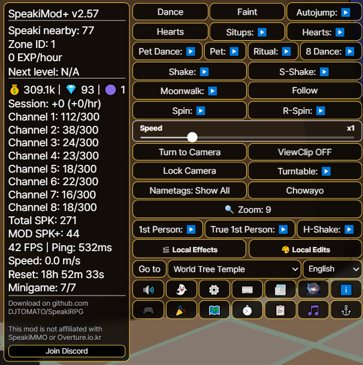
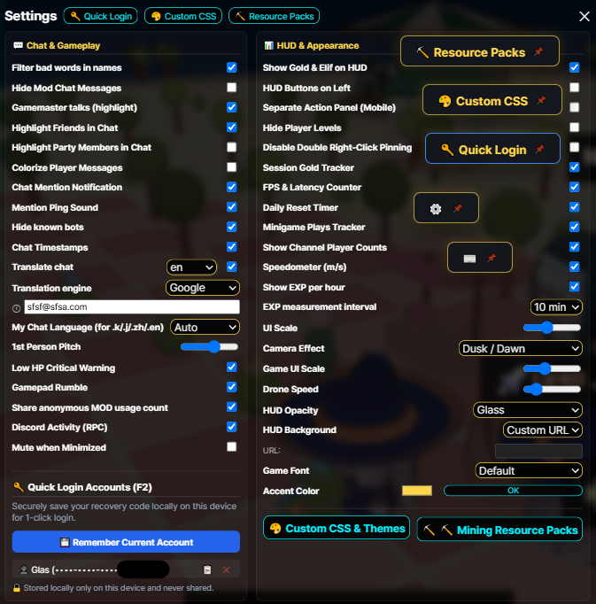
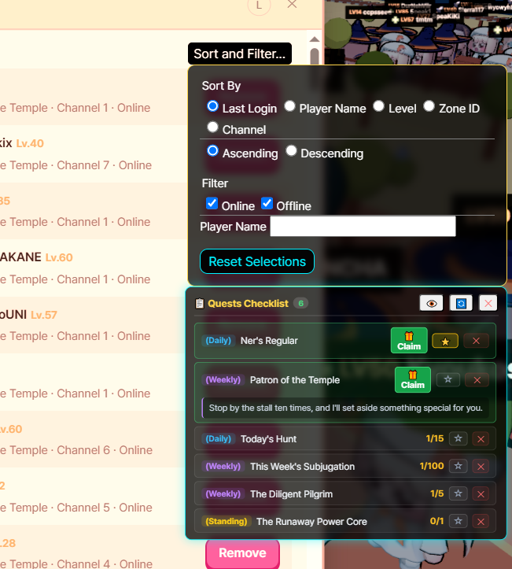
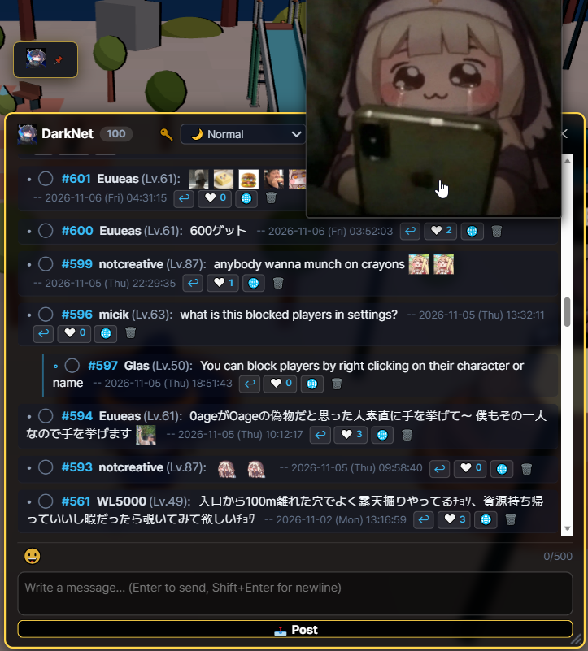
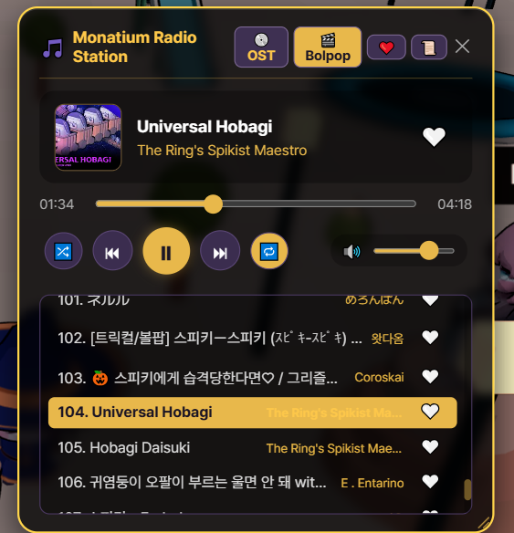
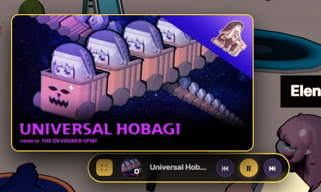
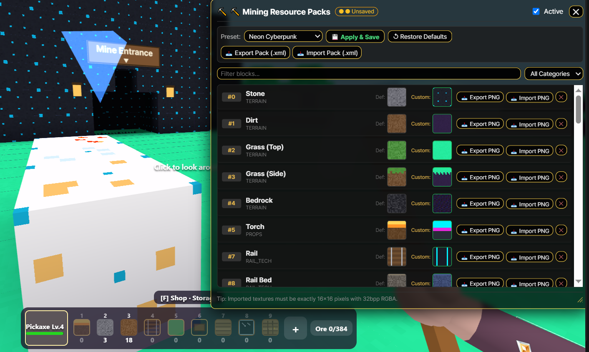
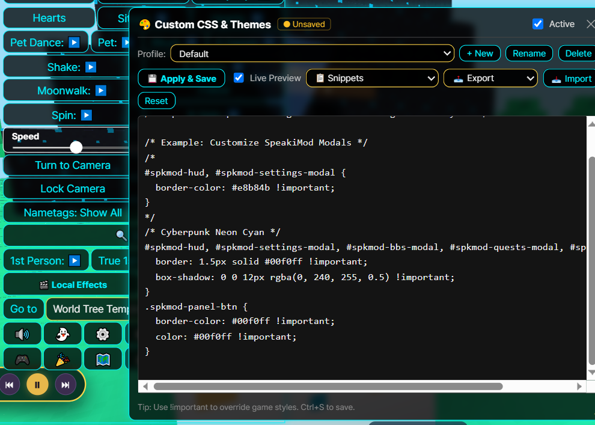
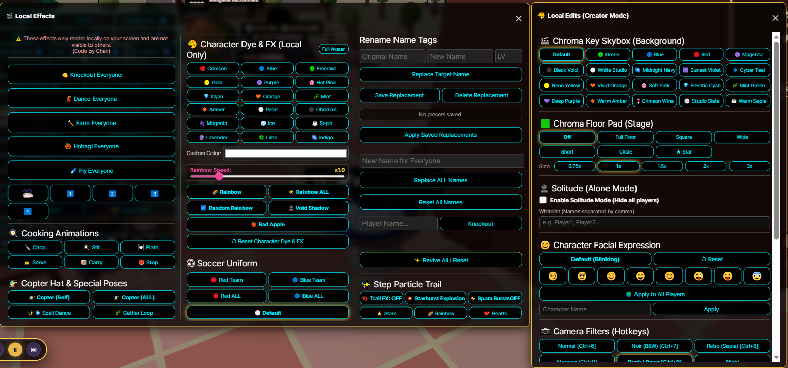
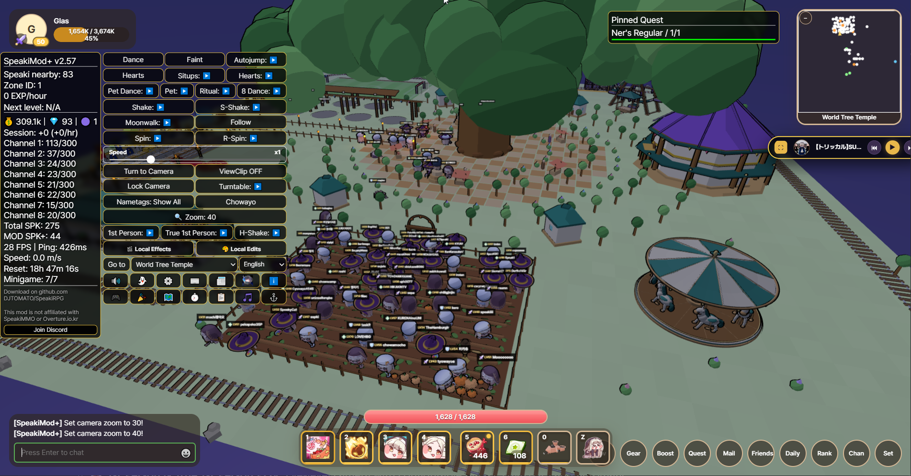

# 스피키 RPG 데스크톱 클라이언트

# -> [English](README.md) | [日本語](README.ja.md) | [한국어](README.ko.md) | [繁體中文](README.zh-tw.md) | [简体中文](README.zh-cn.md) <-


# -> [Download | ダウンロード | 다운로드 | 下載](https://github.com/DJTOMATO/SpeakiRPG/releases) | [Discord](https://discord.gg/bruZhcwqRx) <-

<div align="center">

### 🎥 추천 영상: SpeakiMod+ 기능 소개!
[](https://www.youtube.com/watch?v=ekxvWkYELm8)

**[▶️ YouTube에서 시청하기: 欲しい機能がきっとある！MOD紹介 Introducing Speakimod+! Speakimod+ 소개! [CC:Eng]](https://www.youtube.com/watch?v=ekxvWkYELm8)**  
*커뮤니티 크리에이터 **おあげ** 님이 제작한 SpeakiMod+ 편의 기능 및 UI 가이드 영상입니다! (영어 자막 지원)*

> ⚠️ **안내:** SpeakiMod+는 게임 GM으로부터 공식적으로 사용 허가를 받은 모드이며, 불공정한 악용 기능은 모두 제거되었습니다. 만약 의도치 않은 버그나 악용 소지가 있는 기능을 발견하신다면 악용하지 마시고 [공식 Discord 지원 서버](https://discord.gg/bruZhcwqRx)에 제보해 주세요.

</div>

---

**Speaki RPG Desktop**은 웹 브라우저 기반 MMORPG **Speaki RPG**를 위한 맞춤형 데스크톱 클라이언트, 모바일 래퍼 및 종합 편의성(QoL) 확장 스위트(**SpeakiMod+**)입니다. 브라우저 탭에서 게임을 꺼내어 하드웨어 가속 렌더링, Discord Rich Presence 연동, 실시간 양방향 채팅 번역, 인게임 주크박스, 채굴 리소스 팩, 영상 제작을 위한 크리에이터 스튜디오, 그리고 수많은 소셜 및 게임플레이 편의 기능을 제공합니다!

> **🔒 사칭 및 사기 주의 (면책 조항):** 본 클라이언트 및 모드는 수익 창출이나 기부를 **일절 받지 않습니다**. 게임 자체도 기부를 받거나 수익을 창출하지 않습니다. 금전을 요구하는 사람은 모두 사칭범이니 주의하세요!

<h2 id="table-of-contents">목차</h2>

- [1. 주요 기능 및 하이라이트](#1-features--highlights)
  - [🖥️ 데스크톱 핵심 기능, HUD & 퀘스트](#core-desktop-hud--quests)
  - [💬 소셜, 채팅, 번역 & 커스텀 이모지](#social-chat-translation--emojis)
  - [📻 모나티엄 라디오 방송국 (주크박스)](#monatium-radio-station-jukebox)
  - [⛏️ 채굴 리소스 팩 & 🎨 커스텀 CSS 테마](#mining-resource-packs--custom-css-themes)
  - [🎬 크리에이터 스튜디오: 로컬 편집 & 로컬 효과](#creator-studio-local-edits--local-effects)
  - [💃 이동, 이모트 & 카메라 트릭](#movement-emotes--camera-tricks)
  - [⌨️ 단축키 & 채팅 명령어 모음](#hotkeys--chat-commands-reference)
- [2. 다운로드 및 설치 (데스크톱 & Android)](#2-download--installation)
- [3. 자체 컴파일 빠른 시작 가이드](#3-self-compile-quick-start-guide)
- [4. 사용 방법](#4-how-to-use-it)
- [5. SpeakiMod+ 구현 소개](#5-implementation-of-speakimod)
- [6. 공식 개발자 입장 및 사용 정책](#6-official-developer-reaction--usage-policy)
- [7. 알아두어야 할 사항 & 협업 안내](#7-good-to-know--collaboration)
- [8. 자주 묻는 질문 (FAQ)](#8-faq)
- [9. 크레딧](#9-credits)
- [10. Speaki MMO 커뮤니티 무비!](#10-speaki-mmo-community-movie)

---

<h2 id="1-features--highlights">1. 주요 기능 및 하이라이트</h2>

[⬆ 맨 위로](#table-of-contents)

<h3 id="core-desktop-hud--quests">🖥️ 데스크톱 핵심 기능, HUD & 퀘스트</h3>

<p align="center">
  
  
</p>

* **Discord Rich Presence (상태 연동):** 현재 캐릭터 이름, 레벨, 경험치 진행도를 Discord 프로필에 자동으로 표시합니다 (설정 내 토글 및 `Ctrl+Shift+D` 강제 새로고침 지원).


* **하드웨어 가속 및 고해상도(High-DPI) 지원:** 더욱 부드러운 3D 렌더링을 위해 GPU를 자동 구성하며, **해상도 강제 지정(Override)** 및 **모바일 고해상도 렌더링 보정**을 지원합니다.
* **📌 플로팅 액션 버튼:** 모드 패널의 아무 버튼이나 **우클릭 더블클릭**(모바일은 길게 누르기)하면 화면 어디에나 자유롭게 배치할 수 있는 드래그형 플로팅 바로가기 버튼으로 꺼낼 수 있습니다! 다시 우클릭하면 닫힙니다.
* **🔑 간편 로그인 및 계정 관리자 (<kbd>F2</kbd>):** 여러 계정의 복구 코드를 기기 로컬에 안전하게 저장하고 원클릭으로 전환·로그인·복사할 수 있습니다 (PC 내부에만 저장되며, 설정 내보내기 시에도 제외되어 외부로 절대 공유되지 않습니다).
* **🔊 스마트 오디오 및 최소화 시 음소거:** HUD에서 게임을 즉시 음소거하거나 **최소화 시 음소거**를 켜서 Alt-Tab 중일 때 게임 소리를 자동으로 끌 수 있습니다 (백그라운드 상태에서도 `@멘션` 알림음은 울리도록 허용 가능).
* **⏱️ 실시간 트래커 및 세션 통계:**
  * **경험치(EXP) 트래커:** 측정 주기를 설정할 수 있는 이동 평균 분당/시간당 EXP 및 다음 레벨까지 예상 소요 시간을 표시합니다.
  * **세션 재화 및 성능 통계 창 (`⏱️`):** 세션 플레이 시간, 시간당 골드/엘리프/스피키 코인 획득량, FPS, 현재 게이트웨이 핑(`ms`), 실시간 `m/s` **속도계(Speedometer)**, **채널별 접속자 수**, **일일 초기화 타이머**(`00:00 KST` 자정까지 카운트다운)를 추적합니다.
  * **📰 공식 패치노트 및 업데이트 게시판:** 번역된 공식 게임 패치노트와 모드 업데이트 소식을 인게임에서 바로 읽어볼 수 있습니다.
* **📋 퀘스트 체크리스트 및 원클릭 보상 수령:**
  * **일일**, **주간**, **상시** 퀘스트의 실시간 진행도 카운터, 상세 설명 펼치기, **원클릭 보상 받기(Claim)** 버튼을 갖춘 전용 체크리스트 모달을 제공합니다.
  * 퀘스트를 체크리스트에 고정하거나 별표(`⭐`)를 눌러 화면 HUD에 직접 띄울 수 있습니다.
* **🗺️ 인터랙티브 월드맵 및 자동 이동 경로 탐색:**
  * 모든 지역의 연결 구조, 포털 위치 및 레벨 제한을 한눈에 보여주는 시각적 월드맵입니다.
  * 다중 지역 동적 BFS **자동 이동(Autowalk) 경로 탐색**으로 목표 포털까지 자동으로 걸어갑니다 (이동 중 직접 화면을 주시해야 하며, 사망 시 자동으로 멈춥니다).

<p align="center">
  
  
</p>

---

<h3 id="social-chat-translation--emojis">💬 소셜, 채팅, 번역 & 커스텀 이모지</h3>

[⬆ 맨 위로](#table-of-contents)

<p align="center">
  
</p>

* **💬 인게임 커뮤니티 게시판「SpeakiBBS (`DarkNet`)」:**
  * 스레드형 답글, 답글 체인 접기/펼치기, 게시글 및 답글 ❤️ 좋아요, 원클릭 메시지 번역(`🌐`), 커스텀 이모지 삽입, 창 크기 조절을 지원하는 인게임 커뮤니티 게시판입니다.
* **🌐 양방향 실시간 채팅 번역:**
<p align="center">
  
</p>

  * **번역 엔진 선택 가능:** **Google 번역**과 **MyMemory API** 중 선택할 수 있으며, 자동 폴백(대체) 및 일일 할당량 확인 기능을 제공합니다.
  * **수신 채팅 자동 번역 & 클릭 번역:** 외국어 채팅 메시지를 선호하는 언어로 자동 번역하거나, 채팅창의 아무 줄이나 클릭하여 즉시 번역할 수 있습니다.
  * **발신 채팅 빠른 번역 명령어:** `.en`, `.j`/`.ja`/`.jp`, `.k`/`.ko`, `.zh`/`.cn`, `.tw`, `.es` 뒤에 할 말을 입력하면 해당 언어로 자동 번역하여 전송합니다!
<p align="center">
    
</p>
* **😀 5개 팩 커스텀 이모지, 즐겨찾기 & 로컬 아바타:**
  * 5개의 카탈로그 탭과 **💚 즐겨찾기** 탭으로 구성된 **200종 이상의 움직이는 GIF 및 정적 트릭컬/스피키 이모지**를 제공합니다.
  * **우클릭 즐겨찾기 & 클릭 복사:** 이모지 선택창이나 채팅 로그의 이모지를 우클릭하여 즐겨찾기에 추가/해제할 수 있으며, 채팅창의 이모지를 좌클릭하면 입력창에 바로 삽입됩니다.
  * **스마트 마우스 오버 미리보기 & 크기 조절:** 화면 밖으로 잘리지 않는 큼직한 확대 미리보기와 채팅 이모지 크기를 조절하는 `+`/`−` 버튼을 지원합니다.
  * **커스텀 로컬 아바타:** 내 플레이어 카드 아이콘을 모드 이모지나 원하는 커스텀 이미지/GIF(원형 자동 크롭)로 꾸밀 수 있습니다.
* **👥 친구 목록 정렬, 필터링 & 이름표 동기화:**
  * 친구 목록을 **최근 접속일**, **이름**, **레벨**, **지역 ID**, **채널**(오름차순 / 내림차순) 기준으로 정렬하고, **온라인 / 오프라인** 상태나 이름 검색으로 필터링할 수 있습니다.
  * **스마트 이름표(Nametag) 모드:** 이름표 표시를 *모두 표시*, *파티원만*, *친구만*, *모두 숨김*으로 순환 전환하며, 친구나 파티원이 들어오거나 나갈 때 자동으로 동기화됩니다.
* **✨ 채팅 편의 기능 & 모더레이션:**
  * **채팅 강조 및 색상 구분:** **GM/개발자** 메시지를 황금색으로 강조하고, **친구** 및 **파티원**의 채팅을 하이라이트하거나, 플레이어마다 고유한 색상을 부여하는 **플레이어별 채팅 색상** 기능을 켤 수 있습니다.
  * **멘션 알림 및 타임스탬프:** `[HH:MM:SS]` 타임스탬프 표시, 시각/사운드 `@멘션` 알림, **욕설 필터**, 그리고 **알려진 봇 숨기기**(이모트 도배 봇 음소거 및 캐릭터 숨김) 기능을 지원합니다.
  * **스텔스 차단 목록 & 레이더:** 인게임 차단 목록에 있는 유저의 캐릭터 모델, 말풍선, 이모트를 자동으로 완전히 숨기거나, 특정 플레이어의 위치를 방향 화살표 레이더로 추적할 수 있습니다.

---

<h3 id="monatium-radio-station-jukebox">📻 모나티엄 라디오 방송국 (주크박스)</h3>

[⬆ 맨 위로](#table-of-contents)

<p align="center">
  
  
</p>

* **인게임 뮤직 플레이어 (<kbd>Alt</kbd> + <kbd>M</kbd>):** 브라우저 탭을 따로 열지 않고도 엄선된 **트릭컬 OST**와 커뮤니티 **볼팝(Bolpop) / 매드무비(MAD)** 플레이리스트를 인게임에서 바로 감상하세요.
* **❤️ 즐겨찾기 플레이리스트:** 곡 옆의 하트 아이콘을 눌러 나만의 즐겨찾기 재생목록을 만들 수 있습니다.
* **미니 플레이어 & 앨범 아트 프리뷰:** 주크박스 상단 헤더를 우클릭 더블클릭하면 앨범 커버 확대 기능을 갖춘 깔끔한 플로팅 **미니 플레이어**로 접을 수 있습니다.
* **스마트 인게임 BGM 자동 조절 (더킹):** 주크박스 재생 중에는 게임 기본 배경음악(BGM)을 자동으로 음소거/감소시키고, 일시정지하면 원래 BGM 볼륨으로 복구합니다.
* **완벽한 재생 컨트롤:** 셔플, 반복 재생, 탐색 바(Seek bar), 볼륨 슬라이더, 모서리 드래그 창 크기 조절을 지원합니다.

---

<h3 id="mining-resource-packs--custom-css-themes">⛏️ 채굴 리소스 팩 & 🎨 커스텀 CSS 테마</h3>

[⬆ 맨 위로](#table-of-contents)

<p align="center">
  
  
</p>

* **⛏️ 채굴 복셀 리소스 팩:**
  * 채굴 미니게임의 모든 블록 텍스처(*지형, 광석, 건축, 레일 & 기술, 소품*)를 자유롭게 커스터마이징할 수 있습니다.
  * 내장 프리셋(**기본 바닐라**, **클래식 레트로 8비트**, **네온 사이버펑크**, **파스텔 판타지**, **OBAGI 팩**)을 즉시 전환해 보세요.
  * **가져오기 & 내보내기:** 개별 `16x16` (32bpp RGBA) `.png` 블록 타일을 가져오거나 내보낼 수 있으며, 팩 이름과 제작자 크레딧이 포함된 전체 `.xml` 리소스 팩을 공유할 수 있습니다.
* **🎨 커스텀 CSS & 테마 에디터:**
  * **실시간 미리보기(Live Preview)**와 함께 커스텀 CSS를 작성·붙여넣기하고 여러 개의 테마 프로필을 저장 및 관리할 수 있습니다.
  * 원클릭 내장 테마 스니펫(*다크 글래스 패널, 골든 판타지 테마, 사이버펑크 네온 시안, 컴팩트 HUD, 커스텀 게임 폰트*)을 바로 적용해 보세요.
  * `.css` 스타일시트 또는 전체 `.json` 프로필 번들의 가져오기 및 내보내기를 지원합니다.
* **🖌️ HUD 스타일링, 배경 & 폰트:**
  * **UI 크기 조절**(`80%`–`130%` + 인게임 UI용 `/uiscale`), **HUD 투명도/글래스 효과**(*불투명, 투명, 초투명, 라이트/미디엄/헤비 글래스*), **포인트 컬러**를 자유롭게 설정할 수 있습니다.
  * 레벨 10부터 레벨 50까지 순차적으로 해금되는 **HUD 배경 이미지**를 선택하거나 원하는 **커스텀 이미지 URL**을 넣을 수 있습니다.
  * **게임 폰트 변경:** *기본, 팝(CJK 자동), 명조(Serif), 둥근고딕(Maru), 픽셀 / 레트로, 고정폭(Monospace)* 또는 PC에 설치된 모든 **커스텀 OS 폰트**를 사용할 수 있습니다.
  * **6개 국어 UI 지원:** *한국어, English, 日本語, 繁體中文, 简体中文, Español* 완벽 번역 지원.
<p align="center">

</p>

---

<h3 id="creator-studio-local-edits--local-effects">🎬 크리에이터 스튜디오: 로컬 편집 & 로컬 효과</h3>

[⬆ 맨 위로](#table-of-contents)

<p align="center">
  
</p>

스크린샷 아티스트, 밈 제작자, 커뮤니티 영상 감독님들을 위해 설계되었습니다! *(참고: 로컬 편집 및 로컬 효과는 클라이언트 측인 내 화면에서만 렌더링됩니다).*

* **🟢 크로마키 스카이박스 & 바닥 패드 스테이지:**
  * 하늘 배경(스카이박스)을 스튜디오 배경(*크로마키 그린/블루/레드/마젠타, 블랙 보이드, 화이트 스튜디오, 미드나잇 네이비, 선셋 바이올렛, 사이버 틸* 등 15종 이상)으로 교체할 수 있습니다.
  * 캐릭터 발밑에 크기 조절(`0.75x`–`3x`)이 가능한 **크로마키 바닥 패드**(*사각형, 와이드, 쇼트, 원형, ★ 별모양*, 또는 회색 바닥이 비치는 현상을 완전히 없애주는 **전체 바닥(Full Floor)** 모드)를 생성할 수 있습니다.
* **👻 솔리튜드 모드 (단독 촬영 모드) + 화이트리스트:**
  * 원클릭으로 다른 모든 플레이어와 드론을 숨겨 깔끔한 단독 촬영 환경을 만듭니다.
  * **화이트리스트**에 쉼표(`,`)로 구분하여 플레이어 이름을 입력하면, 함께 촬영할 친구나 배우들만 화면에 남겨두고 상호작용하며 촬영할 수 있습니다!
* **📷 30종 이상의 카메라 포스트 프로세싱 필터:**
  * 단축키(<kbd>Ctrl</kbd>+<kbd>6</kbd>~<kbd>0</kbd>) 또는 메뉴에서 *일반, 느와르(흑백), 레트로(세피아), 아침, 황혼, 밤, 베이퍼웨이브, 색수차, 90년대 VHS, 사이버펑크, 파스텔 애니메이션, 매트릭스, 모나티엄 보이, 블러드 문, 신스웨이브, 골든 아워, 코믹북, 열화상, X-Ray, 버추얼 보이, 글리치 아트, 레인보우 프리즘, 수퍼노바* 등 30가지 이상의 시각 효과를 적용할 수 있습니다.
* **🎨 캐릭터 염색, 실루엣 & 유니폼:**
  * 18종 이상의 색상 프리셋, 커스텀 HEX 컬러 피커, **무지개 / 랜덤 무지개**(속도 조절 지원), **보이드 섀도우(칠흑 그림자)**, **Bad Apple**(흑백 실루엣 반전 모드)을 사용해 내 캐릭터나 모든 플레이어의 의상 또는 전신을 염색할 수 있습니다!
  * 내 캐릭터나 맵 전체 인원에게 **레드 팀** 또는 **블루 팀** 축구 유니폼을 입힐 수도 있습니다.
* **😊 표정 컨트롤러 (Facial Expression):**
  * 내 캐릭터, 이름으로 지정한 특정 플레이어, 또는 **맵 내 모든 플레이어**의 표정(*기본 깜빡임, 자신만만/우쭐 😏, 호기심 🥺, 속눈썹 미소 ☺️, 기쁨 😄, 온화함 😊, 윙크 & 메롱 😜, 장난 😛, 걱정 😨*)을 고정할 수 있습니다.
* **🎭 군중 안무가 & 로컬 이름 변경 (`🎬 로컬 효과`):**
  * 화면의 모든 사람에게 동기화된 애니메이션을 실행합니다: **모두 춤추기**, **모두 농사짓기**, **모두 호바기 타기**, **모두 날기**, **모두 기절(Knockout)** (해제 시 서버의 원래 애니메이션으로 부드럽게 복구됩니다).
  * **요리 애니메이션**(*썰기, 젓기, 플레이팅, 서빙, 나르기*), **프로펠러 모자**(나/모두), **스펠 댄스**, **채집 루프**, **내 캐릭터 투명화**도 바로 실행할 수 있습니다.
  * **로컬 이름표 & 플레이어 이름 변경:** 상황극이나 영상 촬영을 위해 특정 플레이어나 화면의 모든 사람 이름을 일괄 변경(프리셋 저장 지원)할 수 있습니다.

---

<h3 id="movement-emotes--camera-tricks">💃 이동, 이모트 & 카메라 트릭</h3>

[⬆ 맨 위로](#table-of-contents)
<p align="center">
  
</p>

* **다양한 카메라 모드:**
  * **🛸 고급 드론 / 자유 카메라 (<kbd>F4</kbd>):** 카메라를 분리하여 `WASD` + `Space`/`Ctrl`(또는 게임패드 스틱)로 비행 속도를 조절하며 자유롭게 공중 촬영을 할 수 있습니다.
  * **👁️ 1인칭 & 진정한 1인칭 시점 (True POV):** 수직 각도 조절(`!fppitch`) 및 머리/아바타 자동 투명화 동기화를 지원하는 눈높이 카메라입니다.
  * **🔍 빠른 줌 & 뷰클립 (ViewClip):** HUD 버튼이나 `!zoom`으로 프리셋 카메라 거리(`5`~`90`)를 빠르게 순환 전환하고, **카메라 고정**(PS1 스타일 고정 앵글), **턴테이블**(360° 공전 또는 반회전 팬), **뷰클립**(벽을 통과하는 카메라), **낮은 HP 위기 경고** 비네트 효과를 사용할 수 있습니다.
* **동기화 이동 & 이모트 매크로:**
  * **회전 회오리 (`좌회전` / `우회전`):** 속도 조절 슬라이더(`/speed <0.1 - 2.0>`)가 포함된 초고속 제자리 회전입니다.
  * **진정한 방향 고정 문워크:** 캐릭터가 바라보는 시선 각도를 고정한 채 모든 방향으로 자유롭게 이동합니다.
  * **흔들기(Shake), 슈퍼 쉐이크(S-Shake) & 하이퍼 쉐이크(H-Shake):** 카메라를 따라가는 빠른 떨림, 역동적인 슈퍼 쉐이크, 그리고 서버에 동기화되는 초고속 진동(H-Shake) 모드입니다.
  * **의식 댄스 & 콤보 매크로:** 원형 궤도를 도는 **의식 댄스**(일반 & 역방향), 8자 궤도를 그리는 **8자 댄스**(일반 & 역방향), **펫 댄스** 콤보, 기절과 초와요를 초고속으로 번갈아 수행하는 **윗몸일으키기(Situps)** 운동 매크로, 단독 **기절(Faint)**, **자동 점프**, **자동 초와요**, **연속 하트 발사**를 지원합니다.
  * **👣 발걸음 파티클 궤적:** 걸어 다닐 때마다 *별 ⭐, 무지개 🌈, 하트 💖, 스타버스트 폭발 💥* 발자국 효과를 남깁니다.
* **플레이어 상호작용 바로가기:**
  * 아무 플레이어나 클릭하여 **시점 보기 (`[SM] Watch`)**, **따라가기 (`[SM] Follow`)**, 또는 **응시하기 (`[SM] Stare`)**(이동 중에도 캐릭터가 해당 플레이어를 향해 부드럽게 회전하며 바라봅니다. 다시 누르거나 카메라 초기화 시 해제)를 사용할 수 있습니다.
  * **🎮 완벽한 게임패드 / 컨트롤러 지원:** 버튼 커스텀 리매핑, 스틱 데드존/감도 슬라이더, 컨트롤러 레이아웃 다이어그램, 포털 이동 및 호바기 카 탑승 버튼 매핑, **피격 시 진동(햅틱 피드백)**을 지원합니다.

---

<h3 id="hotkeys--chat-commands-reference">⌨️ 단축키 & 채팅 명령어 모음</h3>

<details>
<summary><b>🔽 클릭하여 펼치기: 키보드 단축키 & 핫키</b></summary>

| 단축키 | 동작 설명 |
| :--- | :--- |
| <kbd>P</kbd> | 모든 모드 UI 오버레이 켜기/끄기 |
| <kbd>F2</kbd> | 모드 설정 / 간편 로그인 계정 관리자 열기 |
| <kbd>F3</kbd> | 모든 HUD 및 모달 창 위치를 기본값으로 초기화 |
| <kbd>F4</kbd> | 드론(자유 카메라) 모드 전환 (`WASD` 이동, `Space`/`Ctrl` 상승/하강) |
| <kbd>N</kbd> | 인게임 기본 야간 모드(Night Mode) 전환 |
| <kbd>Alt</kbd> + <kbd>M</kbd> | 모나티엄 라디오 방송국 (주크박스) 열기/닫기 |
| <kbd>Ctrl</kbd> + <kbd>U</kbd> | 게임 UI 배율을 `1.0`으로 초기화 |
| <kbd>Ctrl</kbd> + <kbd>Shift</kbd> + <kbd>D</kbd> | Discord Rich Presence 상태 강제 업데이트 |
| <kbd>Ctrl</kbd> + <kbd>6</kbd> ~ <kbd>0</kbd> | 빠른 카메라 필터 (`6`: 일반, `7`: 흑백, `8`: 세피아, `9`: 아침, `0`: 황혼) |
| **우클릭 더블클릭** (버튼) | 모든 HUD 액션 버튼을 플로팅 버튼으로 고정 (우클릭으로 해제) |
| **우클릭 더블클릭** (주크박스) | 주크박스 미니 플레이어 모드 전환 |
| **모드 제목 클릭** (최대 3회) | SpeakiMod+ 메인 HUD 패널 접기 / 펼치기 |

</details>

<details>
<summary><b>🔽 클릭하여 펼치기: 채팅 명령어 & 빠른 번역 접두사</b></summary>

| 명령어 | 설명 |
| :--- | :--- |
| `.en <내용>` | 메시지를 **영어**로 번역하여 전송 |
| `.j` / `.ja` / `.jp <내용>` | 메시지를 **일본어**로 번역하여 전송 |
| `.k` / `.ko <내용>` | 메시지를 **한국어**로 번역하여 전송 |
| `.zh` / `.cn <내용>` | 메시지를 **중국어 간체**로 번역하여 전송 |
| `.tw <내용>` | 메시지를 **중국어 번체**로 번역하여 전송 |
| `.es <내용>` | 메시지를 **스페인어**로 번역하여 전송 |
| `!watch [플레이어]` | 다른 플레이어의 카메라 시점에서 관전 (이름 생략 시 초기화) |
| `!follow [플레이어]` | 특정 플레이어를 자동으로 따라가기 (이름 생략 시 정지) |
| `!stare [플레이어]` | 내 캐릭터가 바라보는 방향을 특정 플레이어에게 부드럽게 고정 |
| `!players` / `!who` | 주변 모든 플레이어의 레벨, 거리, ID를 채팅창에 표시 |
| `!pos` / `!loc` / `!zone` | 현재 지역 ID 및 X/Y/Z 좌표 출력 |
| `!zoom <숫자>` | 카메라 줌 거리 설정 |
| `!fppitch <숫자>` | 1인칭 카메라 수직 각도 설정 (예: `!fppitch 0.45`) |
| `!dance` / `!chowayo` / `!hearts` / `!pat` | 채팅을 통해 이모트 및 쓰다듬기 동작 실행 |
| `/speed <0.1 - 2.0>` | 회전 회오리(스핀) 회전 속도 배율 설정 |
| `/uiscale <0.5 - 2.0>` | 3D 화면은 줄이지 않고 인게임 기본 UI 크기만 조절 |

</details>

---

<h2 id="2-download--installation">2. 다운로드 및 설치 (데스크톱 & Android)</h2>

[⬆ 맨 위로](#table-of-contents)


### 🖥️ 데스크톱 (Windows / macOS / Linux)
**[Releases (릴리스 페이지)](https://github.com/DJTOMATO/SpeakiRPG/releases)**로 이동하여 운영체제에 맞는 최신 설치 파일을 다운로드하세요.

> [!NOTE]
> **macOS 사용자 필독 ("앱이 손상되었습니다" 오류 해결법):**
> 유료 Apple 개발자 인증서가 없기 때문에 macOS Gatekeeper에서 앱이 손상되었으며 휴지통으로 이동해야 한다는 경고가 뜰 수 있습니다. 이 경우 `SpeakiRPG.app`을 **응용 프로그램(Applications)** 폴더로 옮긴 뒤, **터미널(Terminal)**을 열고 다음 명령어를 실행하세요:
> ```bash
> xattr -cr /Applications/SpeakiRPG.app
> ```

### 📱 SpeakiRPG 모바일 (Android)
커뮤니티에서 개발한 Android 클라이언트가 공식 지원됩니다! 스마트폰이나 태블릿에서 **SpeakiMod+**가 기본 내장된 SpeakiRPG를 즐겨보세요.
* **다운로드:** **[Releases](https://github.com/DJTOMATO/SpeakiRPG/releases)** 페이지에서 최신 `.apk` 파일을 다운로드하세요.
* **주요 기능:** 터치에 최적화된 모바일 토글 버튼, 길게 눌러 플로팅 버튼 고정, 분리형 액션 패널 모드, 고해상도(High-DPI) 보정 및 자동 모드 업데이트.
* **요구 사항:** Android 8.0 이상 (알 수 없는 출처의 APK 설치 허용 필요).
* **크레딧:** Android 클라이언트를 개발해 주신 **[venoroa1358](https://github.com/venoroa1358/)** 님께 특별한 감사를 전합니다!

<details>
<summary><b>📱 Android 문제 해결 (트러블슈팅)</b></summary>

* **앱을 실행했지만 모드가 시작되지 않는 경우:** 앱을 강제 종료한 후 다시 실행해 주세요.
* **UI가 가려져 있거나 화면 밖으로 나간 경우:**
  * 스마트폰 화면 방향을 회전해 보거나 채팅바 위의 모바일 토글 버튼을 눌러보세요.
  * 모드 설정(`⚙️`)을 열어 **UI 크기(UI Scale)** 슬라이더를 낮추거나 **창 위치 초기화 (`F3`)** 버튼을 눌러주세요.

</details>

---

<h2 id="3-self-compile-quick-start-guide">3. 자체 컴파일 빠른 시작 가이드</h2>

[⬆ 맨 위로](#table-of-contents)

소스 코드에서 직접 데스크톱 클라이언트를 실행하거나 빌드하고 싶다면 다음 단계를 따르세요:

1. **저장소 복제 (Clone):**
   ```bash
   git clone https://github.com/DJTOMATO/SpeakiRPG.git
   cd SpeakiRPG
   ```
2. **의존성 패키지 설치:**
   ```bash
   npm install
   ```
3. **개발 모드로 실행:**
   ```bash
   npm start
   ```

*독립형 설치 파일을 패키징하려면 `npm run build` (`electron-builder` 사용)를 실행하세요!*

---

<h2 id="4-how-to-use-it">4. 사용 방법</h2>

[⬆ 맨 위로](#table-of-contents)


1. 데스크톱 또는 Android 클라이언트를 실행하고 **Speaki RPG**에 로그인합니다.
2. 클라이언트가 캐릭터 이름, 레벨, 경험치를 자동으로 감지합니다.
3. Discord Rich Presence 상태가 자동으로 업데이트되어 진행 상황을 뽐낼 수 있습니다 (<kbd>Ctrl</kbd>+<kbd>Shift</kbd>+<kbd>D</kbd>를 눌러 강제 업데이트 가능).
4. 좌측 상단의 **SpeakiMod+** HUD(제목 표시줄을 최대 3번 클릭하여 접기 가능)를 사용해 모든 도구, 모달 창 및 설정을 이용해 보세요!

---

<h2 id="5-implementation-of-speakimod">5. SpeakiMod+ 구현 소개</h2>

[⬆ 맨 위로](#table-of-contents)

**SpeakiMod+**는 원본 SpeakiMod를 대대적으로 수정하고 완전히 새롭게 개편한 포크(Fork) 프로젝트입니다. 플레이어에게 안전하고 투명하며 공정한 환경을 제공하기 위해 코드베이스를 철저히 정리하고자 처음 포크되었으며, 이후 수많은 독창적인 편의 기능과 크리에이터 도구, 커뮤니티 시스템을 갖춘 종합 스위트로 발전했습니다.

*법적 고지: [BSD 3-Clause 라이선스](https://opensource.org/licenses/BSD-3-Clause)에 따라 [Alluseri의 SpeakiMod](https://github.com/Alluseri/SpeakiMod)에서 파생되었습니다.*

---

<h2 id="6-official-developer-reaction--usage-policy">6. 공식 개발자 입장 및 사용 정책</h2>

[⬆ 맨 위로](#table-of-contents)

Speaki MMO 개발자(**GMDT**) 님의 공식 입장문 원문은 다음과 같습니다:


> * 다른 유저들에게 피해가 가지 않는 선의 클라이언트 조작을 허용하였습니다.
> * 이 툴을 사용/개조하셔도 됩니다.
> * 여전히 다른 유저들에게 피해가 가는(자동 사냥 등)은 제재 대상입니다.
> * 제재 기준은 완전히 주관적이라(나, 즉 운영자) 유저들이 알아서 판단해야 합니다.
> * 다른 유저들에게 피해가 가지 않는 것이 확실하면, 아무래도 좋습니다.

### 공식 정책 요약:
* ✅ **허용:** **다른 유저에게 피해를 주거나 공정한 플레이를 방해하지 않는 한**, 클라이언트 수정 및 편의성/크리에이티브 도구 사용은 허용됩니다.
* ❌ **금지:** 다른 플레이어에게 부정적인 영향을 미치는 모든 행위 (예: 자리 비움 자동 사냥, 봇 사용, 치트 행위, 타 유저 괴롭힘 등).
* ⚖️ **제재 기준:** 제재 기준은 전적으로 개발자의 주관적인 판단에 따릅니다. 다른 유저에게 불공정한 영향을 주지 않는 선에서 양심적으로 사용해 주세요. 사용에 따른 책임은 본인에게 있습니다.

---

<h2 id="7-good-to-know--collaboration">7. 알아두어야 할 사항 & 협업 안내</h2>

[⬆ 맨 위로](#table-of-contents)

<p align="center">
  
</p>

* **비공식 팬 프로젝트:** 본 프로젝트는 커뮤니티에서 제작한 팬 프로젝트이며 EPID Games, Speaki MMO 또는 Overture.io.kr과 공식적으로 제휴되어 있지 않습니다. 게임의 독점 에셋은 포함되어 있지 않습니다.
* **오픈 소스:** GNU General Public License v3.0 라이선스 하에 배포됩니다.
* **기여하고 싶으신가요?** **[Discord 서버](https://discord.gg/bruZhcwqRx)**에 참여하시거나 GitHub에서 **[Pull Request 보내기](https://github.com/DJTOMATO/SpeakiRPG/pulls)** 또는 **[Issue 등록하기](https://github.com/DJTOMATO/SpeakiRPG/issues)**로 언제든 함께해 주세요!

---

<h2 id="8-faq">8. 자주 묻는 질문 (FAQ)</h2>

[⬆ 맨 위로](#table-of-contents)


**Q: 사용해도 안전한가요 / 정지(밴) 당하지 않나요?**
> 개발자의 공식 성명([섹션 6](#6-official-developer-reaction--usage-policy) 참조)에 따라 다른 플레이어에게 피해를 주지 않는 클라이언트 수정은 허용됩니다. 자동 사냥이나 봇과 같이 불공정한 이점을 취하는 행위는 엄격히 금지되며 제재 대상이 됩니다.

**Q: Windows, Mac, Linux, Android에서 모두 작동하나요?**
> 네! Windows, macOS 및 Android(`.apk`) 빌드는 [Releases](https://github.com/DJTOMATO/SpeakiRPG/releases) 페이지에서 다운로드하실 수 있습니다. Linux 사용자는 [자체 컴파일 가이드](#3-self-compile-quick-start-guide)를 통해 몇 초 만에 소스에서 실행할 수 있습니다.

**Q: 무료인가요? 후원이나 기부를 받나요?**
> 100% 무료이자 오픈 소스입니다. 어떠한 형태의 기부나 수익 창출도 **받지 않습니다**.

**Q: 게임 파일을 수정하거나 게임 에셋을 포함하고 있나요?**
> 아니요. 공식 웹 게임을 불러와 실행 중에 클라이언트 측 UI 및 시각적 편의 기능을 적용하는 독립형 래퍼입니다.

**Q: 왜 제 Discord 상태가 업데이트되지 않나요?**
> Speaki RPG Desktop을 실행하기 전에 Discord 데스크톱 앱이 실행 중인지 확인하시고, 모드 설정에서 **Discord Activity (RPC)**가 켜져 있는지 확인하거나 <kbd>Ctrl</kbd>+<kbd>Shift</kbd>+<kbd>D</kbd>를 눌러보세요.

**Q: 바이러스에 감염되거나 복구 코드가 유출될 위험은 없나요?**
> 전혀 없습니다. 전체 소스 코드가 이 저장소에 투명하게 공개되어 있습니다. 간편 로그인에 저장된 복구 코드는 오직 본인 PC의 로컬 스토리지에만 보관되며, 설정 `.json` 파일을 내보낼 때에도 자동으로 제외됩니다.

**Q: 최고의 사도는 누구입니까??**
> 루포(Rufo)입니다. 더 이상의 질문은 받지 않습니다.

  

---

<h2 id="9-credits">9. 크레딧</h2>

[⬆ 맨 위로](#table-of-contents)

* **원작 게임 (Trickcal Revive):** EPID Games
* **Speaki MMO 개발:** GMDT
* **데스크톱 클라이언트 & SpeakiMod+ 리드 개발:** Glas
* **품질 보증(QA), 코어 수정 & 로컬 효과:** [Chan (ChanMk2)](https://github.com/ChanMk2)
* **Android 모바일 클라이언트 개발:** [venoroa1358](https://github.com/venoroa1358/)
* **SpeakiMod 원작자:** [Alluseri](https://github.com/Alluseri/SpeakiMod)
* **기능 기여자:**
  * [takejohn](https://github.com/takejohn) *(친구 목록 정렬 및 필터링)*
  * [finn0914](https://github.com/finn0914) *(로컬 이모지 아바타 및 설정 내보내기 보안)*
  * OBAGI *(OBAGI 채굴 리소스 팩)*
* **현지화 및 번역:**
  * **일본어 (`ja`):** JPN_WholesomeElfName15T, [Ijuin-max](https://github.com/Ijuin-max)
  * **중국어 번체 & 간체 (`zh-TW` / `zh-CN`):** PeiYu, [kkoo73918246-blip](https://github.com/kkoo73918246-blip)
  * **한국어 (`ko`):** Mafty-hobagi

**🎨 사용된 팬아트:**
UI 배경으로 작품 사용을 흔쾌히 허락해 주신 아티스트 분들께 특별히 감사드립니다!
* [느그 유노 (Yuno) - Lv. 40](https://x.com/yyakk__11)

**서드파티 구성요소:**
* `SpeakiMod.js` – [BSD 3-Clause 라이선스](https://opensource.org/licenses/BSD-3-Clause)에 따라 [Alluseri의 SpeakiMod](https://github.com/Alluseri/SpeakiMod)에서 파생되었습니다.
  소스 코드는 `develop` 브랜치의 `src` 디렉토리에서 관리되며, 번들 파일은 `main` 브랜치를 통해 배포됩니다.
  라이선스 전문은 [`THIRD-PARTY-LICENSES`](./THIRD-PARTY-LICENSES)에서 확인할 수 있습니다.

---

<h2 id="10-speaki-mmo-community-movie">10. Speaki MMO 커뮤니티 무비!</h2>

[⬆ 맨 위로](#table-of-contents)

**PeiYu** 님과 멋진 Speaki MMO 커뮤니티 여러분이 본 클라이언트의 카메라 녹화 및 크리에이터 스튜디오 기능(1인칭 시점, 드론 카메라, 로컬 효과 등)을 적극 활용하여 Speaki RPG 커뮤니티 영화를 제작했습니다!

🎬 **[YouTube에서 Speaki MMO 커뮤니티 무비 시청하기!](https://www.youtube.com/watch?v=yaIEanyk6WI)**

---

<p align="center">
  
</p>
