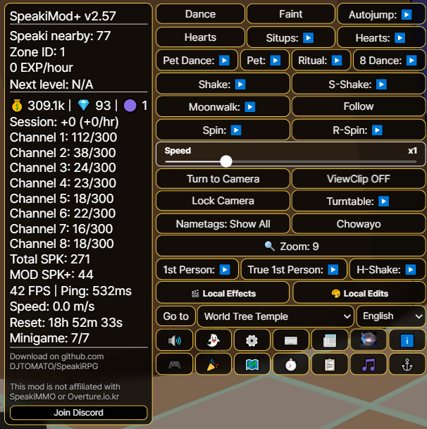
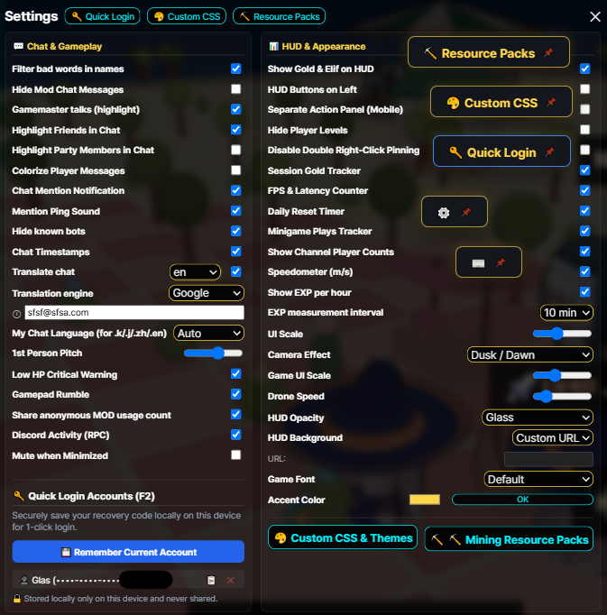
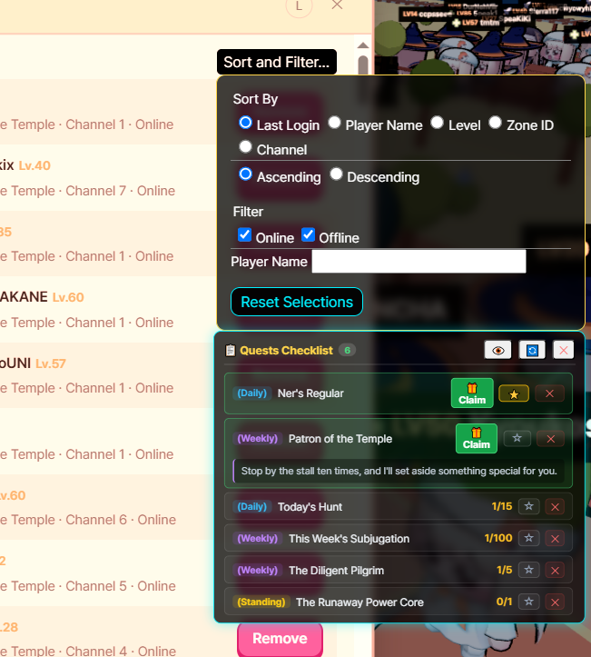
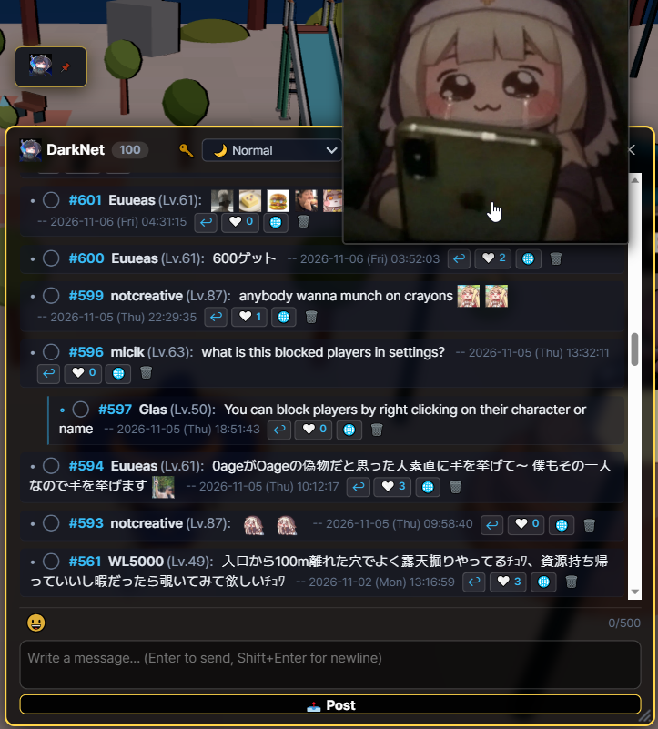
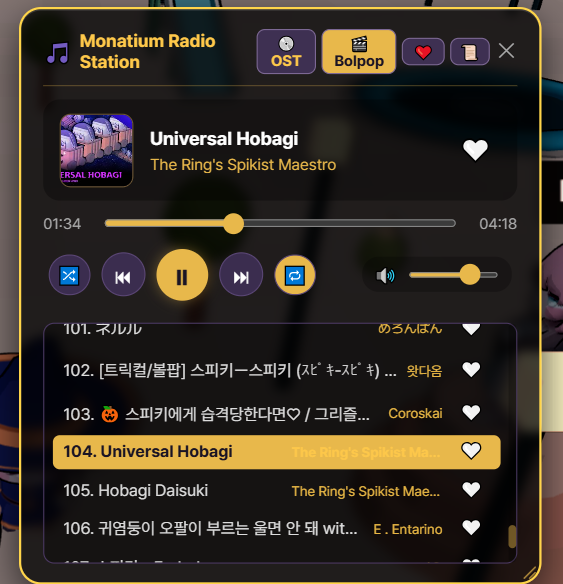
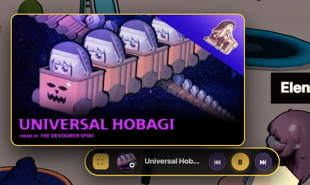
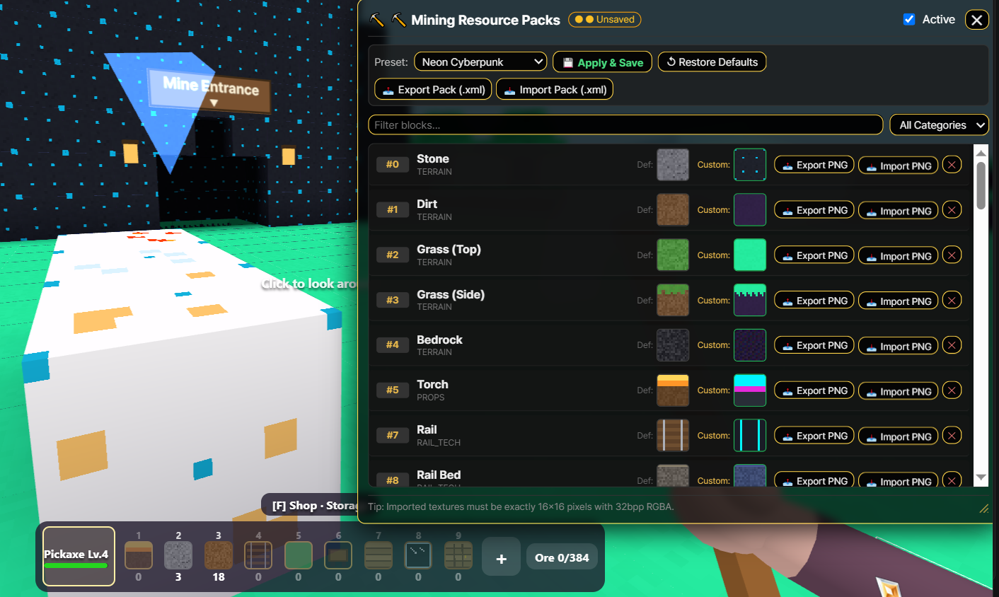
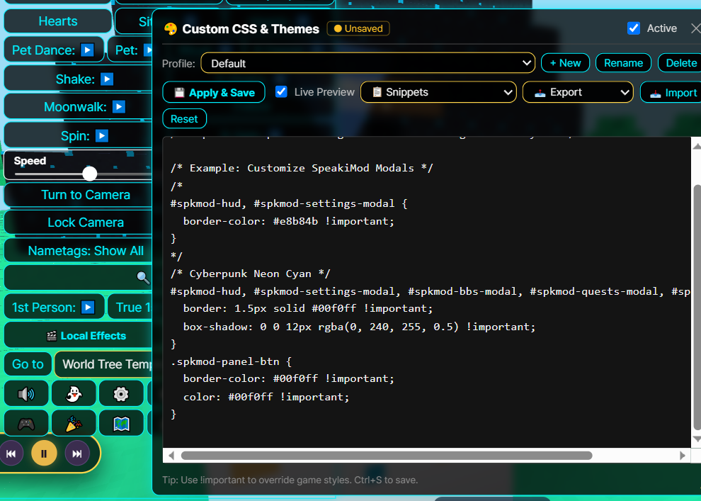
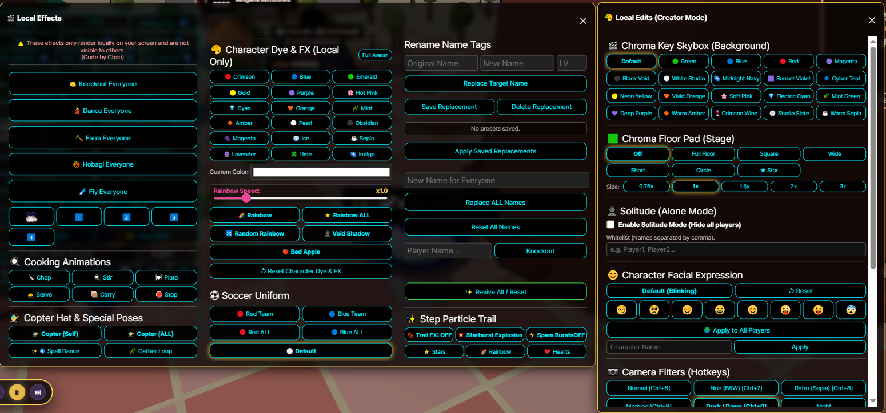

# Speaki RPG Desktop

# -> [English](README.md) | [日本語](README.ja.md) | [한국어](README.ko.md) | [繁體中文](README.zh-tw.md) | [简体中文](README.zh-cn.md) <-


# -> [Download | ダウンロード | 다운로드 | 下載](https://github.com/DJTOMATO/SpeakiRPG/releases) | [Discord](https://discord.gg/bruZhcwqRx) <-

<div align="center">

### 🎥 Featured Video: Introducing SpeakiMod+!
[](https://www.youtube.com/watch?v=ekxvWkYELm8)

**[▶️ Watch on YouTube: 欲しい機能がきっとある！MOD紹介 Introducing Speakimod+! Speakimod+ 소개! [CC:Eng]](https://www.youtube.com/watch?v=ekxvWkYELm8)**  
*A video walkthrough showcasing the features of SpeakiMod+ by community creator **おあげ**! (English subtitles available)*

> ⚠️ **Note:** SpeakiMod+ is officially permitted by the game GM with unfair exploits removed. If you discover any unintended exploits, please report them on our [Discord Support Server](https://discord.gg/bruZhcwqRx) and refrain from abusing them.

</div>

---

**Speaki RPG Desktop** is a custom desktop client, mobile wrapper, and quality-of-life suite (**SpeakiMod+**) for the browser MMORPG **Speaki RPG**. It brings the game out of your browser tab with hardware-accelerated rendering, Discord Rich Presence, real-time chat translation, a built-in Jukebox, mining texture packs, a full video creator studio, and dozens of social and gameplay enhancements!

> **🔒 Anti-Scam Disclaimer:** This client and mod do **not** accept monetization or donations. The game itself does not accept donations or generate revenue. Anyone asking you for money is an impersonator!

<h2 id="table-of-contents">Table of Contents</h2>

- [1. Features & Highlights](#1-features--highlights)
  - [🖥️ Core Desktop, HUD & Quests](#️-core-desktop-hud--quests)
  - [💬 Social, Chat, Translation & Emojis](#-social-chat-translation--emojis)
  - [📻 Monatium Radio Station (Jukebox)](#-monatium-radio-station-jukebox)
  - [⛏️ Mining Resource Packs & 🎨 Custom CSS Themes](#️-mining-resource-packs--custom-css-themes)
  - [🎬 Creator Studio: Local Edits & Local Effects](#-creator-studio-local-edits--local-effects)
  - [💃 Movement, Emotes & Camera Tricks](#-movement-emotes--camera-tricks)
  - [⌨️ Hotkeys & Chat Commands Reference](#️-hotkeys--chat-commands-reference)
- [2. Download & Installation (Desktop & Android)](#2-download--installation)
- [3. Self-Compile Quick Start Guide](#3-self-compile-quick-start-guide)
- [4. How to Use It](#4-how-to-use-it)
- [5. Implementation of SpeakiMod+](#5-implementation-of-speakimod)
- [6. Official Developer Reaction & Usage Policy](#6-official-developer-reaction--usage-policy)
- [7. Good to Know & Collaboration](#7-good-to-know--collaboration)
- [8. FAQ](#8-faq)
- [9. Credits](#9-credits)
- [10. Speaki MMO Community Movie!](#10-speaki-mmo-community-movie)


---

<h2 id="1-features--highlights">1. Features & Highlights</h2>

[⬆ Back to Top](#table-of-contents)

### 🖥️ Core Desktop, HUD & Quests

<p align="center">
  
  
</p>

* **Discord Rich Presence:** Automatically displays your current character name, level, and XP progress on your Discord profile (with an in-game toggle in Settings and `Ctrl+Shift+D` force-refresh).
* **Hardware Acceleration & High-DPI Support:** Automatically configures your GPU for smoother 3D rendering, plus **Resolution Override** and **High-DPI Mobile Render Fixes**.
* **📌 Floating Action Buttons:** Double right-click (or long-press on mobile) any button in the mod panel to pop it out as a draggable floating shortcut button anywhere on screen! Right-click again to dismiss.
* **🔑 Quick Login & Account Manager (<kbd>F2</kbd>):** Securely save, switch, and copy multiple account recovery codes locally on your device for 1-click login (strictly stored on your machine, excluded from settings exports, and never shared).
* **🔊 Smart Audio & Background Mute:** Quickly mute the game from the HUD or enable **Mute when Minimized** to automatically silence game audio when Alt-Tabbing—while still allowing `@mention` alert chimes to play in the background.
* **⏱️ Live Trackers & Session Stats:**
  * **EXP Tracker:** Rolling-average EXP/min or EXP/hour with configurable measurement intervals and estimated time to next level.
  * **Session Currency & Performance Window (`⏱️`):** Tracks session time, Gold/Elif/Speaki Coin gains per hour, FPS, active gateway Ping (`ms`), real-time `m/s` **Speedometer**, **Channel Player Counts**, and **Daily Reset Timer** (countdown to `00:00 KST`).
  * **📰 Official Patch Notes & Update Bulletin:** Read translated official game patch notes and mod update news directly inside the game.
* **📋 Quests Checklist & Instant Claiming:**
  * Dedicated checklist modal tracking **Daily**, **Weekly**, and **Standing** quests with live progress counters, expandable descriptions, and **1-click Claim** buttons.
  * Pin quests to the checklist or star (`⭐`) them directly onto your on-screen HUD.
* **🗺️ Interactive World Map & Autowalk Pathfinding:**
  * Visual map showing all zones, portals, and level requirements.
  * Dynamic multi-zone BFS **Autowalk Pathfinding** to automatically walk toward target portals (must be attended; stops automatically on death).

<p align="center">
  
  
</p>

---

### 💬 Social, Chat, Translation & Emojis

[⬆ Back to Top](#table-of-contents)

<p align="center">
  
  
</p>

* **💬 SpeakiBBS (`DarkNet`) In-Game Community Board:**
  * Built-in community bulletin board featuring threaded replies, collapsible reply chains, ❤️ post/reply likes, 1-click message translation (`🌐`), custom emoji insertion, and a resizable window.
* **🌐 Bi-Directional Real-Time Chat Translation:**
  * **Selectable Translation Engines:** Choose between **Google Translate** and **MyMemory API** with automatic fallback and daily quota tracking.
  * **Incoming Auto-Translate & Click-to-Translate:** Automatically translates foreign chat messages into your preferred language, or click any line in chat to translate it on demand.
  * **Outgoing Quick-Translate Commands:** Type `.en`, `.j`/`.ja`/`.jp`, `.k`/`.ko`, `.zh`/`.cn`, `.tw`, or `.es` followed by your message to automatically translate and send it in that language!
* **😀 5-Pack Custom Emojis, Favorites & Local Avatars:**
  * Over **200+ animated GIF and static Trickcal/Speaki emojis** organized across 5 catalog tabs plus a **💚 Favorites** tab.
  * **Right-Click Favorites & Copy:** Right-click any emoji in the picker or chat log to favorite/unfavorite it; left-click an emoji in chat to insert it into your input box.
  * **Smart Hover Previews & Resizing:** Large screen-clamped hover previews and `+`/`−` controls to adjust in-chat emoji size.
  * **Custom Local Avatars:** Customize your player card icon with any mod emoji or custom image/GIF (cropped to a circle locally).
* **👥 Friend List Sorting, Filtering & Nametag Sync:**
  * Sort your Friend List by **Last Login**, **Player Name**, **Level**, **Zone ID**, or **Channel** (Ascending / Descending) and filter by **Online / Offline** or name search.
  * **Smart Nametag Modes:** Cycle nametags between *Show All*, *Party Only*, *Friends Only*, and *Hidden*—automatically syncing when friends or party members join or leave.
* **✨ Chat QoL & Moderation:**
  * **Chat Highlights & Colors:** Highlight **GM/Developer** messages in gold, highlight **Friends** and **Party Members** in chat, or enable **Colorize Player Messages** for unique per-player colors.
  * **Mention Alerts & Timestamps:** Optional `[HH:MM:SS]` timestamps, visual/audio `@mention` notifications, **Profanity Filter**, and **Hide Known Bots** (mutes and hides emote-spamming bots).
  * **Stealth Blocklist & Radar:** Automatically hides character models, chat bubbles, and emotes for users on your native blocklist, or track specific players with directional radar arrows.

---

### 📻 Monatium Radio Station (Jukebox)

[⬆ Back to Top](#table-of-contents)

<p align="center">
  
  
</p>

* **Built-In Music Player (<kbd>Alt</kbd> + <kbd>M</kbd>):** Listen to curated **Trickcal OST** and community **Bolpop / MADs** playlists directly in-game without opening a browser tab.
* **❤️ Favorites Playlist:** Click the heart icon on any song to build your own persistent Favorites playlist.
* **Mini-Player & Artwork Preview:** Double right-click the Jukebox header to collapse it into a sleek floating **Mini-Player** with expandable album cover art.
* **Smart Native BGM Ducking:** Automatically mutes/lowers the game's native background music while the Jukebox is playing and restores your previous BGM volume when paused.
* **Full Playback Controls:** Supports Shuffle, Repeat, seek bar, volume slider, and corner drag-to-resize.

---

### ⛏️ Mining Resource Packs & 🎨 Custom CSS Themes

[⬆ Back to Top](#table-of-contents)

<p align="center">
  
  
</p>

* **⛏️ Mining Voxel Resource Packs:**
  * Customize every block texture in the mining minigame (*Terrain, Ores, Building, Rail & Tech, Props*).
  * Switch instantly between built-in presets: **Default Vanilla**, **Classic Retro 8-Bit**, **Neon Cyberpunk**, **Pastel Fantasy**, and the **OBAGI Pack**.
  * **Import & Export:** Import or export individual `16x16` (32bpp RGBA) `.png` block tiles, or share complete `.xml` resource packs with custom pack names and author credits.
* **🎨 Custom CSS & Theme Editor:**
  * Write or paste custom CSS with **Live Preview** and manage multiple saved theme profiles.
  * Apply 1-click built-in theme snippets: *Dark Glass Panels, Golden Fantasy Theme, Cyberpunk Neon Cyan, Compact HUD,* and *Custom Game Font*.
  * Import and export `.css` stylesheets or full `.json` profile bundles.
* **🖌️ HUD Styling, Backgrounds & Fonts:**
  * Customize **UI Scale** (`80%`–`130%` + `/uiscale` for game UI), **HUD Opacity** (*Solid, Transparent, Super Transparent, Light/Medium/Heavy Glass*), and **Accent Color**.
  * Unlock progressive **HUD Backgrounds** from Level 10 to Level 50 (or paste any **Custom Image URL**).
  * **Game Font Switcher:** Choose between *Default, Pop (Auto CJK), Serif (Mincho), Rounded (Maru), Pixel / Retro, Monospace*, or any installed **Custom OS Font**.
  * **6 UI Languages:** Full localization in *English, 日本語, 한국어, 繁體中文, 简体中文,* and *Español*.

---

### 🎬 Creator Studio: Local Edits & Local Effects

[⬆ Back to Top](#table-of-contents)

<p align="center">
  
</p>

Designed for screenshot artists, meme makers, and community movie directors! *(Note: Local Edits and Local Effects render client-side on your screen only).*

* **🟢 Chroma Key Skybox & Floor Pad Stage:**
  * Replace the skybox with studio backdrops (*Chroma Green/Blue/Red/Magenta, Black Void, White Studio, Midnight Navy, Sunset Violet, Cyber Teal*, and 10+ more).
  * Spawn a **Chroma Floor Pad** directly beneath your character (*Square, Wide, Short, Circle, ★ Star*, or **Full Floor** mode to eliminate grey ground clipping) with adjustable size (`0.75x`–`3x`).
* **👻 Solitude Mode (Alone Mode) + Whitelist:**
  * Hide all other players and their pets/drones with one click for clean solo recording.
  * Add comma-separated player names to the **Whitelist** so selected co-stars and friends remain visible and interactive during shoots!
* **📷 30+ Camera Post-Processing Filters:**
  * Cycle via hotkeys (<kbd>Ctrl</kbd>+<kbd>6</kbd>~<kbd>0</kbd>) or choose from 30+ visual effects including *Normal, Noir (B&W), Retro (Sepia), Morning, Dusk, Night, Vaporwave, Chromatic Aberration, 90s VHS, Cyberpunk, Pastel Anime, Matrix, Monatium Boy, Blood Moon, Synthwave, Golden Hour, Comic Book, Thermal, X-Ray, Virtual Boy, Glitch Art, Rainbow Prism,* and *Supernova*.
* **🎨 Character Dye, Silhouettes & Uniforms:**
  * Dye your outfit or full avatar using 18+ color presets, a custom hex color picker, **Rainbow / Random Rainbow** (with speed control), **Void Shadow**, or **Bad Apple** (stark black-and-white silhouette mode) for yourself or all players!
  * Equip **Red Team** or **Blue Team** Soccer Uniforms on yourself or everyone in the zone.
* **😊 Facial Expression Controller:**
  * Lock facial expressions (*Default Blinking, Confident/Smug 😏, Curious 🥺, Lash Smile ☺️, Delighted 😄, Gentle 😊, Wink & Tongue 😜, Teasing 😛, Worried 😨*) on yourself, a specific player by name, or **all players on the map**.
* **🎭 Crowd Choreographer & Nametag Renaming (`🎬 Local Effects`):**
  * Trigger synchronized animations across everyone on screen: **Dance Everyone**, **Farm Everyone**, **Hobagi Everyone**, **Fly Everyone**, or **Knockout Everyone** (smoothly restores true server animations when reset).
  * Trigger **Cooking Animations** (*Chop, Stir, Plate, Serve, Carry*), **Copter Hat** (Self/All), **Spell Dance**, **Gather Loop**, or **Invisible Self**.
  * **Local Nametag & Pet Renaming:** Rename any player, pet, or everyone on screen for skits, with savable replacement presets.

---

### 💃 Movement, Emotes & Camera Tricks

[⬆ Back to Top](#table-of-contents)


* **Camera Modes:**
  * **🛸 Advanced Drone / Free Camera (<kbd>F4</kbd>):** Detach the camera and fly freely with `WASD` + `Space`/`Ctrl` (or Gamepad sticks) with adjustable flight speed.
  * **👁️ 1st-Person & True 1st-Person POV:** Eye-level camera with configurable pitch (`!fppitch`) and automatic head/avatar invisibility sync.
  * **🔍 Quick Zoom & ViewClip:** Cycle preset camera distances (`5` to `90`) via the HUD button or `!zoom`, **Lock Camera** (PS1-style fixed angle), **Turntable** (360° orbit or half-pan), **ViewClip** (phase camera through walls), and **Low HP Critical Warning** vignette.
* **Synchronized Movement & Emote Macros:**
  * **Spin (`L-Spin` / `R-Spin`):** High-speed spinning with adjustable speed slider (`/speed <0.1 - 2.0>`).
  * **True Direction-Locked Moonwalk:** Move in any direction while keeping your character's facing angle locked.
  * **Shake, S-Shake & H-Shake:** Rapid camera-following jitter, energetic Super Shake, and server-synced Hyper Shake vibration.
  * **Dance Rituals & Combos:** Circular orbit **Ritual** (Normal & Reverse), figure-eight **8-Dance** (Normal & Reverse), **Pet Dance** combo, **Situps** workout macro (rapid Faint/Chowayo alternation), standalone **Faint**, **Autojump**, **Auto-Chowayo**, and **Continuous Hearts**.
  * **👣 Step Particle Trails:** Leave trails of *Stars ⭐, Rainbow 🌈, Hearts 💖,* or *Starburst Explosions 💥* as you walk.
* **Player Interaction Shortcuts:**
  * Click any player to **Watch** (`[SM] Watch`), **Follow** (`[SM] Follow`), or **Stare** (`[SM] Stare` — smoothly rotates your character to face them even while moving; toggle off anytime or press Reset Camera).
  * **🎮 Full Gamepad / Controller Support:** Custom button remapping, stick deadzone/sensitivity sliders, controller layout diagram, portal interaction & Hobagi Car bindings, and **Haptic Rumble on Damage**.

---

### ⌨️ Hotkeys & Chat Commands Reference

<details>
<summary><b>🔽 Click to expand: Keyboard Shortcuts & Hotkeys</b></summary>

| Shortcut | Action |
| :--- | :--- |
| <kbd>P</kbd> | Toggle all Mod UI overlays on/off |
| <kbd>F2</kbd> | Open Mod Settings / Quick Login Account Manager |
| <kbd>F3</kbd> | Reset all HUD & modal window positions to default |
| <kbd>F4</kbd> | Toggle Drone (Free Camera) Mode (`WASD` to move, `Space`/`Ctrl` to ascend/descend) |
| <kbd>N</kbd> | Toggle Native Night Mode |
| <kbd>Alt</kbd> + <kbd>M</kbd> | Toggle Monatium Radio Station (Jukebox) |
| <kbd>Ctrl</kbd> + <kbd>U</kbd> | Reset Game UI Scale to `1.0` |
| <kbd>Ctrl</kbd> + <kbd>Shift</kbd> + <kbd>D</kbd> | Force-update Discord Rich Presence status |
| <kbd>Ctrl</kbd> + <kbd>6</kbd> ~ <kbd>0</kbd> | Quick Camera Filters (`6`: Normal, `7`: B&W, `8`: Sepia, `9`: Morning, `0`: Dusk) |
| **Double Right-Click** (Button) | Pin any HUD action button as a floating button (Right-click to dismiss) |
| **Double Right-Click** (Jukebox) | Toggle Jukebox Mini-Player mode |
| **Click Mod Title** (up to 3x) | Fold / collapse the main SpeakiMod+ HUD panel |

</details>

<details>
<summary><b>🔽 Click to expand: Chat Commands & Quick-Translation Prefixes</b></summary>

| Command | Description |
| :--- | :--- |
| `.en <text>` | Translate your message to **English** and send |
| `.j` / `.ja` / `.jp <text>` | Translate your message to **Japanese** and send |
| `.k` / `.ko <text>` | Translate your message to **Korean** and send |
| `.zh` / `.cn <text>` | Translate your message to **Simplified Chinese** and send |
| `.tw <text>` | Translate your message to **Traditional Chinese** and send |
| `.es <text>` | Translate your message to **Spanish** and send |
| `!watch [player]` | Watch from another player's camera perspective (omit name to reset) |
| `!follow [player]` | Automatically follow a player (omit name to stop) |
| `!stare [player]` | Smoothly lock your character's facing direction toward a player |
| `!players` / `!who` | List all nearby players with their levels and distances in chat |
| `!pos` / `!loc` / `!zone` | Print your current Zone ID and X/Y/Z coordinates |
| `!zoom <number>` | Set camera zoom distance |
| `!fppitch <number>` | Set 1st-Person camera vertical pitch angle (e.g., `!fppitch 0.45`) |
| `!dance` / `!chowayo` / `!hearts` / `!pat` | Trigger emotes and pet sequences via chat |
| `/speed <0.1 - 2.0>` | Set Spin (Beyblade) rotation speed multiplier |
| `/uiscale <0.5 - 2.0>` | Scale the native game UI without shrinking the 3D viewport |

</details>

<p align="center">
  
</p>

---

<h2 id="2-download--installation">2. Download & Installation (Desktop & Android)</h2>

[⬆ Back to Top](#table-of-contents)


### 🖥️ Desktop (Windows / macOS / Linux)
Head to the **[Releases](https://github.com/DJTOMATO/SpeakiRPG/releases)** page and download the latest installer for your operating system.

> [!NOTE]
> **For macOS Users ("App is damaged" error):**
> If macOS Gatekeeper warns that the app is damaged and should be moved to the Trash (due to not having a paid Apple developer certificate), move `SpeakiRPG.app` into your **Applications** folder, open **Terminal**, and run:
> ```bash
> xattr -cr /Applications/SpeakiRPG.app
> ```

### 📱 SpeakiRPG Mobile (Android)
A community-developed Android client is officially supported! Play SpeakiRPG on your phone or tablet with **SpeakiMod+** built right in.
* **Download:** Grab the latest `.apk` from the **[Releases](https://github.com/DJTOMATO/SpeakiRPG/releases)** page.
* **Features:** Touch-optimized mobile toggles, long-press button pinning, separated action panel mode, high-DPI resolution fix, and automatic mod updates.
* **Requirements:** Android 8.0 or later (with permission to install APK files from unknown sources).
* **Credits:** Special thanks to **[venoroa1358](https://github.com/venoroa1358/)** for developing the Android client!

<details>
<summary><b>📱 Android Troubleshooting</b></summary>

* **I launched the app, but the mod didn't start:** Force quit the app and restart it.
* **The UI is hidden or off-screen:**
  * Try rotating your phone's orientation, or press the mobile toggle buttons above the chat bar.
  * Open Mod Settings (`⚙️`) and lower the **UI Scale** slider, or press **Reset Window Positions (`F3`)**.

</details>

---

<h2 id="3-self-compile-quick-start-guide">3. Self-Compile Quick Start Guide</h2>

[⬆ Back to Top](#table-of-contents)

Want to run or build the desktop client from source? Follow these steps:

1. **Clone the repository:**
   ```bash
   git clone https://github.com/DJTOMATO/SpeakiRPG.git
   cd SpeakiRPG
   ```
2. **Install dependencies:**
   ```bash
   npm install
   ```
3. **Launch in development mode:**
   ```bash
   npm start
   ```

*Want to package a standalone installer? Run `npm run build` (uses `electron-builder`)!*

---

<h2 id="4-how-to-use-it">4. How to Use It</h2>

[⬆ Back to Top](#table-of-contents)


1. Launch the desktop or Android client and log into **Speaki RPG**.
2. The client automatically detects your character name, level, and XP.
3. Your Discord Rich Presence updates automatically to show off your progress (press <kbd>Ctrl</kbd>+<kbd>Shift</kbd>+<kbd>D</kbd> to force an update).
4. Use the **SpeakiMod+** HUD on the top-left (or click the title bar up to 3 times to fold it) to access all tools, modals, and settings!

---

<h2 id="5-implementation-of-speakimod">5. Implementation of SpeakiMod+</h2>

[⬆ Back to Top](#table-of-contents)


**SpeakiMod+** is a heavily modified, completely overhauled fork of the original SpeakiMod. We originally forked this project to thoroughly clean up the codebase and ensure a secure, transparent, and fair experience for players. Since then, it has evolved into a comprehensive suite of original features, creative tools, and community systems.

*Legal: Derived from [SpeakiMod by Alluseri](https://github.com/Alluseri/SpeakiMod) under the [BSD 3-Clause License](https://opensource.org/licenses/BSD-3-Clause).*

---

<h2 id="6-official-developer-reaction--usage-policy">6. Official Developer Reaction & Usage Policy</h2>

[⬆ Back to Top](#table-of-contents)

The English translation of the official statement by the Speaki MMO Developer (**GMDT**) is as follows:


> * Client modifications to the extent that they do not harm other users have been permitted.
> * You are free to use or modify this tool.
> * Anything that still harms other users (such as auto-hunting) remains subject to penalties.
> * The criteria for penalties are completely subjective (i.e., me, the operator), so users must judge for themselves.
> * As long as it's certain that it doesn't harm other users, it doesn't matter.

### Summary of Official Policy:
* ✅ **Allowed:** Client modifications and QoL/creative tools, **provided they do not harm other users** or disrupt fair play.
* ❌ **Prohibited:** Any actions that negatively impact other players (e.g., unattended auto-hunting, botting, cheating, or harassing players).
* ⚖️ **Enforcement:** Ban criteria are at the developer's subjective discretion. Use good judgment—if it doesn't affect others unfairly, it is permitted. Use at your own risk.

---

<h2 id="7-good-to-know--collaboration">7. Good to Know & Collaboration</h2>

[⬆ Back to Top](#table-of-contents)

<p align="center">
  
</p>

* **Unofficial Fan Project:** This is a community-made project and is not officially affiliated with EPID Games, Speaki MMO, or Overture.io.kr. No proprietary game assets are bundled.
* **Open Source:** Licensed under the GNU General Public License v3.0.
* **Want to Collaborate?** Join our **[Discord Server](https://discord.gg/bruZhcwqRx)**, **[open a Pull Request](https://github.com/DJTOMATO/SpeakiRPG/pulls)**, or **[submit an Issue](https://github.com/DJTOMATO/SpeakiRPG/issues)** on GitHub!

---

<h2 id="8-faq">8. FAQ</h2>

[⬆ Back to Top](#table-of-contents)


**Q: Is this safe to use / will I get banned?**
> Per the developer's official statement (see [Section 6](#6-official-developer-reaction--usage-policy)), client modifications that do not harm other players are permitted. Unfair advantages like unattended auto-hunting or botting are strictly prohibited and will result in a ban.

**Q: Does this work on Windows, Mac, Linux, and Android?**
> Yes! Windows, macOS, and Android (`.apk`) builds are available on the [Releases](https://github.com/DJTOMATO/SpeakiRPG/releases) page. Linux users can build from source in seconds using the [Self-Compile Guide](#3-self-compile-quick-start-guide).

**Q: Is this free? Do you accept donations?**
> It is 100% free and open source. We do **not** accept donations or monetization of any kind.

**Q: Does this modify game files or include game assets?**
> No. It is a standalone wrapper that loads the official web game and applies client-side UI/visual enhancements at runtime.

**Q: Why isn't my Discord status updating?**
> Make sure the Discord desktop app is running before launching Speaki RPG Desktop, ensure **Discord Activity (RPC)** is enabled in Mod Settings, or press <kbd>Ctrl</kbd>+<kbd>Shift</kbd>+<kbd>D</kbd>.

**Q: Will this give me a virus or steal my recovery code?**
> No. The entire source code is open for inspection in this repository. Your Quick Login recovery codes are stored strictly in your local browser storage on your own PC and are even stripped out when exporting your settings `.json`.

**Q: Who is the best Apostle??**
> Rufo. No further questions.

  

---

<h2 id="9-credits">9. Credits</h2>

[⬆ Back to Top](#table-of-contents)

* **Original Game (Trickcal Revive):** EPID Games
* **Speaki MMO Development:** GMDT
* **Desktop Client & SpeakiMod+ Lead Developer:** Glas
* **Quality Assurance, Core Fixes & Local Effects:** [Chan (ChanMk2)](https://github.com/ChanMk2)
* **Android Mobile Client Developer:** [venoroa1358](https://github.com/venoroa1358/)
* **SpeakiMod Original Developer:** [Alluseri](https://github.com/Alluseri/SpeakiMod)
* **Feature Contributors:**
  * [takejohn](https://github.com/takejohn) *(Friend List sorting & filtering)*
  * [finn0914](https://github.com/finn0914) *(Local emoji avatars & settings export security)*
  * OBAGI *(OBAGI Mining Resource Pack)*
* **Localization & Translations:**
  * **Japanese (`ja`):** JPN_WholesomeElfName15T, [Ijuin-max](https://github.com/Ijuin-max)
  * **Traditional & Simplified Chinese (`zh-TW` / `zh-CN`):** PeiYu, [kkoo73918246-blip](https://github.com/kkoo73918246-blip)
  * **Korean (`ko`):** Mafty-hobagi

**🎨 Fanart Used:**
A special thanks to the artists who kindly authorized the use of their artwork for the UI backgrounds!
* [느그 유노 (Yuno) - Lv. 40](https://x.com/yyakk__11)

**Third-Party Components:**
* `SpeakiMod.js` – Derived from [SpeakiMod by Alluseri](https://github.com/Alluseri/SpeakiMod), licensed under the [BSD 3-Clause License](https://opensource.org/licenses/BSD-3-Clause).

---

<h2 id="10-speaki-mmo-community-movie">10. Speaki MMO Community Movie!</h2>

[⬆ Back to Top](#table-of-contents)

A movie about Speaki RPG was recorded by **PeiYu** and the amazing Speaki MMO community, making heavy use of the camera recording and Creator Studio features (such as First-Person, Drone Camera, and Local Effects) available in this client!

🎬 **[Watch the Speaki MMO Community Movie on YouTube!](https://www.youtube.com/watch?v=yaIEanyk6WI)**

---

<p align="center">
  
</p>
