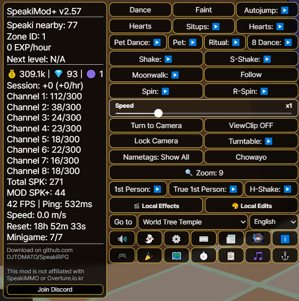
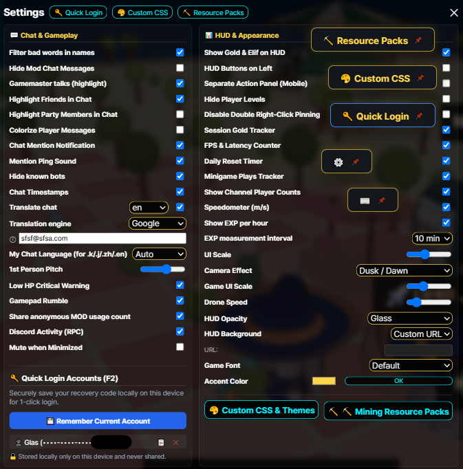
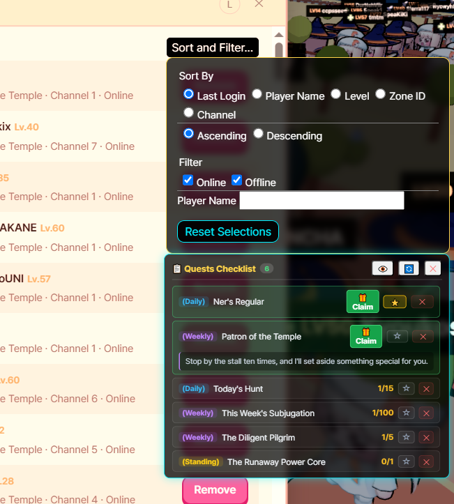
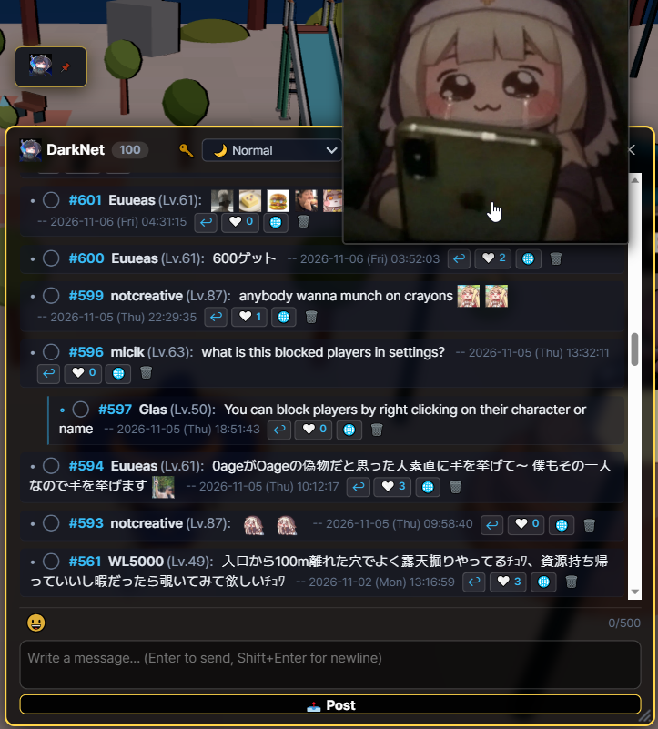
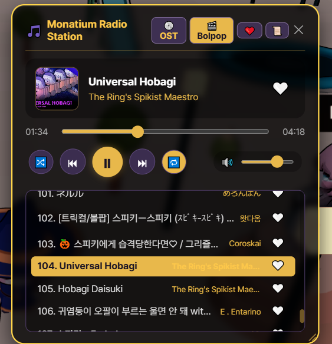
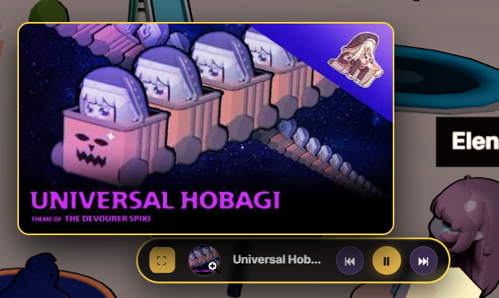
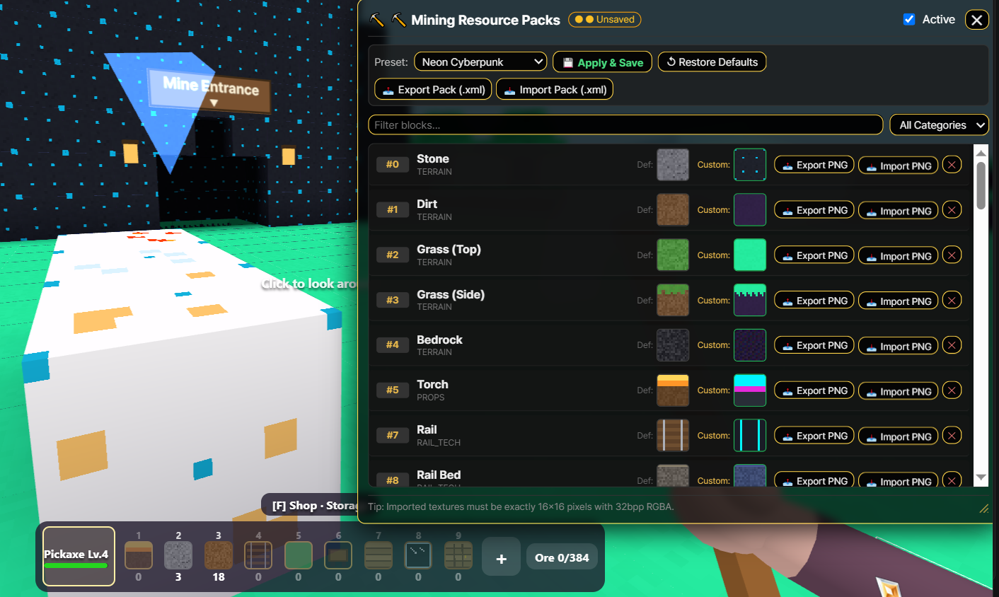
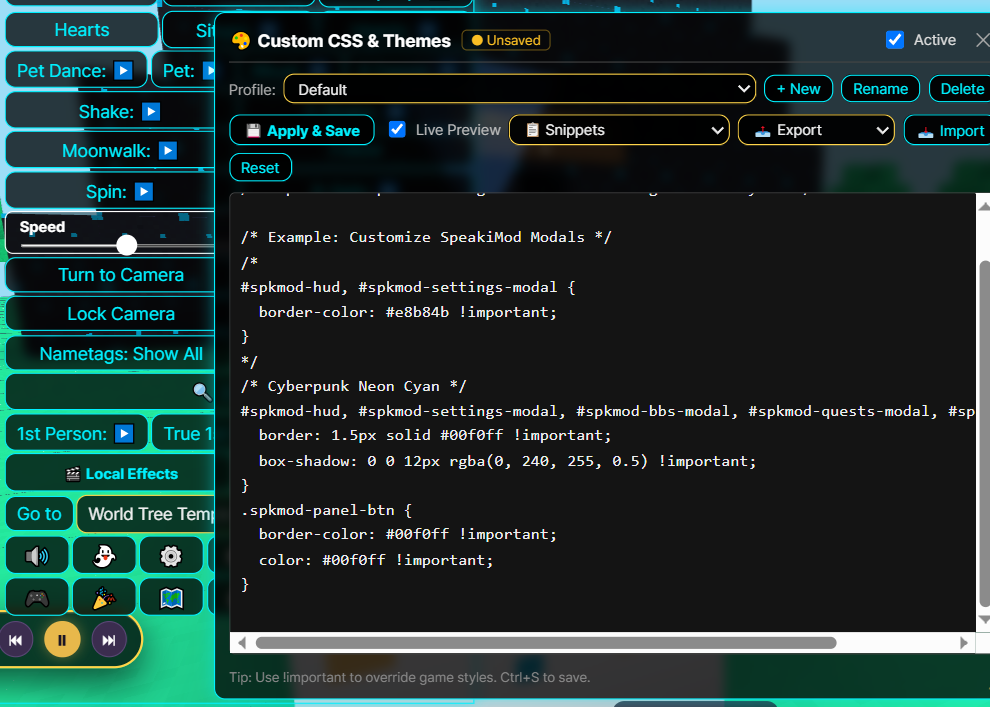
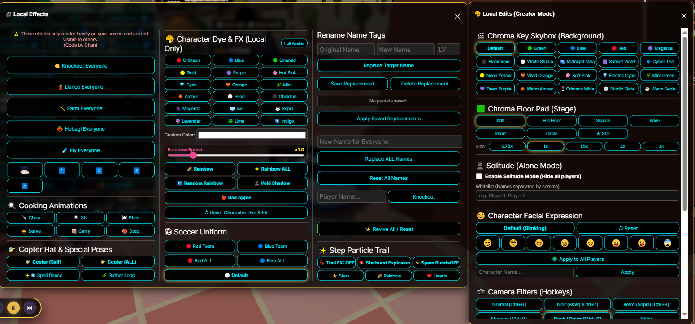
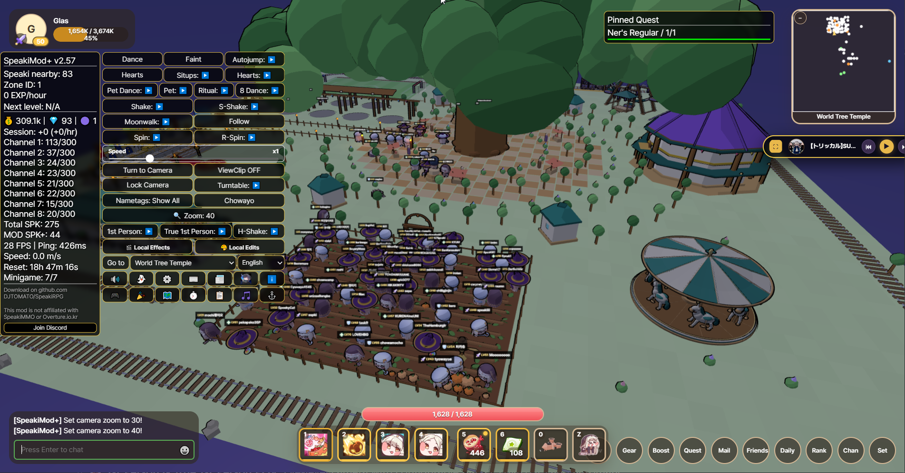

# Speaki RPG 桌面启动器

# -> [English](README.md) | [日本語](README.ja.md) | [한국어](README.ko.md) | [繁體中文](README.zh-tw.md) | [简体中文](README.zh-cn.md) <-


# -> [Download | ダウンロード | 다운로드 | 下载](https://github.com/DJTOMATO/SpeakiRPG/releases) | [Discord](https://discord.gg/bruZhcwqRx) <-

<div align="center">

### 🎥 精选视频：SpeakiMod+ 功能介绍！
[](https://www.youtube.com/watch?v=ekxvWkYELm8)

**[▶️ 在 YouTube 上观看: 欲しい機能がきっとある！MOD紹介 Introducing Speakimod+! Speakimod+ 소개! [CC:Eng]](https://www.youtube.com/watch?v=ekxvWkYELm8)**  
*由社区创作者 **おあげ** 制作的 SpeakiMod+ 功能详细介绍与导览视频！（支持英文字幕）*

> ⚠️ **注意：** SpeakiMod+ 为获得游戏 GM 官方许可使用的合法模组，且已移除所有破坏平衡的不当功能。若您在游玩过程中发现任何非预期的漏洞或可能被滥用的机制，请前往我们的 [Discord 支持服务器](https://discord.gg/bruZhcwqRx) 反馈，并请勿滥用。

</div>

---

**Speaki RPG Desktop** 是一款专为网页 MMORPG **Speaki RPG** 打造的自定义桌面客户端、移动端封装器与全方位便利性套件（**SpeakiMod+**）。它能将游戏从浏览器标签页中独立出来，提供硬件加速渲染、Discord Rich Presence 状态集成、双向实时聊天翻译、内置音乐点唱机、采掘材质包、完整的视频创作者工作室，以及数十种社交与游戏体验强化功能！

> **🔒 防诈骗免责声明：** 本客户端及模组**绝不**接受任何形式的盈利或捐赠。游戏本身亦不接受捐款或产生收益。任何向您索要金钱的人皆为冒充者！

<h2 id="table-of-contents">目录</h2>

- [1. 特色与功能亮点](#1-features--highlights)
  - [🖥️ 桌面核心功能、HUD 与任务清单](#core-desktop-hud--quests)
  - [💬 社交、聊天、实时翻译与自定义表情](#social-chat-translation--emojis)
  - [📻 莫娜蒂姆广播电台（点唱机）](#monatium-radio-station-jukebox)
  - [⛏️ 采掘材质包 & 🎨 自定义 CSS 主题](#mining-resource-packs--custom-css-themes)
  - [🎬 创作者工作室：本地编辑 & 本地特效](#creator-studio-local-edits--local-effects)
  - [💃 移动特技、表情动作 & 镜头技巧](#movement-emotes--camera-tricks)
  - [⌨️ 快捷键 & 聊天指令总览](#hotkeys--chat-commands-reference)
- [2. 下载与安装（桌面版 & Android）](#2-download--installation)
- [3. 自行编译快速入门指南](#3-self-compile-quick-start-guide)
- [4. 如何使用](#4-how-to-use-it)
- [5. SpeakiMod+ 的实装与架构](#5-implementation-of-speakimod)
- [6. 官方开发者回应与使用规范](#6-official-developer-reaction--usage-policy)
- [7. 注意事项与协作邀请](#7-good-to-know--collaboration)
- [8. 常见问题 (FAQ)](#8-faq)
- [9. 致谢名单](#9-credits)
- [10. Speaki MMO 社区电影！](#10-speaki-mmo-community-movie)

---

<h2 id="1-features--highlights">1. 特色与功能亮点</h2>

[⬆ 返回顶部](#table-of-contents)

<h3 id="core-desktop-hud--quests">🖥️ 桌面核心功能、HUD 与任务清单</h3>

<p align="center">
  
  
</p>

* **Discord Rich Presence（丰富个人状态）：** 自动在您的 Discord 个人资料上展示当前的角色名称、等级与 EXP 进度（支持设置内开关切换，以及 `Ctrl+Shift+D` 强制刷新）。


* **硬件加速与高 DPI 支持：** 自动优化 GPU 设置以带来更流畅的 3D 渲染表现，并内置**分辨率覆盖 (Resolution Override)** 与**移动端高 DPI 渲染修复**。
* **📌 悬浮快捷按钮：** 在模组面板中的任何按钮上**双击右键**（手机版为长按），即可将该功能弹出为可自由拖拽至画面任意位置的悬浮快捷键！再次右键点击即可收回。
* **🔑 快速登录与账号管理器 (<kbd>F2</kbd>)：** 在本地设备上安全地保存、一键切换与复制多组账号恢复代码（严格保存在您的电脑本地端，导出配置文件时会自动剔除，绝不外流）。
* **🔊 智能音效与后台自动静音：** 可直接从 HUD 快速静音游戏，或开启**最小化时静音**，在切换窗口（Alt-Tab）时自动关闭游戏背景音——同时仍允许在后台播放 `@提及` 的提示音效。
* **⏱️ 实时追踪器与游玩数据统计：**
  * **经验值追踪器 (EXP Tracker)：** 提供可自定义计算区间的滚动平均每分钟 / 每小时 EXP 收益，以及升至下一级的预估时间。
  * **单次游玩收益与性能统计窗口 (`⏱️`)：** 实时追踪本次游玩时长、每小时金币 / 水晶叶 (Elif) / 斯皮奇币收益、FPS 帧率、当前网关网络延迟 (`ms`)、实时 `m/s` **移动速度计**、**各频道人数统计**，以及**每日重置倒计时器**（距离韩国时间 `00:00 KST` 的剩余时间）。
  * **📰 官方更新公告与模组新闻：** 直接在游戏内阅读翻译好的官方游戏更新日志与模组最新消息。
* **📋 任务检核表与一键领奖：**
  * 专属的任务清单窗口，可实时追踪**每日**、**每周**与**常驻**任务进度、展开详细说明，并提供**一键领取奖励 (Claim)** 按钮。
  * 可将任务钉选至清单中，或点击星号 (`⭐`) 直接固定显示在画面 HUD 上。
* **🗺️ 互动式世界地图与自动寻路：**
  * 可视化呈现所有区域连接、传送门位置与等级需求的世界地图。
  * 支持跨区域动态 BFS **自动寻路 (Autowalk)**，自动走向目标传送门（移动期间请保持有人照看，不会自动吃药或躲避怪物；死亡时会自动停止）。

<p align="center">
  
  
</p>

---

<h3 id="social-chat-translation--emojis">💬 社交、聊天、实时翻译与自定义表情</h3>

[⬆ 返回顶部](#table-of-contents)

<p align="center">
  
</p>

* **💬 游戏内社区留言板「SpeakiBBS (`DarkNet`)」：**
  * 内置游戏社区讨论区，支持串联回复、折叠回复链、❤️ 帖子与评论点赞、一键消息翻译 (`🌐`)、插入自定义表情符号，以及自由缩放窗口大小。
* **🌐 双向实时聊天翻译：**
<p align="center">
  
</p>

  * **可切换翻译引擎：** 支持在 **Google 翻译** 与 **MyMemory API** 之间自由选择，具备自动备援机制与每日配额显示。
  * **接收消息自动翻译 & 点击翻译：** 自动将外语聊天消息翻译为您的偏好语言，或直接点击聊天室中的任何一句话进行即时翻译。
  * **发送消息快速翻译指令：** 输入 `.en`、`.j`/`.ja`/`.jp`、`.k`/`.ko`、`.zh`/`.cn`、`.tw` 或 `.es` 加上消息内容，即可自动翻译成该语言并发送出去！
<p align="center">
    
</p>
* **😀 5 合 1 自定义表情包、收藏夹与本地头像：**
  * 收录超过 **200+ 款动态 GIF 与静态嘟嘟脸/斯皮奇表情符号**，分类于 5 个目录标签页以及专属的 **💚 收藏夹**标签页。
  * **右键添加收藏 & 点击插入：** 在表情面板或聊天记录中对任何表情点击右键即可添加/取消收藏；左键点击聊天室中的表情即可直接插入输入框。
  * **智能悬停预览 & 尺寸调整：** 自动贴合屏幕边界的大型悬停预览窗口，并提供 `+`/`−` 按钮调整聊天室内表情显示大小。
  * **自定义本地头像：** 可使用任何模组表情或自定义图片/GIF（自动裁切为圆形）来替换您的玩家名片头像。
* **👥 好友列表排序、筛选与名牌同步：**
  * 支持按**最后登录时间**、**玩家名称**、**等级**、**区域 ID** 或**频道**（升序 / 降序）排序好友列表，并可按**在线 / 离线**状态或名称关键字进行筛选。
  * **智能名牌显示模式：** 可在 *显示全部*、*仅限队伍*、*仅限好友* 与 *全部隐藏* 之间循环切换他人的名字标签——当好友或队员加入/离开时会自动同步更新。
* **✨ 聊天便利功能与环境管理：**
  * **聊天高亮与专属配色：** 以金色突显 **GM/开发者** 消息、高亮显示**好友**与**队伍成员**发言，或开启**玩家消息彩色化**为每位玩家赋予独特颜色。
  * **提及提醒与时间戳：** 可选的 `[HH:MM:SS]` 时间戳、视觉与音效 `@提及` 通知、**不雅字词过滤器**，以及**隐藏已知机器人**（自动静音并隐藏刷屏机器人）。
  * **隐身黑名单与雷达追踪：** 自动隐藏原生黑名单用户的角色模型、对话气泡与表情动作，或使用方向雷达箭头追踪特定玩家的位置。

---

<h3 id="monatium-radio-station-jukebox">📻 莫娜蒂姆广播电台（点唱机）</h3>

[⬆ 返回顶部](#table-of-contents)

<p align="center">
  
  
</p>

* **内置音乐播放器 (<kbd>Alt</kbd> + <kbd>M</kbd>)：** 不必另外开浏览器标签页，即可在游戏内直接收听精选的 **嘟嘟脸恶作剧 OST** 与社区 **Bolpop / 二创 MAD** 播放列表。
* **❤️ 收藏播放列表：** 点击歌曲旁的爱心图标，建立并保存专属的个人最爱歌单。
* **迷你播放器 & 专辑封面预览：** 在点唱机标题栏双击右键，即可将其收合为精致的悬浮**迷你播放器**，并支持展开专辑封面插图。
* **智能原生 BGM 自动回避：** 当点唱机播放音乐时，会自动静音或降低游戏原生的背景音乐；暂停播放时则自动恢复原本的 BGM 音量。
* **完整播放控制：** 支持随机播放、循环播放、进度拖拽条、音量滑块，以及拖拽窗口角落调整大小。

---

<h3 id="mining-resource-packs--custom-css-themes">⛏️ 采掘材质包 & 🎨 自定义 CSS 主题</h3>

[⬆ 返回顶部](#table-of-contents)

<p align="center">
  
  
</p>

* **⛏️ 采掘方块材质包 (Resource Packs)：**
  * 自定义挖矿小游戏中的每种方块贴图（*地形、矿物、建筑、铁轨与科技、装饰道具*）。
  * 一键切换内置预设材质包：**原版预设 (Vanilla)**、**经典复古 8-Bit**、**霓虹赛博朋克**、**粉彩奇幻**，以及 **OBAGI 材质包**。
  * **导入与导出：** 支持导入或导出单一 `16x16` (32bpp RGBA) `.png` 方块贴图，或分享包含自定义名称与作者署名的完整 `.xml` 材质包文件。
* **🎨 自定义 CSS 与主题编辑器：**
  * 支持**实时预览 (Live Preview)** 编写或粘贴自定义 CSS，并可保存与管理多组主题配置文件。
  * 一键套用内置主题模板：*深色毛玻璃面板、金色奇幻主题、赛博朋克霓虹青、紧凑型 HUD* 与 *自定义游戏字体*。
  * 支持导入与导出 `.css` 样式表或完整的 `.json` 主题配置包。
* **🖌️ HUD 外观、背景与字体切换：**
  * 自由调整 **UI 缩放比例**（`80%`–`130%` + 针对游戏原生界面的 `/uiscale`）、**HUD 透明度与毛玻璃效果**（*不透明、透明、超透明、轻度/中度/重度毛玻璃*）及**主题强调色**。
  * 随角色从 10 级升至 50 级逐步解锁专属 **HUD 背景插图**（亦可粘贴任何**自定义图片链接**）。
  * **游戏字体切换器：** 可在 *默认、圆体 Pop（自动 CJK）、宋体/明体 (Serif)、丸ゴ圆体 (Maru)、像素复古风、等宽字体 (Monospace)* 之间选择，或直接套用电脑中已安装的任何**自定义系统字体**。
  * **6 种界面语言：** 完整支持 *简体中文、繁體中文、English、日本語、한국어* 与 *Español*。
<p align="center">

</p>

---

<h3 id="creator-studio-local-edits--local-effects">🎬 创作者工作室：本地编辑 & 本地特效</h3>

[⬆ 返回顶部](#table-of-contents)

<p align="center">
  
</p>

专为截图摄影师、梗图创作者与社区电影导演量身打造！*(注：本地编辑与本地特效仅在您的客户端屏幕上渲染显示，不会影响服务器端其他玩家)*。

* **🟢 绿幕抠像天空盒 & 地垫舞台：**
  * 将天空盒替换为摄影棚纯色背景（*抠像绿幕/蓝幕/红幕/洋红幕、深邃黑洞、纯白影棚、午夜深蓝、日落紫罗兰、赛博青色* 等超过 15 种背景）。
  * 在角色脚下生成可调大小（`0.75x`–`3x`）的**抠像地垫**（*方形、宽版、短版、圆形、★ 星形*，或可完全消除灰色地面穿模的**全地面覆盖 (Full Floor)** 模式）。
* **👻 孤独模式（单人摄影模式）+ 白名单：**
  * 一键隐藏所有其他玩家与无人机，打造干净无干扰的单人拍摄环境。
  * 在**白名单**中输入以逗号分隔的玩家名称，即可让指定的合作演员与好友保持显示并正常互动！
* **📷 30+ 种镜头后期滤镜：**
  * 通过快捷键（<kbd>Ctrl</kbd>+<kbd>6</kbd>~<kbd>0</kbd>）或菜单切换超过 30 种视觉滤镜，包含 *正常、黑色电影 (黑白)、复古怀旧 (褐色)、晨曦、黄昏、夜晚、蒸汽波、色差特效、90年代 VHS、赛博朋克、粉彩动漫、黑客帝国、莫娜蒂姆掌机、血月、合成波、黄金时刻、美漫风、热成像、X光、Virtual Boy、故障艺术、彩虹棱镜* 与 *超新星*。
* **🎨 角色染色、剪影与队服：**
  * 使用 18+ 种预设色板、自定义 HEX 调色盘、**彩虹渐变 / 随机彩虹**（可调速度）、**虚空暗影 (Void Shadow)** 或 **Bad Apple 模式**（纯黑白反转剪影），为自己或全场玩家的服装与全身染色！
  * 为自己或区域内的所有人换上**红队**或**蓝队**足球队服。
* **😊 面部表情控制器：**
  * 为自己、指定名称的玩家或**地图上的所有玩家**锁定面部表情（*默认眨眼、自信得意 😏、好奇无辜 🥺、睫毛微笑 ☺️、开怀大笑 😄、温柔微笑 😊、眨眼吐舌 😜、调皮促狭 😛、担心受怕 😨*）。
* **🎭 群众编舞家 & 本地改名 (`🎬 本地特效`)：**
  * 让画面上的所有人同步执行动作：**全员跳舞**、**全员种田**、**全员开南瓜车**、**全员飞行**或**全员晕倒 (Knockout)**（重置时会平滑恢复为服务器真实动画）。
  * 一键触发**料理动作**（*切菜、搅拌、摆盘、上菜、端盘*）、**竹蜻蜓帽**（自己/全员）、**咒语舞蹈**、**采集循环**或**自身隐形**。
  * **本地名牌与玩家改名：** 拍摄小剧场时可任意修改单一玩家或全场玩家的名字标签，并支持保存替换预设集。

---

<h3 id="movement-emotes--camera-tricks">💃 移动特技、表情动作 & 镜头技巧</h3>

[⬆ 返回顶部](#table-of-contents)
<p align="center">
  
</p>

* **进阶摄像机模式：**
  * **🛸 进阶无人机 / 自由镜头 (<kbd>F4</kbd>)：** 分离摄像机，使用 `WASD` + `Space`/`Ctrl`（或手柄摇杆）自由飞行运镜，并可调整飞行速度。
  * **👁️ 第一人称 & 真·第一人称视角 (True POV)：** 锁定视线高度的摄像机，支持自定义垂直仰俯角 (`!fppitch`) 与头部/角色模型自动隐形同步。
  * **🔍 快速缩放 & 穿墙视角 (ViewClip)：** 通过 HUD 按钮或 `!zoom` 快速循环切换预设镜头距离（`5` 至 `90`），并提供**锁定镜头**（PS1 经典固定视角）、**旋转展示台 (Turntable)**（360° 环绕或半圈运镜）、**穿墙视角 (ViewClip)**，以及**低血量危急红框警示**。
* **同步移动特技 & 表情宏：**
  * **高速旋转 (`左旋` / `右旋`)：** 配备速度滑块（`/speed <0.1 - 2.0>`）的超高速原地陀螺旋转。
  * **真·方向锁定月球漫步：** 在保持角色面向角度锁定的同时，向任意方向自由移动。
  * **抽搐 (Shake)、超级抽搐 (S-Shake) & 极限抽搐 (H-Shake)：** 跟随镜头的快速抖动、活力满满的超级摇摆，以及服务器同步的高频震动 (H-Shake)。
  * **神秘仪式舞 & 组合动作：** 圆形轨道**神秘仪式舞 (Ritual)**（正向 & 逆向）、8 字形轨道 **8 字舞**（正向 & 逆向）、**摸头跳舞**组合技、极速交替晕倒与啾哇唷的**仰卧起坐 (Situps)** 健身宏、独立**晕倒 (Faint)** 按钮、**自动跳跃**、**自动啾哇唷**与**连续发射爱心**。
  * **👣 脚步粒子轨迹：** 行走时在身后留下 *星星 ⭐、彩虹 🌈、爱心 💖* 或 *星爆 💥* 特效轨迹。
* **玩家互动快捷功能：**
  * 点击任何玩家即可执行**观察视角 (`[SM] Watch`)**、**自动跟随 (`[SM] Follow`)** 或**凝视锁定 (`[SM] Stare`)**（即使在移动中也会平滑转动您的角色面向对方；随时可再次点击关闭或按重置镜头取消）。
  * **🎮 完整手柄 / 控制器支持：** 支持自定义按键映射、摇杆死区与灵敏度滑块、控制器布局图示、传送门互动与南瓜车驾驶按键绑定，以及**受击触觉震动反馈**。

---

<h3 id="hotkeys--chat-commands-reference">⌨️ 快捷键 & 聊天指令总览</h3>

<details>
<summary><b>🔽 点击展开：键盘快捷键 & 热键</b></summary>

| 快捷键 | 功能说明 |
| :--- | :--- |
| <kbd>P</kbd> | 显示 / 隐藏所有模组 UI 覆盖层 |
| <kbd>F2</kbd> | 开启模组设置 / 快速登录账号管理器 |
| <kbd>F3</kbd> | 将所有 HUD 与弹出窗口位置重置回默认值 |
| <kbd>F4</kbd> | 切换无人机（自由镜头）模式（`WASD` 移动，`Space`/`Ctrl` 上升/下降） |
| <kbd>N</kbd> | 切换游戏原生夜间模式 |
| <kbd>Alt</kbd> + <kbd>M</kbd> | 开启 / 关闭莫娜蒂姆广播电台（点唱机） |
| <kbd>Ctrl</kbd> + <kbd>U</kbd> | 将游戏原生 UI 缩放重置为 `1.0` |
| <kbd>Ctrl</kbd> + <kbd>Shift</kbd> + <kbd>D</kbd> | 强制立即更新 Discord Rich Presence 状态 |
| <kbd>Ctrl</kbd> + <kbd>6</kbd> ~ <kbd>0</kbd> | 快速切换镜头滤镜（`6`: 正常、`7`: 黑白、`8`: 复古、`9`: 晨曦、`0`: 黄昏） |
| **双击右键**（功能按钮） | 将任何 HUD 功能按钮钉选为悬浮快捷键（右键点击即可移除） |
| **双击右键**（点唱机标题） | 切换点唱机迷你播放器模式 |
| **点击模组标题栏**（最多 3 次） | 阶段性折叠 / 收合 SpeakiMod+ 主 HUD 面板 |

</details>

<details>
<summary><b>🔽 点击展开：聊天指令 & 快速翻译前缀</b></summary>

| 指令 | 功能说明 |
| :--- | :--- |
| `.en <内容>` | 将消息翻译为**英文**并发送 |
| `.j` / `.ja` / `.jp <内容>` | 将消息翻译为**日文**并发送 |
| `.k` / `.ko <内容>` | 将消息翻译为**韩文**并发送 |
| `.zh` / `.cn <内容>` | 将消息翻译为**简体中文**并发送 |
| `.tw <内容>` | 将消息翻译为**繁体中文**并发送 |
| `.es <内容>` | 将消息翻译为**西班牙文**并发送 |
| `!watch [玩家名称]` | 切换至其他玩家的摄像机视角观看（省略名称则重置） |
| `!follow [玩家名称]` | 自动跟随指定玩家（省略名称则停止） |
| `!stare [玩家名称]` | 平滑锁定角色面向角度并持续凝视指定玩家 |
| `!players` / `!who` | 在聊天室列出附近所有玩家的等级、距离与 ID |
| `!pos` / `!loc` / `!zone` | 显示当前的区域 ID 与 X/Y/Z 坐标 |
| `!zoom <数值>` | 设置摄像机缩放距离 |
| `!fppitch <数值>` | 设置第一人称镜头垂直仰俯角度（例如 `!fppitch 0.45`） |
| `!dance` / `!chowayo` / `!hearts` / `!pat` | 通过聊天指令触发表情动作与摸头连段 |
| `/speed <0.1 - 2.0>` | 设置原地旋转（陀螺）的速度倍率 |
| `/uiscale <0.5 - 2.0>` | 在不缩小 3D 游戏画面的情况下缩放游戏原生 UI |

</details>

---

<h2 id="2-download--installation">2. 下载与安装（桌面版 & Android）</h2>

[⬆ 返回顶部](#table-of-contents)


### 🖥️ 桌面版 (Windows / macOS / Linux)
前往 **[Releases（版本发布页面）](https://github.com/DJTOMATO/SpeakiRPG/releases)** 下载适合您操作系统的最新安装包。

> [!NOTE]
> **macOS 用户必读（“应用已损坏”错误解决方法）：**
> 由于未购买付费的 Apple 开发者证书签名，macOS Gatekeeper 可能会弹出“应用已损坏，应将其移至废纸篓”的警告。请先将 `SpeakiRPG.app` 移至您的**“应用程序 (Applications)”**文件夹，接着打开**终端 (Terminal)** 并运行以下命令：
> ```bash
> xattr -cr /Applications/SpeakiRPG.app
> ```

### 📱 SpeakiRPG 手机版 (Android)
官方现已正式支持由社区开发的 Android 客户端！在手机或平板上也能畅玩内置 **SpeakiMod+** 的 SpeakiRPG。
* **下载：** 请前往 **[Releases](https://github.com/DJTOMATO/SpeakiRPG/releases)** 页面下载最新的 `.apk` 安装包。
* **功能特色：** 触控优化的移动端开关按钮、长按钉选悬浮按钮、分离式动作面板模式、高 DPI 分辨率修复，以及自动更新模组功能。
* **系统要求：** Android 8.0 或更高版本（需允许安装未知来源的 APK 文件）。
* **特别致谢：** 非常感谢 **[venoroa1358](https://github.com/venoroa1358/)** 开发并维护 Android 客户端！

<details>
<summary><b>📱 Android 常见问题与排障</b></summary>

* **启动应用后，模组没有加载：** 请强制关闭应用后再重新启动。
* **UI 界面被遮挡或超出屏幕范围：**
  * 尝试旋转手机屏幕方向，或点击聊天室上方的移动端切换按钮。
  * 打开模组设置（`⚙️`）并调低 **UI 缩放比例 (UI Scale)** 滑块，或点击**重置窗口位置 (`F3`)**。

</details>

---

<h2 id="3-self-compile-quick-start-guide">3. 自行编译快速入门指南</h2>

[⬆ 返回顶部](#table-of-contents)

想直接从源代码运行或构建桌面客户端吗？请遵循以下步骤：

1. **克隆仓库 (Clone)：**
   ```bash
   git clone https://github.com/DJTOMATO/SpeakiRPG.git
   cd SpeakiRPG
   ```
2. **安装依赖包：**
   ```bash
   npm install
   ```
3. **以开发模式启动：**
   ```bash
   npm start
   ```

*想打包成独立安装包吗？运行 `npm run build`（使用 `electron-builder`）即可！*

---

<h2 id="4-how-to-use-it">4. 如何使用</h2>

[⬆ 返回顶部](#table-of-contents)


1. 启动桌面版或 Android 客户端并登录 **Speaki RPG**。
2. 客户端会自动检测您的角色名称、等级与经验值。
3. 您的 Discord Rich Presence 状态会自动更新，向好友展示您的冒险进度（按下 <kbd>Ctrl</kbd>+<kbd>Shift</kbd>+<kbd>D</kbd> 可强制立即更新）。
4. 使用左上角的 **SpeakiMod+** HUD（点击标题栏最多 3 次可收合面板）即可打开所有工具、窗口与设置！

---

<h2 id="5-implementation-of-speakimod">5. SpeakiMod+ 的实装与架构</h2>

[⬆ 返回顶部](#table-of-contents)

**SpeakiMod+** 是基于原始 SpeakiMod 进行大幅修改与全面重构的分支版本（Fork）。我们最初分叉此项目是为了彻底清理代码库，确保为玩家提供安全、透明且公平的游玩环境。自那之后，它已发展为结合众多原创功能、创作工具与社区系统的全方位套件。

*法律声明：衍生自 [Alluseri 开发的 SpeakiMod](https://github.com/Alluseri/SpeakiMod)，采用 [BSD 3-Clause 授权条款](https://opensource.org/licenses/BSD-3-Clause)。*

---

<h2 id="6-official-developer-reaction--usage-policy">6. 官方开发者回应与使用规范</h2>

[⬆ 返回顶部](#table-of-contents)

Speaki MMO 官方开发者（**GMDT**）发表的官方声明简体中文翻译如下：


> * 在不损害其他玩家权益的前提下，允许对客户端进行修改。
> * 你可以自由使用或修改此工具。
> * 任何仍会损害其他玩家权益的行为（例如自动打怪）依然属于惩处对象。
> * 惩处标准完全是主观的（也就是由我，运营者自行判断），因此玩家必须自行斟酌。
> * 只要确定不会对其他玩家造成损害，就没有关系。

### 官方规范摘要：
* ✅ **允许：** 客户端修改与便利性/创作工具，**前提是不损害其他玩家权益**且不破坏公平竞争。
* ❌ **禁止：** 任何对其他玩家产生负面影响的行为（例如：无人看管的自动打怪、挂机机器人、作弊外挂或骚扰其他玩家）。
* ⚖️ **裁量标准：** 封禁标准完全取决于开发者的主观裁量。请保持良好判断力——只要不对他人造成不公平影响即属允许。使用风险请自行承担。

---

<h2 id="7-good-to-know--collaboration">7. 注意事项与协作邀请</h2>

[⬆ 返回顶部](#table-of-contents)

<p align="center">
  
</p>

* **非官方粉丝项目：** 本项目为社区自制作品，与 EPID Games、Speaki MMO 或 Overture.io.kr 无任何官方附属关系。项目内未打包任何受版权保护的游戏专有素材。
* **开源项目：** 采用 GNU General Public License v3.0 授权条款开源。
* **想要一起协作？** 欢迎加入我们的 **[Discord 服务器](https://discord.gg/bruZhcwqRx)**、在 GitHub 上**[发起 Pull Request](https://github.com/DJTOMATO/SpeakiRPG/pulls)** 或**[提交 Issue 问题反馈](https://github.com/DJTOMATO/SpeakiRPG/issues)**！

---

<h2 id="8-faq">8. 常见问题 (FAQ)</h2>

[⬆ 返回顶部](#table-of-contents)


**Q: 使用这个工具安全吗？我会被封禁账号 (Ban) 吗？**
> 根据开发者的官方声明（请见[第 6 节](#6-official-developer-reaction--usage-policy)），只要不损害其他玩家权益的客户端修改皆属允许。诸如无人看管的自动打怪或外挂机器人等不公平优势则严格禁止，并会导致账号被封禁。

**Q: 支持 Windows、Mac、Linux 与 Android 吗？**
> 支持！Windows、macOS 与 Android (`.apk`) 版本皆可在 [Releases](https://github.com/DJTOMATO/SpeakiRPG/releases) 页面下载。Linux 用户可参考[自行编译指南](#3-self-compile-quick-start-guide)在几秒钟内从源代码构建运行。

**Q: 这是免费的吗？你们接受赞助或捐款吗？**
> 本项目 100% 免费且开源。我们**不接受**任何形式的捐款或商业盈利。

**Q: 这会修改游戏文件或包含游戏素材吗？**
> 不会。这是一个独立的外壳启动器，仅在运行期间加载官方网页游戏并套用客户端本地的 UI 与视觉强化效果。

**Q: 为什么我的 Discord 状态没有更新？**
> 请确保在启动 Speaki RPG Desktop 之前已先打开 Discord 桌面应用程序，并确认模组设置中的 **Discord Activity (RPC)** 已开启，或按下 <kbd>Ctrl</kbd>+<kbd>Shift</kbd>+<kbd>D</kbd> 强制更新。

**Q: 这会有病毒或偷走我的恢复代码吗？**
> 不会。所有源代码皆公开在此仓库中供任何人检视。您的快速登录恢复代码仅严格保存在您个人电脑的本地存储空间中，甚至在导出 `.json` 配置文件时也会被自动剥离。

**Q: 谁是最棒的使徒 (Apostle)？？**
> 鲁波 (Rufo)。不接受任何反驳。

  

---

<h2 id="9-credits">9. 致谢名单</h2>

[⬆ 返回顶部](#table-of-contents)

* **原作游戏 (Trickcal Revive):** EPID Games
* **Speaki MMO 开发:** GMDT
* **桌面客户端 & SpeakiMod+ 主导开发:** Glas
* **质量保证 (QA)、核心修复 & 本地特效:** [Chan (ChanMk2)](https://github.com/ChanMk2)
* **Android 移动端客户端开发:** [venoroa1358](https://github.com/venoroa1358/)
* **SpeakiMod 原作者:** [Alluseri](https://github.com/Alluseri/SpeakiMod)
* **功能贡献者:**
  * [takejohn](https://github.com/takejohn) *（好友列表排序与筛选功能）*
  * [finn0914](https://github.com/finn0914) *（本地表情符号头像与设置导出安全防护）*
  * OBAGI *（OBAGI 采掘材质包）*
* **本地化与翻译:**
  * **日文 (`ja`):** JPN_WholesomeElfName15T, [Ijuin-max](https://github.com/Ijuin-max)
  * **繁体与简体中文 (`zh-TW` / `zh-CN`):** PeiYu, [kkoo73918246-blip](https://github.com/kkoo73918246-blip)
  * **韩文 (`ko`):** Mafty-hobagi

**🎨 使用的同人插画：**
特别感谢慷慨授权将其作品用于 UI 背景的画师们！
* [느그 유노 (Yuno) - Lv. 40](https://x.com/yyakk__11)

**第三方组件：**
* `SpeakiMod.js` – 衍生自 [Alluseri 开发的 SpeakiMod](https://github.com/Alluseri/SpeakiMod)，采用 [BSD 3-Clause 授权条款](https://opensource.org/licenses/BSD-3-Clause)。

---

<h2 id="10-speaki-mmo-community-movie">10. Speaki MMO 社区电影！</h2>

[⬆ 返回顶部](#table-of-contents)

由 **PeiYu** 与热情的 Speaki MMO 社区共同录制了一部关于 Speaki RPG 的大电影，片中大量运用了本客户端提供的摄影运镜与创作者工作室功能（例如第一人称视角、无人机自由镜头与本地特效）！

🎬 **[在 YouTube 上观看 Speaki MMO 社区电影！](https://www.youtube.com/watch?v=yaIEanyk6WI)**

---

<p align="center">
  
</p>
