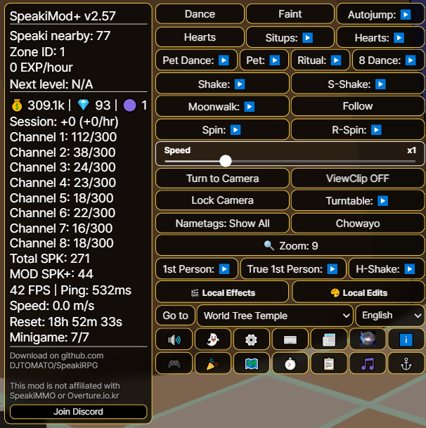
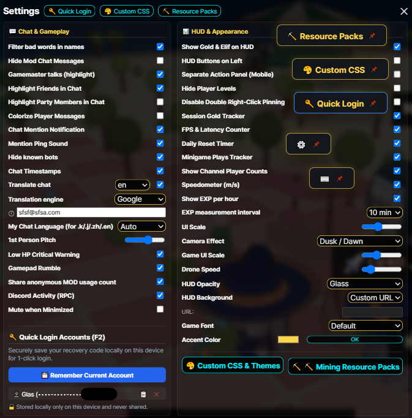
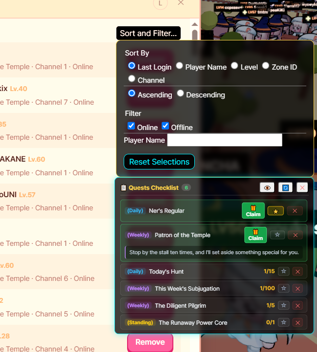
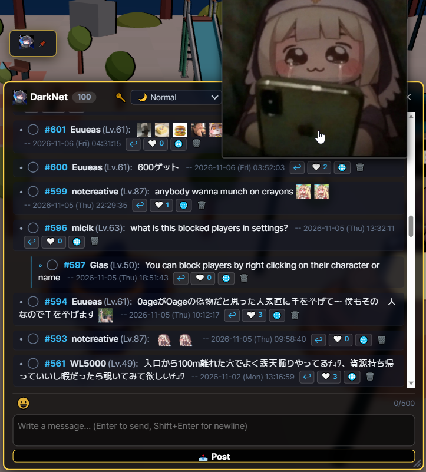
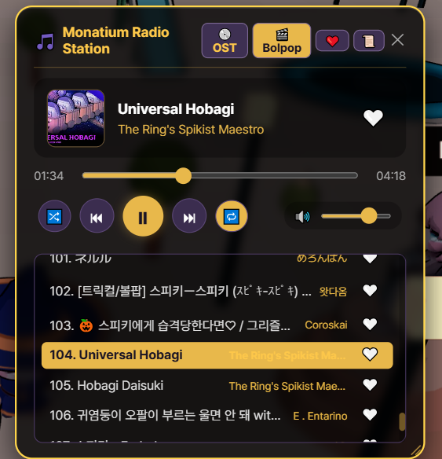
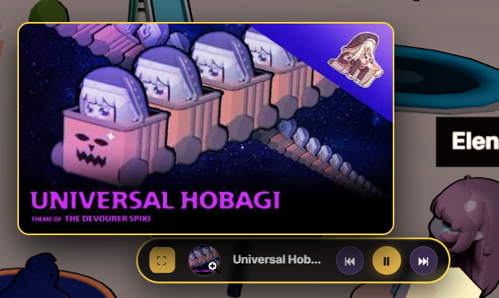
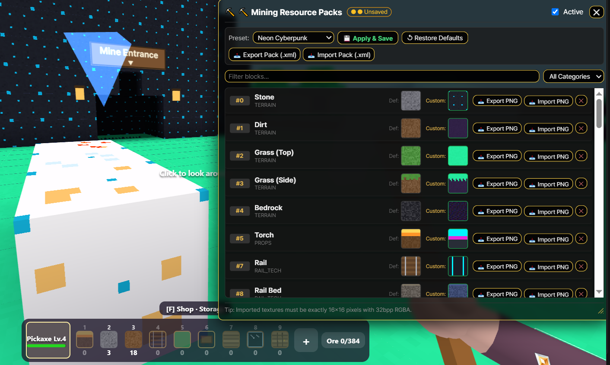
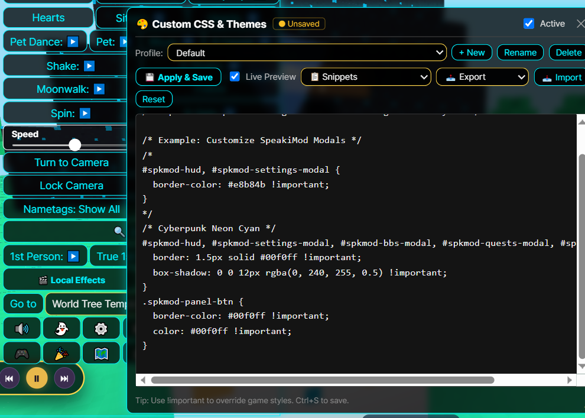
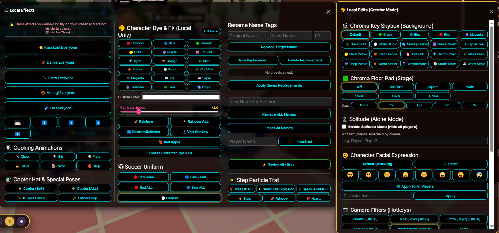
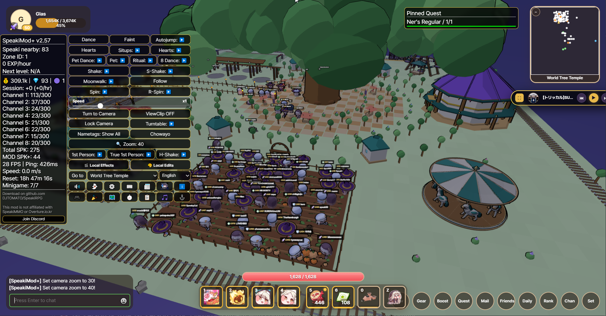

# Speaki RPG 桌面啟動器

# -> [English](README.md) | [日本語](README.ja.md) | [한국어](README.ko.md) | [繁體中文](README.zh-tw.md) | [简体中文](README.zh-cn.md) <-


# -> [Download | ダウンロード | 다운로드 | 下載](https://github.com/DJTOMATO/SpeakiRPG/releases) | [Discord](https://discord.gg/bruZhcwqRx) <-

<div align="center">

### 🎥 精選影片：SpeakiMod+ 功能介紹！
[](https://www.youtube.com/watch?v=ekxvWkYELm8)

**[▶️ 在 YouTube 上觀看: 欲しい機能がきっとある！MOD紹介 Introducing Speakimod+! Speakimod+ 소개! [CC:Eng]](https://www.youtube.com/watch?v=ekxvWkYELm8)**  
*由社群創作者 **おあげ** 製作的 SpeakiMod+ 功能詳細介紹與導覽影片！（支援英文字幕）*

> ⚠️ **注意：** SpeakiMod+ 為獲得遊戲 GM 官方許可使用的合法模組，且已移除所有破壞平衡的不當功能。若您在遊玩過程中發現任何非預期的漏洞或可能遭濫用的機制，請至我們的 [Discord 支援伺服器](https://discord.gg/bruZhcwqRx) 回報，並請勿濫用。

</div>

---

**Speaki RPG Desktop** 是一款專為網頁 MMORPG **Speaki RPG** 打造的自訂桌面客戶端、行動裝置封裝器與全方位便利性套件（**SpeakiMod+**）。它能將遊戲從瀏覽器分頁中獨立出來，提供硬體加速渲染、Discord Rich Presence 狀態整合、雙向即時聊天翻譯、內建音樂點唱機、採掘材質包、完整的影片創作者工作室，以及數十種社交與遊戲體驗強化功能！

> **🔒 防詐騙免責聲明：** 本客戶端及模組**絕不**接受任何形式的盈利或捐贈。遊戲本身亦不接受捐款或產生收益。任何向您索取金錢的人皆為冒充者！

<h2 id="table-of-contents">目錄</h2>

- [1. 特色與功能亮點](#1-features--highlights)
  - [🖥️ 桌面核心功能、HUD 與任務清單](#core-desktop-hud--quests)
  - [💬 社交、聊天、即時翻譯與自訂表情](#social-chat-translation--emojis)
  - [📻 莫娜蒂姆廣播電台（點唱機）](#monatium-radio-station-jukebox)
  - [⛏️ 採掘材質包 & 🎨 自訂 CSS 主題](#mining-resource-packs--custom-css-themes)
  - [🎬 創作者工作室：本地編輯 & 本地特效](#creator-studio-local-edits--local-effects)
  - [💃 移動特技、表情動作 & 鏡頭技巧](#movement-emotes--camera-tricks)
  - [⌨️ 快捷鍵 & 聊天指令總覽](#hotkeys--chat-commands-reference)
- [2. 下載與安裝（桌面版 & Android）](#2-download--installation)
- [3. 自行編譯快速入門指南](#3-self-compile-quick-start-guide)
- [4. 如何使用](#4-how-to-use-it)
- [5. SpeakiMod+ 的實裝與架構](#5-implementation-of-speakimod)
- [6. 官方開發者回應與使用規範](#6-official-developer-reaction--usage-policy)
- [7. 注意事項與協作邀請](#7-good-to-know--collaboration)
- [8. 常見問題 (FAQ)](#8-faq)
- [9. 致謝名單](#9-credits)
- [10. Speaki MMO 社群電影！](#10-speaki-mmo-community-movie)

---

<h2 id="1-features--highlights">1. 特色與功能亮點</h2>

[⬆ 返回頂部](#table-of-contents)

<h3 id="core-desktop-hud--quests">🖥️ 桌面核心功能、HUD 與任務清單</h3>

<p align="center">
  
  
</p>

* **Discord Rich Presence（豐富個人狀態）：** 自動在您的 Discord 個人檔案上展示目前的角色名稱、等級與 EXP 進度（支援設定內開關切換，以及 `Ctrl+Shift+D` 強制刷新）。


* **硬體加速與高 DPI 支援：** 自動最佳化 GPU 設定以帶來更流暢的 3D 渲染表現，並內建**解析度覆寫 (Resolution Override)** 與**行動端高 DPI 渲染修復**。
* **📌 懸浮快捷按鈕：** 在模組面板中的任何按鈕上**連點兩下右鍵**（手機版為長按），即可將該功能彈出為可自由拖曳至畫面任何位置的懸浮快捷鍵！再次點擊右鍵即可收回。
* **🔑 快速登入與帳號管理器 (<kbd>F2</kbd>)：** 在本機裝置上安全地儲存、一鍵切換與複製多組帳號復原代碼（嚴格儲存在您的電腦本機端，匯出設定檔時會自動剔除，絕不外流）。
* **🔊 智慧音效與背景自動靜音：** 可直接從 HUD 快速靜音遊戲，或開啟**最小化時靜音**，在切換視窗（Alt-Tab）時自動關閉遊戲背景音——同時仍允許在背景播放 `@提及` 的提示音效。
* **⏱️ 即時追蹤器與遊玩數據統計：**
  * **經驗值追蹤器 (EXP Tracker)：** 提供可自訂計算區間的滾動平均每分鐘 / 每小時 EXP 收益，以及升至下一級的預估時間。
  * **單次遊玩收益與效能統計視窗 (`⏱️`)：** 即時追蹤本次遊玩時長、每小時金幣 / 水晶葉 (Elif) / 斯皮奇幣收益、FPS 幀率、目前閘道網路延遲 (`ms`)、即時 `m/s` **移動速度計**、**各頻道人數統計**，以及**每日重置倒數計時器**（距離韓國時間 `00:00 KST` 的剩餘時間）。
  * **📰 官方更新公告與模組新聞：** 直接在遊戲內閱讀翻譯好的官方遊戲更新日誌與模組最新消息。
* **📋 任務檢核表與一鍵領獎：**
  * 專屬的任務清單視窗，可即時追蹤**每日**、**每週**與**常駐**任務進度、展開詳細說明，並提供**一鍵領取獎勵 (Claim)** 按鈕。
  * 可將任務釘選至清單中，或點擊星號 (`⭐`) 直接固定顯示在畫面 HUD 上。
* **🗺️ 互動式世界地圖與自動尋路：**
  * 視覺化呈現所有區域連結、傳送門位置與等級需求的世界地圖。
  * 支援跨區域動態 BFS **自動尋路 (Autowalk)**，自動走向目標傳送門（移動期間請保持有人照看，不會自動吃藥或躲避怪物；死亡時會自動停止）。

<p align="center">
  
  
</p>

---

<h3 id="social-chat-translation--emojis">💬 社交、聊天、即時翻譯與自訂表情</h3>

[⬆ 返回頂部](#table-of-contents)

<p align="center">
  
</p>

* **💬 遊戲內社群留言板「SpeakiBBS (`DarkNet`)」：**
  * 內建遊戲社群討論區，支援討論串回覆、折疊回覆鏈、❤️ 貼文與留言按讚、一鍵訊息翻譯 (`🌐`)、插入自訂表情符號，以及自由縮放視窗大小。
* **🌐 雙向即時聊天翻譯：**
<p align="center">
  
</p>

  * **可切換翻譯引擎：** 支援在 **Google 翻譯** 與 **MyMemory API** 之間自由選擇，具備自動備援機制與每日配額顯示。
  * **接收訊息自動翻譯 & 點擊翻譯：** 自動將外語聊天訊息翻譯為您的偏好語言，或直接點擊聊天室中的任何一句話進行即時翻譯。
  * **發送訊息快速翻譯指令：** 輸入 `.en`、`.j`/`.ja`/`.jp`、`.k`/`.ko`、`.zh`/`.cn`、`.tw` 或 `.es` 加上訊息內容，即可自動翻譯成該語言並發送出去！
<p align="center">
    
</p>
* **😀 5 合 1 自訂表情包、最愛收藏與本機頭像：**
  * 收錄超過 **200+ 款動態 GIF 與靜態嘟嘟臉/斯皮奇表情符號**，分類於 5 個目錄分頁以及專屬的 **💚 最愛收藏**分頁。
  * **右鍵加入最愛 & 點擊插入：** 在表情面板或聊天紀錄中對任何表情點擊右鍵即可加入/移除最愛；左鍵點擊聊天室中的表情即可直接插入輸入框。
  * **智慧懸停預覽 & 尺寸調整：** 自動貼合螢幕邊界的大型懸停預覽視窗，並提供 `+`/`−` 按鈕調整聊天室內表情顯示大小。
  * **自訂本機頭像：** 可使用任何模組表情或自訂圖片/GIF（自動裁切為圓形）來替換您的玩家名片頭像。
* **👥 好友名單排序、篩選與名牌同步：**
  * 支援依**最後登入時間**、**玩家名稱**、**等級**、**區域 ID** 或**頻道**（升序 / 降序）排序好友名單，並可依**線上 / 離線**狀態或名稱關鍵字進行篩選。
  * **智慧名牌顯示模式：** 可在 *顯示全部*、*僅限隊伍*、*僅限好友* 與 *全部隱藏* 之間循環切換他人的名字標籤——當好友或隊員加入/離開時會自動同步更新。
* **✨ 聊天便利功能與環境管理：**
  * **聊天高亮與專屬配色：** 以金色突顯 **GM/開發者** 訊息、高亮顯示**好友**與**隊伍成員**發言，或開啟**玩家訊息彩色化**為每位玩家賦予獨特顏色。
  * **提及提醒與時間戳記：** 可選的 `[HH:MM:SS]` 時間戳記、視覺與音效 `@提及` 通知、**不雅字詞過濾器**，以及**隱藏已知機器人**（自動靜音並隱藏洗版機器人）。
  * **隱身黑名單與雷達追蹤：** 自動隱藏原生黑名單用戶的角色模型、對話氣泡與表情動作，或使用方向雷達箭頭追蹤特定玩家的位置。

---

<h3 id="monatium-radio-station-jukebox">📻 莫娜蒂姆廣播電台（點唱機）</h3>

[⬆ 返回頂部](#table-of-contents)

<p align="center">
  
  
</p>

* **內建音樂播放器 (<kbd>Alt</kbd> + <kbd>M</kbd>)：** 不必另外開瀏覽器分頁，即可在遊戲內直接收聽精選的 **嘟嘟臉惡作劇 OST** 與社群 **Bolpop / 二創 MAD** 播放清單。
* **❤️ 最愛播放清單：** 點擊歌曲旁的愛心圖示，建立並保存專屬的個人最愛歌單。
* **迷你播放器 & 專輯封面預覽：** 在點唱機標題列連點兩下右鍵，即可將其收合為精緻的懸浮**迷你播放器**，並支援展開專輯封面插圖。
* **智慧原生 BGM 自動迴避：** 當點唱機播放音樂時，會自動靜音或降低遊戲原生的背景音樂；暫停播放時則自動恢復原本的 BGM 音量。
* **完整播放控制：** 支援隨機播放、循環播放、進度拖曳條、音量滑桿，以及拖曳視窗角落調整大小。

---

<h3 id="mining-resource-packs--custom-css-themes">⛏️ 採掘材質包 & 🎨 自訂 CSS 主題</h3>

[⬆ 返回頂部](#table-of-contents)

<p align="center">
  
  
</p>

* **⛏️ 採掘方塊材質包 (Resource Packs)：**
  * 自訂挖礦小遊戲中的每種方塊貼圖（*地形、礦物、建築、鐵軌與科技、裝飾道具*）。
  * 一鍵切換內建預設材質包：**原版預設 (Vanilla)**、**經典復古 8-Bit**、**霓虹賽博龐克**、**粉彩奇幻**，以及 **OBAGI 材質包**。
  * **匯入與匯出：** 支援匯入或匯出單一 `16x16` (32bpp RGBA) `.png` 方塊貼圖，或分享包含自訂名稱與作者署名的完整 `.xml` 材質包檔案。
* **🎨 自訂 CSS 與主題編輯器：**
  * 支援**即時預覽 (Live Preview)** 編寫或貼上自訂 CSS，並可儲存與管理多組主題設定檔。
  * 一鍵套用內建主題範本：*深色毛玻璃面板、金色奇幻主題、賽博龐克霓虹青、緊湊型 HUD* 與 *自訂遊戲字型*。
  * 支援匯入與匯出 `.css` 樣式表或完整的 `.json` 主題設定包。
* **🖌️ HUD 外觀、背景與字型切換：**
  * 自由調整 **UI 縮放比例**（`80%`–`130%` + 針對遊戲原生介面的 `/uiscale`）、**HUD 透明度與毛玻璃效果**（*不透明、透明、超透明、輕度/中度/重度毛玻璃*）及**主題強調色**。
  * 隨角色從 10 級升至 50 級逐步解鎖專屬 **HUD 背景插圖**（亦可貼上任何**自訂圖片網址**）。
  * **遊戲字型切換器：** 可在 *預設、圓體 Pop（自動 CJK）、明體 (Serif)、丸ゴ圓體 (Maru)、像素復古風、等寬字型 (Monospace)* 之間選擇，或直接套用電腦中已安裝的任何**自訂系統字型**。
  * **6 種介面語言：** 完整支援 *繁體中文、简体中文、English、日本語、한국어* 與 *Español*。
<p align="center">

</p>

---

<h3 id="creator-studio-local-edits--local-effects">🎬 創作者工作室：本地編輯 & 本地特效</h3>

[⬆ 返回頂部](#table-of-contents)

<p align="center">
  
</p>

專為截圖攝影師、迷因創作者與社群電影導演量身打造！*(註：本地編輯與本地特效僅在您的客戶端螢幕上渲染顯示，不會影響伺服器端其他玩家)*。

* **🟢 綠幕去背天空盒 & 地墊舞台：**
  * 將天空盒替換為攝影棚純色背景（*去背綠幕/藍幕/紅幕/洋紅幕、深邃黑洞、純白影棚、午夜深藍、日落紫羅蘭、賽博青色* 等超過 15 種背景）。
  * 在角色腳下生成可調大小（`0.75x`–`3x`）的**去背地墊**（*方形、寬版、短版、圓形、★ 星形*，或可完全消除灰色地面穿模的**全地面覆蓋 (Full Floor)** 模式）。
* **👻 孤獨模式（單人攝影模式）+ 白名單：**
  * 一鍵隱藏所有其他玩家與無人機，打造乾淨無干擾的單人拍攝環境。
  * 在**白名單**中輸入以逗號分隔的玩家名稱，即可讓指定的合作演員與好友保持顯示並正常互動！
* **📷 30+ 種鏡頭後製濾鏡：**
  * 透過快捷鍵（<kbd>Ctrl</kbd>+<kbd>6</kbd>~<kbd>0</kbd>）或選單切換超過 30 種視覺濾鏡，包含 *正常、黑色電影 (黑白)、復古懷舊 (褐色)、晨曦、黃昏、夜晚、蒸氣波、色差特效、90年代 VHS、賽博龐克、粉彩動漫、駭客任務、莫娜蒂姆掌機、血月、合成波、黃金時刻、美漫風、熱成像、X光、Virtual Boy、故障藝術、彩虹稜鏡* 與 *超新星*。
* **🎨 角色染色、剪影與隊服：**
  * 使用 18+ 種預設色票、自訂 HEX 調色盤、**彩虹漸變 / 隨機彩虹**（可調速度）、**虛空暗影 (Void Shadow)** 或 **Bad Apple 模式**（純黑白反轉剪影），為自己或全場玩家的服裝與全身染色！
  * 為自己或區域內的所有人換上**紅隊**或**藍隊**足球隊服。
* **😊 臉部表情控制器：**
  * 為自己、指定名稱的玩家或**地圖上的所有玩家**鎖定臉部表情（*預設眨眼、自信得意 😏、好奇無辜 🥺、睫毛微笑 ☺️、開懷大笑 😄、溫柔微笑 😊、眨眼吐舌 😜、調皮促狹 😛、擔心受怕 😨*）。
* **🎭 群眾編舞家 & 本地改名 (`🎬 本地特效`)：**
  * 讓畫面上的所有人同步執行動作：**全員跳舞**、**全員種田**、**全員開南瓜車**、**全員飛行**或**全員暈倒 (Knockout)**（重設時會平滑恢復為伺服器真實動畫）。
  * 一鍵觸發**料理動作**（*切菜、攪拌、擺盤、上菜、端盤*）、**竹蜻蜓帽**（自己/全員）、**咒語舞蹈**、**採集循環**或**自身隱形**。
  * **本地名牌與玩家改名：** 拍攝小劇場時可任意修改單一玩家或全場玩家的名字標籤，並支援儲存替換預設集。

---

<h3 id="movement-emotes--camera-tricks">💃 移動特技、表情動作 & 鏡頭技巧</h3>

[⬆ 返回頂部](#table-of-contents)
<p align="center">
  
</p>

* **進階攝影機模式：**
  * **🛸 進階無人機 / 自由鏡頭 (<kbd>F4</kbd>)：** 分離攝影機，使用 `WASD` + `Space`/`Ctrl`（或手把搖桿）自由飛行運鏡，並可調整飛行速度。
  * **👁️ 第一人稱 & 真·第一人稱視角 (True POV)：** 鎖定視線高度的攝影機，支援自訂垂直仰俯角 (`!fppitch`) 與頭部/角色模型自動隱形同步。
  * **🔍 快速縮放 & 穿牆視角 (ViewClip)：** 透過 HUD 按鈕或 `!zoom` 快速循環切換預設鏡頭距離（`5` 至 `90`），並提供**鎖定鏡頭**（PS1 經典固定視角）、**旋轉展示台 (Turntable)**（360° 環繞或半圈運鏡）、**穿牆視角 (ViewClip)**，以及**低血量危急紅框警示**。
* **同步移動特技 & 表情巨集：**
  * **高速旋轉 (`左旋` / `右旋`)：** 配備速度滑桿（`/speed <0.1 - 2.0>`）的超高速原地陀螺旋轉。
  * **真·方向鎖定月球漫步：** 在保持角色面向角度鎖定的同時，向任意方向自由移動。
  * **抽搐 (Shake)、超級抽搐 (S-Shake) & 極限抽搐 (H-Shake)：** 跟隨鏡頭的快速抖動、活力滿滿的超級搖擺，以及伺服器同步的高頻震動 (H-Shake)。
  * **神秘儀式舞 & 組合動作：** 圓形軌道**神秘儀式舞 (Ritual)**（正向 & 逆向）、8 字形軌道 **8 字舞**（正向 & 逆向）、**摸頭跳舞**組合技、極速交替暈倒與啾哇唷的**仰臥起坐 (Situps)** 健身巨集、獨立**暈倒 (Faint)** 按鈕、**自動跳躍**、**自動啾哇唷**與**連續發射愛心**。
  * **👣 腳步粒子軌跡：** 行走時在身後留下 *星星 ⭐、彩虹 🌈、愛心 💖* 或 *星爆 💥* 特效軌跡。
* **玩家互動快捷功能：**
  * 點擊任何玩家即可執行**觀察視角 (`[SM] Watch`)**、**自動跟隨 (`[SM] Follow`)** 或**凝視鎖定 (`[SM] Stare`)**（即使在移動中也會平滑轉動您的角色面向對方；隨時可再次點擊關閉或按重設鏡頭取消）。
  * **🎮 完整手把 / 控制器支援：** 支援自訂按鍵映射、搖桿死區與靈敏度滑桿、控制器配置圖示、傳送門互動與南瓜車駕駛按鍵綁定，以及**受擊觸覺震動回饋**。

---

<h3 id="hotkeys--chat-commands-reference">⌨️ 快捷鍵 & 聊天指令總覽</h3>

<details>
<summary><b>🔽 點擊展開：鍵盤快捷鍵 & 熱鍵</b></summary>

| 快捷鍵 | 功能說明 |
| :--- | :--- |
| <kbd>P</kbd> | 顯示 / 隱藏所有模組 UI 覆蓋層 |
| <kbd>F2</kbd> | 開啟模組設定 / 快速登入帳號管理器 |
| <kbd>F3</kbd> | 將所有 HUD 與彈出視窗位置重設回預設值 |
| <kbd>F4</kbd> | 切換無人機（自由鏡頭）模式（`WASD` 移動，`Space`/`Ctrl` 上升/下降） |
| <kbd>N</kbd> | 切換遊戲原生夜間模式 |
| <kbd>Alt</kbd> + <kbd>M</kbd> | 開啟 / 關閉莫娜蒂姆廣播電台（點唱機） |
| <kbd>Ctrl</kbd> + <kbd>U</kbd> | 將遊戲原生 UI 縮放重設為 `1.0` |
| <kbd>Ctrl</kbd> + <kbd>Shift</kbd> + <kbd>D</kbd> | 強制立即更新 Discord Rich Presence 狀態 |
| <kbd>Ctrl</kbd> + <kbd>6</kbd> ~ <kbd>0</kbd> | 快速切換鏡頭濾鏡（`6`: 正常、`7`: 黑白、`8`: 復古、`9`: 晨曦、`0`: 黃昏） |
| **連點兩下右鍵**（功能按鈕） | 將任何 HUD 功能按鈕釘選為懸浮快捷鍵（右鍵點擊即可移除） |
| **連點兩下右鍵**（點唱機標題） | 切換點唱機迷你播放器模式 |
| **點擊模組標題列**（最多 3 次） | 階段性折疊 / 收合 SpeakiMod+ 主 HUD 面板 |

</details>

<details>
<summary><b>🔽 點擊展開：聊天指令 & 快速翻譯前綴</b></summary>

| 指令 | 功能說明 |
| :--- | :--- |
| `.en <內容>` | 將訊息翻譯為**英文**並發送 |
| `.j` / `.ja` / `.jp <內容>` | 將訊息翻譯為**日文**並發送 |
| `.k` / `.ko <內容>` | 將訊息翻譯為**韓文**並發送 |
| `.zh` / `.cn <內容>` | 將訊息翻譯為**簡體中文**並發送 |
| `.tw <內容>` | 將訊息翻譯為**繁體中文**並發送 |
| `.es <內容>` | 將訊息翻譯為**西班牙文**並發送 |
| `!watch [玩家名稱]` | 切換至其他玩家的攝影機視角觀看（省略名稱則重設） |
| `!follow [玩家名稱]` | 自動跟隨指定玩家（省略名稱則停止） |
| `!stare [玩家名稱]` | 平滑鎖定角色面向角度並持續凝視指定玩家 |
| `!players` / `!who` | 在聊天室列出附近所有玩家的等級、距離與 ID |
| `!pos` / `!loc` / `!zone` | 顯示目前的區域 ID 與 X/Y/Z 座標 |
| `!zoom <數值>` | 設定攝影機縮放距離 |
| `!fppitch <數值>` | 設定第一人稱鏡頭垂直仰俯角度（例如 `!fppitch 0.45`） |
| `!dance` / `!chowayo` / `!hearts` / `!pat` | 透過聊天指令觸發表情動作與摸頭連段 |
| `/speed <0.1 - 2.0>` | 設定原地旋轉（陀螺）的速度倍率 |
| `/uiscale <0.5 - 2.0>` | 在不縮小 3D 遊戲畫面的情況下縮放遊戲原生 UI |

</details>

---

<h2 id="2-download--installation">2. 下載與安裝（桌面版 & Android）</h2>

[⬆ 返回頂部](#table-of-contents)


### 🖥️ 桌面版 (Windows / macOS / Linux)
前往 **[Releases（版本發布頁面）](https://github.com/DJTOMATO/SpeakiRPG/releases)** 下載適合您作業系統的最新安裝檔。

> [!NOTE]
> **macOS 用戶必讀（「應用程式已損壞」錯誤解決方法）：**
> 由於未購買付費的 Apple 開發者憑證簽署，macOS Gatekeeper 可能會跳出「應用程式已損壞，應該丟到垃圾桶」的警告。請先將 `SpeakiRPG.app` 移至您的**「應用程式 (Applications)」**資料夾，接著開啟**終端機 (Terminal)** 並執行以下指令：
> ```bash
> xattr -cr /Applications/SpeakiRPG.app
> ```

### 📱 SpeakiRPG 手機版 (Android)
官方現已正式支援由社群開發的 Android 客戶端！在手機或平板上也能暢玩內建 **SpeakiMod+** 的 SpeakiRPG。
* **下載：** 請至 **[Releases](https://github.com/DJTOMATO/SpeakiRPG/releases)** 頁面下載最新的 `.apk` 安裝檔。
* **功能特色：** 觸控最佳化的行動端開關按鈕、長按釘選懸浮按鈕、分離式動作面板模式、高 DPI 解析度修復，以及自動更新模組功能。
* **系統需求：** Android 8.0 或以上版本（需允許安裝未知來源的 APK 檔案）。
* **特別致謝：** 非常感謝 **[venoroa1358](https://github.com/venoroa1358/)** 開發並維護 Android 客戶端！

<details>
<summary><b>📱 Android 常見問題與排解</b></summary>

* **啟動應用程式後，模組沒有載入：** 請強制關閉應用程式後再重新啟動。
* **UI 介面被遮擋或超出螢幕範圍：**
  * 嘗試旋轉手機螢幕方向，或點擊聊天室上方的行動端切換按鈕。
  * 開啟模組設定（`⚙️`）並調低 **UI 縮放比例 (UI Scale)** 滑桿，或點擊**重設視窗位置 (`F3`)**。

</details>

---

<h2 id="3-self-compile-quick-start-guide">3. 自行編譯快速入門指南</h2>

[⬆ 返回頂部](#table-of-contents)

想直接從原始碼執行或建置桌面客戶端嗎？請依循以下步驟：

1. **複製儲存庫 (Clone)：**
   ```bash
   git clone https://github.com/DJTOMATO/SpeakiRPG.git
   cd SpeakiRPG
   ```
2. **安裝相依套件：**
   ```bash
   npm install
   ```
3. **以開發模式啟動：**
   ```bash
   npm start
   ```

*想打包成獨立安裝檔嗎？執行 `npm run build`（使用 `electron-builder`）即可！*

---

<h2 id="4-how-to-use-it">4. 如何使用</h2>

[⬆ 返回頂部](#table-of-contents)


1. 啟動桌面版或 Android 客戶端並登入 **Speaki RPG**。
2. 客戶端會自動偵測您的角色名稱、等級與經驗值。
3. 您的 Discord Rich Presence 狀態會自動更新，向好友展示您的冒險進度（按下 <kbd>Ctrl</kbd>+<kbd>Shift</kbd>+<kbd>D</kbd> 可強制立即更新）。
4. 使用左上角的 **SpeakiMod+** HUD（點擊標題列最多 3 次可收合面板）即可開啟所有工具、視窗與設定！

---

<h2 id="5-implementation-of-speakimod">5. SpeakiMod+ 的實裝與架構</h2>

[⬆ 返回頂部](#table-of-contents)

**SpeakiMod+** 是基於原始 SpeakiMod 進行大幅修改與全面重構的分支版本（Fork）。我們最初分叉此專案是為了徹底清理程式碼庫，確保為玩家提供安全、透明且公平的遊玩環境。自那之後，它已發展為結合眾多原創功能、創作工具與社群系統的全方位套件。

*法律聲明：衍生自 [Alluseri 開發的 SpeakiMod](https://github.com/Alluseri/SpeakiMod)，採用 [BSD 3-Clause 授權條款](https://opensource.org/licenses/BSD-3-Clause)。*

---

<h2 id="6-official-developer-reaction--usage-policy">6. 官方開發者回應與使用規範</h2>

[⬆ 返回頂部](#table-of-contents)

Speaki MMO 官方開發者（**GMDT**）發表的官方聲明繁體中文翻譯如下：


> * 在不損害其他玩家權益的前提下，允許對客戶端進行修改。
> * 你可以自由使用或修改此工具。
> * 任何仍會損害其他玩家權益的行為（例如自動打怪）依然屬於懲處對象。
> * 懲處標準完全是主觀的（也就是由我，營運者自行判斷），因此玩家必須自行斟酌。
> * 只要確定不會對其他玩家造成損害，就沒有關係。

### 官方規範摘要：
* ✅ **允許：** 客戶端修改與便利性/創作工具，**前提是不損害其他玩家權益**且不破壞公平競爭。
* ❌ **禁止：** 任何對其他玩家產生負面影響的行為（例如：無人看管的自動打怪、掛機機器人、作弊外掛或騷擾其他玩家）。
* ⚖️ **裁量標準：** 封禁標準完全取決於開發者的主觀裁量。請保持良好判斷力——只要不對他人造成不公平影響即屬允許。使用風險請自行承擔。

---

<h2 id="7-good-to-know--collaboration">7. 注意事項與協作邀請</h2>

[⬆ 返回頂部](#table-of-contents)

<p align="center">
  
</p>

* **非官方粉絲專案：** 本專案為社群自製作品，與 EPID Games、Speaki MMO 或 Overture.io.kr 無任何官方附屬關係。專案內未打包任何受版權保護的遊戲專有素材。
* **開源專案：** 採用 GNU General Public License v3.0 授權條款開源。
* **想要一起協作？** 歡迎加入我們的 **[Discord 伺服器](https://discord.gg/bruZhcwqRx)**、在 GitHub 上**[發起 Pull Request](https://github.com/DJTOMATO/SpeakiRPG/pulls)** 或**[提交 Issue 問題回報](https://github.com/DJTOMATO/SpeakiRPG/issues)**！

---

<h2 id="8-faq">8. 常見問題 (FAQ)</h2>

[⬆ 返回頂部](#table-of-contents)


**Q: 使用這個工具安全嗎？我會被封鎖帳號 (Ban) 嗎？**
> 根據開發者的官方聲明（請見[第 6 節](#6-official-developer-reaction--usage-policy)），只要不損害其他玩家權益的客戶端修改皆屬允許。諸如無人看管的自動打怪或外掛機器人等不公平優勢則嚴格禁止，並會導致帳號被封禁。

**Q: 支援 Windows、Mac、Linux 與 Android 嗎？**
> 支援！Windows、macOS 與 Android (`.apk`) 版本皆可在 [Releases](https://github.com/DJTOMATO/SpeakiRPG/releases) 頁面下載。Linux 用戶可參考[自行編譯指南](#3-self-compile-quick-start-guide)在幾秒鐘內從原始碼建置執行。

**Q: 這是免費的嗎？你們接受贊助或捐款嗎？**
> 本專案 100% 免費且開源。我們**不接受**任何形式的捐款或商業盈利。

**Q: 這會修改遊戲檔案或包含遊戲素材嗎？**
> 不會。這是一個獨立的外殼啟動器，僅在執行期間載入官方網頁遊戲並套用客戶端本地的 UI 與視覺強化效果。

**Q: 為什麼我的 Discord 狀態沒有更新？**
> 請確保在啟動 Speaki RPG Desktop 之前已先開啟 Discord 桌面應用程式，並確認模組設定中的 **Discord Activity (RPC)** 已開啟，或按下 <kbd>Ctrl</kbd>+<kbd>Shift</kbd>+<kbd>D</kbd> 強制更新。

**Q: 這會有病毒或偷走我的復原代碼嗎？**
> 不會。所有原始碼皆公開在此儲存庫中供任何人檢視。您的快速登入復原代碼僅嚴格儲存在您個人電腦的本機儲存空間中，甚至在匯出 `.json` 設定檔時也會被自動剝離。

**Q: 誰是最棒的使徒 (Apostle)？？**
> 魯波 (Rufo)。不接受任何反駁。

  

---

<h2 id="9-credits">9. 致謝名單</h2>

[⬆ 返回頂部](#table-of-contents)

* **原作遊戲 (Trickcal Revive):** EPID Games
* **Speaki MMO 開發:** GMDT
* **桌面客戶端 & SpeakiMod+ 主導開發:** Glas
* **品質保證 (QA)、核心修復 & 本地特效:** [Chan (ChanMk2)](https://github.com/ChanMk2)
* **Android 行動端客戶端開發:** [venoroa1358](https://github.com/venoroa1358/)
* **SpeakiMod 原作者:** [Alluseri](https://github.com/Alluseri/SpeakiMod)
* **功能貢獻者:**
  * [takejohn](https://github.com/takejohn) *（好友名單排序與篩選功能）*
  * [finn0914](https://github.com/finn0914) *（本機表情符號頭像與設定匯出安全防護）*
  * OBAGI *（OBAGI 採掘材質包）*
* **在地化與翻譯:**
  * **日文 (`ja`):** JPN_WholesomeElfName15T, [Ijuin-max](https://github.com/Ijuin-max)
  * **繁體與簡體中文 (`zh-TW` / `zh-CN`):** PeiYu, [kkoo73918246-blip](https://github.com/kkoo73918246-blip)
  * **韓文 (`ko`):** Mafty-hobagi

**🎨 使用的同人插畫：**
特別感謝慷慨授權將其作品用於 UI 背景的繪師們！
* [느그 유노 (Yuno) - Lv. 40](https://x.com/yyakk__11)

**第三方元件：**
* `SpeakiMod.js` – 衍生自 [Alluseri 開發的 SpeakiMod](https://github.com/Alluseri/SpeakiMod)，採用 [BSD 3-Clause 授權條款](https://opensource.org/licenses/BSD-3-Clause)。

---

<h2 id="10-speaki-mmo-community-movie">10. Speaki MMO 社群電影！</h2>

[⬆ 返回頂部](#table-of-contents)

由 **PeiYu** 與熱情的 Speaki MMO 社群共同錄製了一部關於 Speaki RPG 的大電影，片中大量運用了本客戶端提供的攝影運鏡與創作者工作室功能（例如第一人稱視角、無人機自由鏡頭與本地特效）！

🎬 **[在 YouTube 上觀看 Speaki MMO 社群電影！](https://www.youtube.com/watch?v=yaIEanyk6WI)**

---

<p align="center">
  
</p>
